# Commerce and retail architecture overviews

<!-- category-architecture:auto -->
## Category deployment architecture

This Azure-oriented deployment separates deterministic business operations from probabilistic model reasoning. The application owns authorization, validation, workflow state and approval; the model proposes actions only through allowlisted tools.

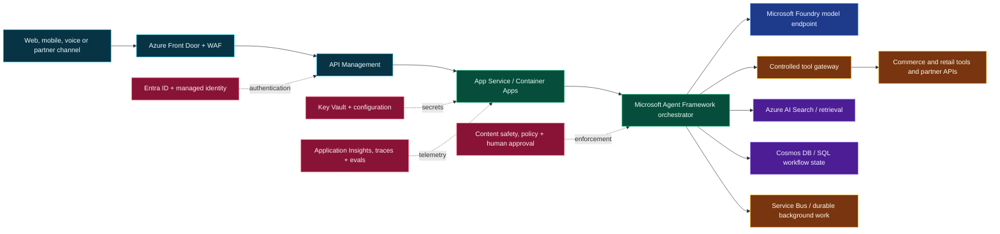

**Responsibility split**

- **Edge and API layer:** authentication, quotas, request validation and tenant routing.
- **Application/orchestration layer:** deterministic workflow, retries, approvals, state and tool authorization.
- **Model layer:** language understanding, planning and explanation; it never becomes the system of record.
- **Tool layer:** narrow typed operations with idempotency, schema validation and audit events.
- **Data layer:** retrieval indexes are separate from transactional state and sensitive records.
- **Control plane:** identity, secrets, policy, privacy, observability and evaluations apply across every request.

## 1. Personal shopping assistant

**Purpose and user journey**
A conversational assistant that turns a vague need ("running shoes under 120 EUR for flat feet") into a ranked shortlist. The user states a need, answers one or two clarifying questions, reviews product cards with reasons, then saves items or sends them to the cart.

**Reference architecture**
Chat UI -> API gateway -> orchestrator agent -> [catalog search | profile memory | price/stock tools] -> ranker -> product cards -> cart handoff

<!-- architecture-diagram:auto -->
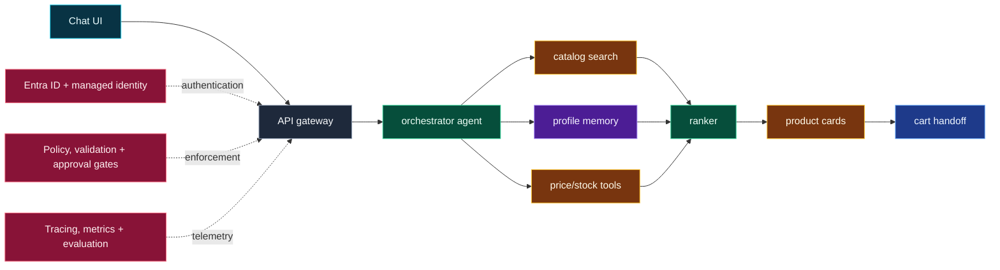

**Core components**
- Web/mobile chat front end.
- Orchestrator on Azure Container Apps or Functions, calling Azure OpenAI.
- Hybrid keyword and vector index (Azure AI Search).
- Profile store (Cosmos DB).
- Ranking service.
- Guardrail layer (Azure AI Content Safety).
- Telemetry (Application Insights).

**Agent/workflow design**
One tool-using agent runs a plan-act loop. It classifies intent, extracts constraints into a structured filter schema, calls search, reranks, and explains each pick. It makes at most four tool calls per turn and asks a clarifying question only when a missing constraint would change the results. Session summary is kept by default; long-term preferences are opt-in.

**Data and integrations**
Product feed (SKU, attributes, price, stock), reviews, user profile and order history. Integrations: commerce platform APIs (Shopify, Commerce Cloud, Magento), inventory service, merchant feeds, analytics events.

**Security and safety**
Expose read tools plus add-to-cart, and require user confirmation for the cart action. Minimize PII and get consent before storing preferences. Filter prompt injection in review and product text. Take price and stock only from tool results, never from model memory. Use managed identity and Key Vault.

**Reliability, observability and evaluation**
Cache frequent catalog queries and fall back to keyword search if the LLM is down. Trace every tool call. Track shortlist click-through, add-to-cart rate, constraint satisfaction and hallucinated-attribute rate. Evaluate offline on about 200 labeled queries and red-team before launch.

**MVP build path**
Weeks 1-2: ingest the feed and build the hybrid index. Weeks 3-4: single-agent chat with the search tool. Week 5: profile memory and cart handoff. Week 6: eval harness and a pilot in one category.

## 2. Fashion and styling assistant

**Purpose and user journey**
Suggests complete outfits for an occasion, body preference and budget. The user describes an event or uploads a reference photo, gets three outfit options with swap-able items, and buys the full look or single pieces.

**Reference architecture**
Chat/photo UI -> style agent -> [attribute extractor | outfit composer | catalog + inventory search] -> compatibility scorer -> outfit cards -> cart

<!-- architecture-diagram:auto -->
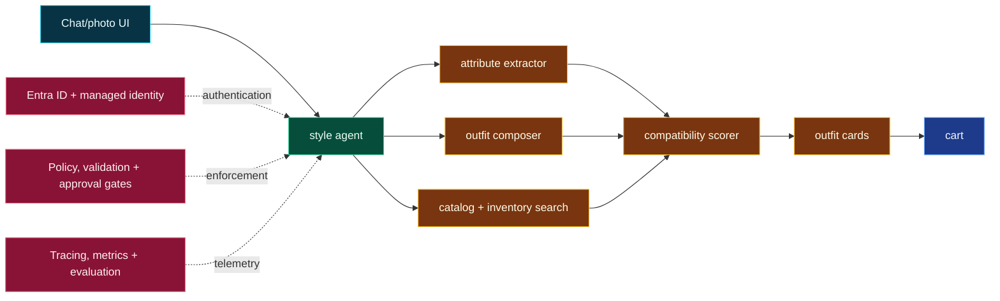

**Core components**
- Multimodal LLM (Azure OpenAI vision) for photo and attribute reading.
- Fashion taxonomy service (category, color, fit, season, formality).
- Embedding index (Azure AI Search) over product images and text.
- Outfit composer with compatibility rules.
- Size and fit service.
- Profile store.

**Agent/workflow design**
Two-stage flow. A planner turns the occasion, weather, dress code and style profile into outfit slots (top, bottom, shoes, layer). A retriever fills each slot, then a scorer checks color harmony, formality match, budget total and stock of every size. If any slot fails, the agent substitutes and explains the change.

**Data and integrations**
Product images and attributes, size charts, return-by-size statistics, trend and season metadata, user style profile. Integrations: retailer catalog, weather API, calendar (optional, consent-based), visual-embedding service.

**Security and safety**
Strip EXIF and face data from uploads, store images with short retention, and avoid inferring sensitive traits such as body shape unless the user states them. Use inclusive sizing language. Moderate uploads and keep fit claims tied to size-chart data.

**Reliability, observability and evaluation**
Outfit coverage (percent of slots filled in stock), acceptance rate, outfit-level conversion, and return rate by suggested size. Use human stylist review of a sampled set. A/B test rules-only against LLM-composed outfits.

**MVP build path**
Start with one gender-neutral category set and a rules-based composer. Add photo input in week 4, size recommendation in week 6, and stylist feedback loops after pilot.

## 3. Personal wardrobe assistant

**Purpose and user journey**
Helps users catalog clothes they already own, plan outfits from them, and spot gaps worth buying. The user photographs items, confirms detected attributes, gets daily outfit suggestions, and sees targeted purchase suggestions.

**Reference architecture**
Photo capture -> image pipeline (segment, tag, embed) -> wardrobe store -> outfit agent -> daily plan / gap analysis -> optional shop links

<!-- architecture-diagram:auto -->
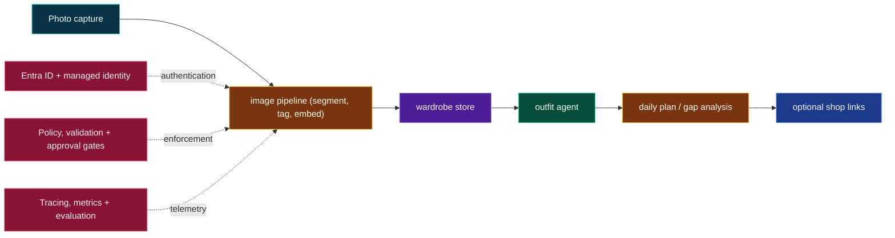

**Core components**
- Mobile app with camera and offline queue.
- Image pipeline: background removal, classification, color extraction (Azure AI Vision plus a custom model).
- Wardrobe database (Cosmos DB, per-user partition).
- Blob Storage for images.
- Outfit agent.
- Notification service.

**Agent/workflow design**
Ingestion is a deterministic pipeline with human confirmation, not free agent behavior. The outfit agent receives weather, calendar events and wear history, then proposes outfits from owned items. A gap-analysis job compares wardrobe coverage against the user's lifestyle profile and calls the product-search tool only when the user opts in.

**Data and integrations**
Item records (type, color, material, brand, wear count, last worn, cost), user preferences, outfit history. Integrations: weather API, calendar, optional retailer catalogs and resale marketplaces.

**Security and safety**
Private by default. Encrypt images, use per-user storage isolation, and provide full export and deletion. Keep wardrobe data out of ad targeting. Avoid storing background content such as faces or home interiors, and crop to the item where possible.

**Reliability, observability and evaluation**
Measure tag accuracy after user correction, outfits accepted, items worn per month, and upload completion rate. Keep a golden image set for classifier regression. Log pipeline failures and retry through queues.

**MVP build path**
Build upload-and-tag with manual correction first. Then add weather-based daily outfit suggestions, wear tracking, and finally gap analysis with shop links.

## 4. Product discovery assistant

**Purpose and user journey**
Helps shoppers who do not know what to search for. They browse by need, mood or use case, refine through facets and conversation, and discover products they would not have found by keyword.

**Reference architecture**
Query/browse UI -> intent and facet agent -> hybrid retrieval (keyword + vector + graph) -> diversified reranker -> explained results -> refinement loop

<!-- architecture-diagram:auto -->
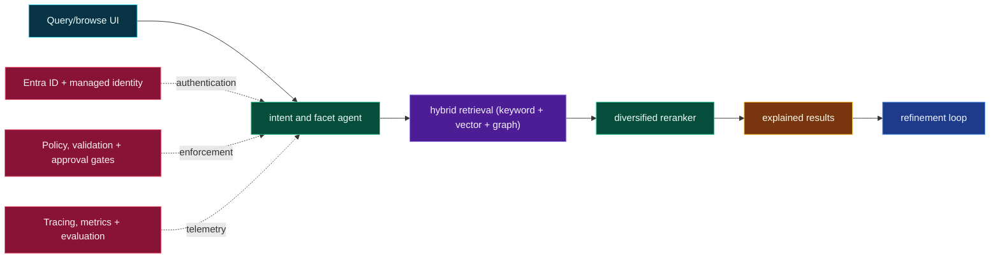

**Core components**
- Query understanding service (LLM with schema output).
- Azure AI Search hybrid index with semantic ranking.
- Product knowledge graph (categories, use cases, accessories).
- Reranker blending relevance, popularity, margin limits and diversity.
- Facet generator.
- Event pipeline (Event Hubs).

**Agent/workflow design**
The agent rewrites free text into filters and several sub-queries, runs them in parallel, merges results, and generates dynamic facets from the result set. It proposes next refinements such as "quieter", "cheaper" or "for small spaces". Conversation state holds the current constraints so each refinement edits them rather than restarting.

**Data and integrations**
Catalog enrichment with LLM-generated use-case tags validated against source attributes, clickstream, reviews, search logs. Integrations: commerce platform, CDP/analytics, merchandising rules tool.

**Security and safety**
Apply merchandising and legal filters (age-restricted, region-restricted products) after retrieval, not by prompt. Label sponsored placements. Do not use sensitive attributes for personalization. Sanitize generated tags.

**Reliability, observability and evaluation**
Track zero-result rate, query reformulation rate, click depth, discovery-to-purchase conversion and result diversity. Evaluate with NDCG on judged queries plus LLM-assisted relevance labeling checked by humans. Keep a plain keyword fallback.

**MVP build path**
Step 1: hybrid index and query rewriting. Step 2: dynamic facets. Step 3: knowledge-graph expansion. Step 4: personalization and diversity reranking after enough click data.

## 5. Product comparison assistant

**Purpose and user journey**
Compares two to five products on the criteria the user cares about. The user picks items or describes a decision, receives a normalized comparison table with a plain-language verdict, and can adjust priorities.

**Reference architecture**
Selected SKUs -> spec normalizer -> criteria weighting -> evidence retriever (specs, reviews) -> comparison generator -> table + verdict + citations

<!-- architecture-diagram:auto -->
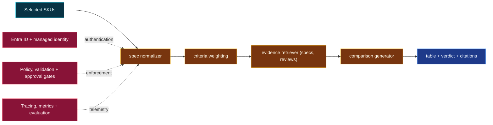

**Core components**
- Spec normalization service mapping units and attribute names across brands.
- Review mining pipeline (aspect-based sentiment).
- Azure AI Search for evidence passages.
- Comparison agent (Azure OpenAI with structured output).
- Weighting UI.
- Citation store.

**Agent/workflow design**
The agent first clarifies the decision criteria and converts them into weights. Specs are compared by deterministic code; the LLM only writes the explanation and trade-offs from retrieved evidence. Each claim must carry a source reference to a spec field or review excerpt, and unsupported claims are dropped by a verifier step.

**Data and integrations**
Manufacturer specs, retailer attributes, reviews, price history, warranty and return terms. Integrations: catalog API, review provider, price-history service, optional expert-review feeds.

**Security and safety**
Guard against fake or injected reviews by using verified-purchase filters and anomaly detection. Disclose sponsored or affiliate relationships. Do not state safety or medical claims beyond source data. Keep verdicts neutral and show uncertainty when data is missing.

**Reliability, observability and evaluation**
Measure citation coverage, factual-accuracy rate on spec comparisons, user-adjusted weight rate, and decision conversion. Run regression tests on a fixed product-pair set. Alert on normalization failures.

**MVP build path**
Pick one spec-heavy category such as laptops. Build normalization and the table first, then add review aspects, then the weighted verdict and citations.

## 6. Gift recommendation assistant

**Purpose and user journey**
Finds suitable gifts for a recipient, occasion and budget. The buyer answers a short guided interview, gets diverse ideas with rationale, and can order with gift wrap, a message and a delivery date.

**Reference architecture**
Gift brief form/chat -> recipient profile builder -> idea generator -> catalog matcher + delivery-date filter -> curated shortlist -> gift checkout options

<!-- architecture-diagram:auto -->
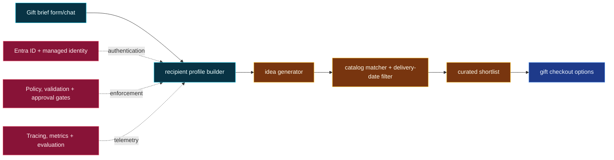

**Core components**
- Guided intake UI.
- Recipient profile service (relationship, interests, age band, past gifts).
- LLM idea generator.
- Azure AI Search catalog matcher.
- Delivery-promise service.
- Gift options module (wrap, note, hide price).

**Agent/workflow design**
The agent produces idea categories first (experience, consumable, personalized, practical), then queries the catalog per category, enforces budget and arrival date, and balances the final list for diversity. It asks about the relationship and tone rather than inferring them. Rejected ideas feed back as negative constraints.

**Data and integrations**
Catalog, bestseller and gifting-tagged data, occasion calendar, buyer's order history for avoiding duplicates, delivery estimates. Integrations: retailer APIs, carrier cut-off times, optional wishlist links, e-gift-card provider.

**Security and safety**
Treat recipient information as third-party personal data: collect minimal details, do not persist without consent, and never infer sensitive traits such as health or orientation. Block inappropriate gift categories for minors. Hide prices on gift receipts and verify addresses.

**Reliability, observability and evaluation**
Track shortlist acceptance, on-time-arrival rate, gift return rate and idea diversity. Use human panel evaluation for appropriateness. Keep seasonal load tests for peak periods and a deterministic fallback of curated gift guides.

**MVP build path**
Launch with five occasions and a curated catalog subset. Add delivery-date filtering, then gift wrap and notes, then wishlist integration.

## 7. Visual product-search app

**Purpose and user journey**
Lets users search with a photo, screenshot or sketch to find the same or similar products. The user takes a photo, crops the region of interest, receives exact and similar matches, and refines with text such as "in blue".

**Reference architecture**
Image upload -> preprocessing/detection -> embedding model -> vector index -> exact-match verifier + similar-item ranker -> results -> text refinement

<!-- architecture-diagram:auto -->
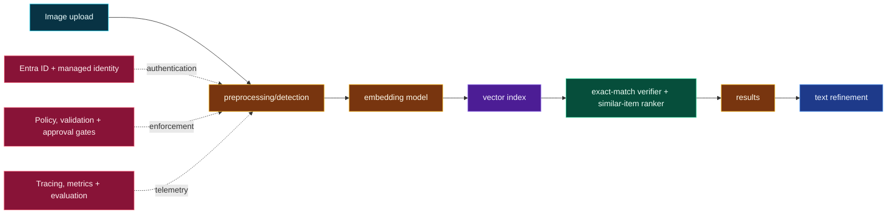

**Core components**
- Mobile and web capture SDK.
- Object detection and cropping service.
- Image embedding model (CLIP-style or Azure AI Vision multimodal embeddings).
- Vector index (Azure AI Search or pgvector).
- Attribute re-ranker.
- Catalog image ingestion pipeline.

**Agent/workflow design**
Mostly a deterministic retrieval pipeline. An LLM is used only to interpret refinement text into filters and to describe differences between match and query. Exact-match verification uses local-feature or high-threshold similarity, and low-confidence results are labeled as similar rather than identical.

**Data and integrations**
Catalog images from several angles, attributes, brand and logo data, user query images with short retention, click feedback. Integrations: PIM or DAM, commerce APIs, camera SDKs, optional AR try-on.

**Security and safety**
Scan uploads for malware and inappropriate content, strip EXIF location data, and blur faces and license plates by default. Set retention to hours unless the user saves a search. Avoid person-identification and rate-limit uploads to deter scraping.

**Reliability, observability and evaluation**
Measure recall at k on labeled query-to-product pairs, latency (target under one second), exact-match precision, and search-to-cart rate. Re-embed the catalog when the model changes using versioned indexes with blue-green swap.

**MVP build path**
Build a catalog embedding job, then single-object search with a pre-trained model, then crop and detect, then text refinement, then fine-tuning on your own click data.

## 8. Shopping-cart assistant

**Purpose and user journey**
Helps users complete and optimize a cart. While shopping, it flags compatibility problems, suggests missing accessories, finds cheaper alternatives or bundles, and reminds users about abandoned items.

**Reference architecture**
Cart events -> cart-state service -> assistant agent -> [compatibility rules | pricing/promo engine | inventory | recommendations] -> inline suggestions -> user-approved cart change

<!-- architecture-diagram:auto -->
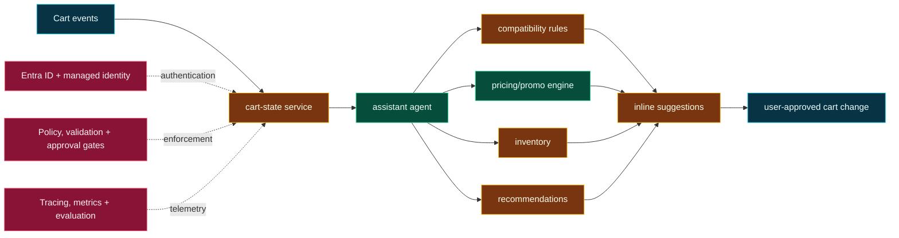

**Core components**
- Cart service exposing events and mutation API.
- Compatibility and rules engine.
- Promotion and pricing API.
- Recommendation service.
- Agent runtime (Azure OpenAI with function calling).
- Notification service for recovery messages.

**Agent/workflow design**
Event-triggered rather than purely chat-based. On cart change the agent runs a limited check list: stock, compatibility, free-shipping threshold, bundle savings and duplicate items. Suggestions are ranked by user benefit, not only margin. Any cart mutation is a proposal that needs an explicit click.

**Data and integrations**
Cart contents, product relationships (accessory, substitute, bundle), prices, promotions, stock, session behavior. Integrations: commerce platform cart API, promo engine, inventory service, email or push provider.

**Security and safety**
Authorize every cart operation against the session user and make mutations idempotent. Never silently add items. Recompute prices server-side. Respect marketing consent for recovery messages, and cap their frequency. Disclose sponsored suggestions.

**Reliability, observability and evaluation**
Track suggestion acceptance, average order value change, cart abandonment, incorrect-compatibility rate and complaint rate. Add circuit breakers so the cart never blocks if the assistant fails. Test via A/B with a holdout group.

**MVP build path**
Start with rule-based checks (stock, shipping threshold, duplicates), then compatibility for one category, then LLM-written explanations, then recovery messaging.

## 9. Checkout assistant

**Purpose and user journey**
Reduces friction and errors during checkout. It helps with address correction, shipping choice, payment-method questions, tax and fee explanations, and failed-payment recovery, while keeping payment handling out of the model.

**Reference architecture**
Checkout UI -> checkout orchestrator -> [address validation | shipping options | tax/fees | payment provider hosted fields] -> assistant explanations -> order confirmation

<!-- architecture-diagram:auto -->
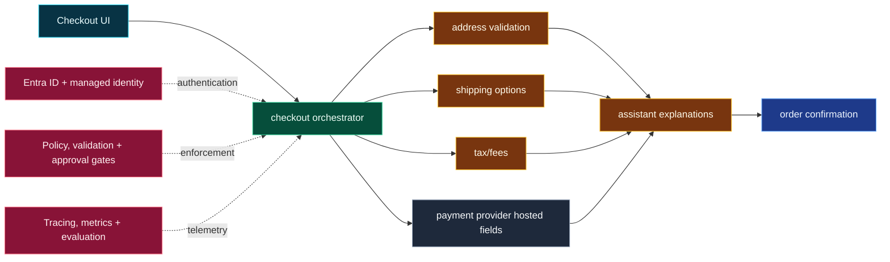

**Core components**
- Checkout service (system of record).
- Assistant panel with function calling.
- Address validation service.
- Shipping-rate and delivery-promise API.
- Payment service provider with hosted fields (Stripe, Adyen, or Azure-hosted gateway integration).
- Fraud screening.

**Agent/workflow design**
The assistant is advisory and checkout logic is deterministic. It answers questions using read-only tools (delivery estimates, fee breakdown, return terms), proposes address fixes, and recommends the best shipping option for the user's stated priority. On payment failure it maps the provider error code to a plain explanation and next steps.

**Data and integrations**
Cart, address book, shipping methods, tax engine, payment status codes, consent flags. Integrations: tax service, carriers, PSP webhooks, fraud tools, loyalty balance lookup.

**Security and safety**
Remain outside PCI scope: card data goes only into PSP-hosted fields and never reaches the LLM or logs. Mask addresses in telemetry, require step-up authentication for saved-payment use, and prevent the agent from changing totals. Defend against prompt injection from address fields.

**Reliability, observability and evaluation**
Track checkout completion, payment success, address-correction acceptance, assistant-handled-question rate and error rate. Use synthetic checkout monitoring, idempotency keys, and a fully working checkout when the assistant is disabled.

**MVP build path**
Ship address validation and a delivery/fee FAQ panel first. Add shipping recommendation, then payment-failure guidance, then personalized reassurance for abandoned checkouts.

## 10. Order-tracking assistant

**Purpose and user journey**
Answers "where is my order?" across channels. The user asks via chat, SMS or email, is verified, and receives a plain status with an estimated delivery window, proactive updates, and options such as rerouting or notifications.

**Reference architecture**
Channel (web/SMS/WhatsApp) -> identity check -> tracking agent -> [order API | carrier tracking aggregator | event store] -> status explanation -> proactive notifier

<!-- architecture-diagram:auto -->
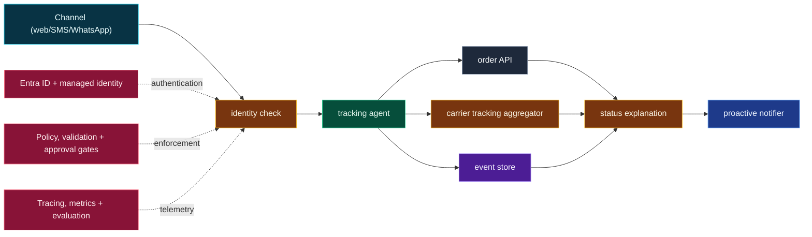

**Core components**
- Omnichannel gateway (Azure Communication Services).
- Identity verification (order number plus email or login).
- Order management system client.
- Carrier tracking aggregator.
- Event store of normalized tracking events (Cosmos DB or Postgres).
- Notification service.

**Agent/workflow design**
A small agent with two read tools. It maps raw carrier scan codes to a normalized status model (placed, packed, in transit, out for delivery, delayed, delivered, exception), gets the ETA, and rewrites it for the user. If the status is exception or ETA is missed, it hands off to the delivery-exception flow. Proactive messages are triggered by event rules, not the LLM.

**Data and integrations**
Orders, shipments, carrier events, ETAs, notification preferences. Integrations: OMS/ERP, carrier APIs or aggregators (AfterShip, Shippo), SMS/email providers, webhook receivers.

**Security and safety**
Verify the requester before showing address or items. Return limited information to unauthenticated users, rate-limit lookups to prevent order enumeration, and mask address data. Honor opt-in rules for SMS. Sign and validate carrier webhooks.

**Reliability, observability and evaluation**
Track deflection rate, status accuracy against carrier truth, event lag, WISMO contact reduction and proactive-message opt-out rate. Handle carrier API outages with cached last-known status and clear staleness labels.

**MVP build path**
Build order lookup and a single carrier integration first. Add status normalization, then webhook-driven proactive notices, then multi-channel support.

## 11. Delivery-exception assistant

**Purpose and user journey**
Detects and resolves delivery problems such as delays, failed attempts, damage, lost parcels and address issues. The customer is notified before they ask, picks a resolution (reschedule, pickup point, reship, refund), and the case is closed or escalated.

**Reference architecture**
Carrier events -> exception detector -> case manager -> resolution agent -> [carrier actions | reship/refund engine | customer messaging] -> outcome tracking

<!-- architecture-diagram:auto -->
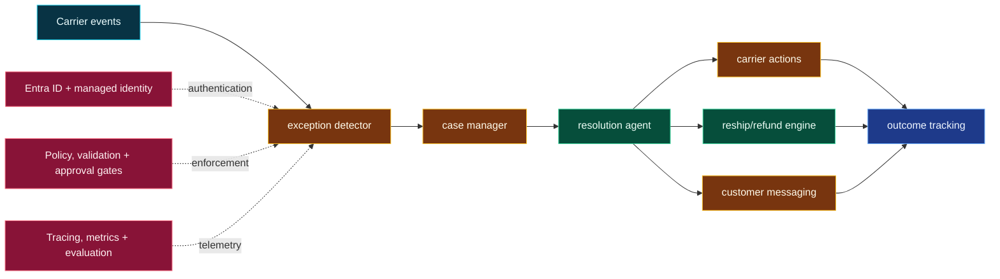

**Core components**
- Event stream processor (Event Hubs and Functions).
- Exception rules and ML delay predictor.
- Case management system (Dynamics 365 or equivalent).
- Resolution policy engine.
- Carrier API connectors.
- Customer messaging service.

**Agent/workflow design**
Exceptions are classified and given a severity score. A policy engine determines allowed remedies by order value, customer tier, carrier and elapsed time. The agent presents permitted options and executes the chosen one through tools such as redirect, reship or refund. Cases above thresholds or involving damage disputes go to human agents with a full summary.

**Data and integrations**
Tracking events, order value, customer history, carrier performance, photos of damage, case notes. Integrations: carrier APIs, OMS, WMS for reship stock, payments for refunds, support desk.

**Security and safety**
Enforce refund and reship limits in the policy engine, not prompts. Log approvals for audit. Validate damage photos and use fraud signals for repeated claims. Verify identity before address changes to avoid redirection scams.

**Reliability, observability and evaluation**
Track time to detection, proactive contact rate, first-contact resolution, cost per exception, and claim-fraud rate. Evaluate the delay predictor with precision and recall. Use idempotent actions and dead-letter queues for failed carrier calls.

**MVP build path**
Start with rule-based detection of stalled and failed-attempt shipments plus proactive messages. Add self-service reschedule, then policy-driven reship/refund, then predictive delay detection.

## 12. Returns and refunds assistant

**Purpose and user journey**
Guides customers through eligibility, reason capture, return method, label creation and refund or exchange, then keeps them informed until the money is returned. It also helps merchants cut avoidable returns.

**Reference architecture**
Return request -> eligibility engine -> returns agent -> [label/carrier | exchange suggester | refund service] -> warehouse receipt -> refund status updates

<!-- architecture-diagram:auto -->
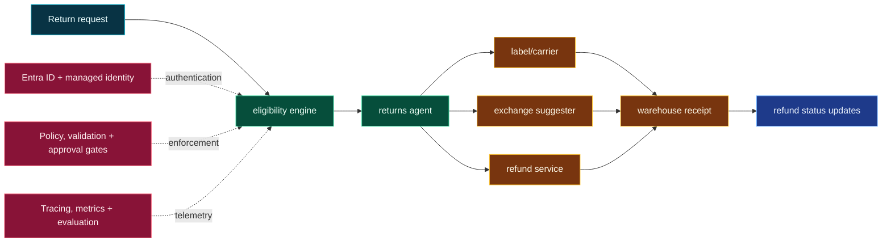

**Core components**
- Return policy engine with versioned rules.
- Returns management system (RMA).
- Label and drop-off location API.
- Exchange and size recommender.
- Payments refund API.
- Warehouse receiving integration.

**Agent/workflow design**
The agent identifies the order and items, checks eligibility through the policy engine, asks for the reason, and tries relevant alternatives such as exchange for another size or a partial refund. Final decisions come from policy rules. Ambiguous or high-value cases route to a human. Refund triggers wait for warehouse scan or a trusted-customer rule.

**Data and integrations**
Orders, return policies, item condition, reasons, customer return history, carrier labels, refund transactions. Integrations: OMS, WMS, PSP refund API, carriers, loyalty system for point reversal.

**Security and safety**
Authenticate before showing orders. Detect return fraud with velocity and pattern checks, but give humans the final adverse decision. Make refunds idempotent and reconcile them against payments. Comply with consumer-rights rules such as the EU 14-day withdrawal period.

**Reliability, observability and evaluation**
Track return-initiation completion, exchange-over-refund rate, time to refund, policy-decision accuracy, fraud loss and reason-code trends. Test the policy engine with scenario suites. Reconcile daily refund totals.

**MVP build path**
Build the policy engine and label generation first. Add reason capture, then exchange suggestions, then refund status updates, then fraud scoring.

## 13. E-commerce customer-support agent

**Purpose and user journey**
A general support agent that resolves common customer requests across orders, products, policies and accounts, and hands complex cases to humans. The customer asks in chat or email, gets an answer or action, and can escalate with context preserved.

**Reference architecture**
Channel -> router/intent classifier -> support agent -> [knowledge RAG | order tools | account tools | specialist sub-agents] -> response or human handoff -> QA loop

<!-- architecture-diagram:auto -->
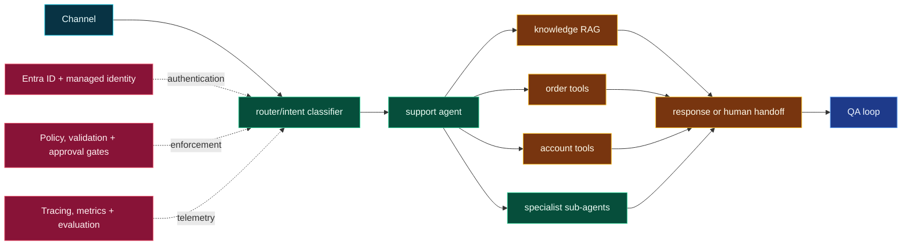

**Core components**
- Omnichannel inbox (Dynamics 365 Contact Center, Zendesk or similar).
- Intent router.
- RAG over help center and policies (Azure AI Search).
- Tool layer for order, account and refund actions.
- Handoff service with conversation summary.
- QA and feedback pipeline.

**Agent/workflow design**
A router sends tracking, returns, subscription and loyalty intents to the specialist flows and handles general questions itself. The agent answers policy questions only from retrieved documents with citations. Write actions use scoped tools with limits and confirmations. A confidence threshold or sentiment trigger escalates to a human with a structured summary.

**Data and integrations**
Knowledge base, policies, ticket history, orders, customer profile, macros. Integrations: OMS, CRM, payments, carrier tracking, identity provider, analytics.

**Security and safety**
Verify identity before any account data is shown. Redact PII and card numbers from transcripts and prompts. Use least-privilege service credentials per tool, rate limits, and an audit trail of all actions. Sanitize inbound email content against prompt injection. Disclose that the user is talking to AI.

**Reliability, observability and evaluation**
Track containment rate, CSAT, escalation quality, wrong-answer rate, average handling time and policy-citation coverage. Build a regression set from past tickets, review sampled conversations weekly, and keep human takeover available at all times.

**MVP build path**
Begin with RAG answers for FAQs and read-only order lookup. Add handoff with summaries, then low-risk actions such as address update, then specialist flows and QA dashboards.

## 14. Subscription-management assistant

**Purpose and user journey**
Lets customers manage recurring orders: skip, delay, swap products, change frequency, update payment or cancel. It also helps merchants retain customers with fair offers and prevents surprise charges.

**Reference architecture**
User request -> authentication -> subscription agent -> [subscription API | billing/dunning | catalog swaps | retention offers] -> confirmation -> scheduled-event updates

<!-- architecture-diagram:auto -->
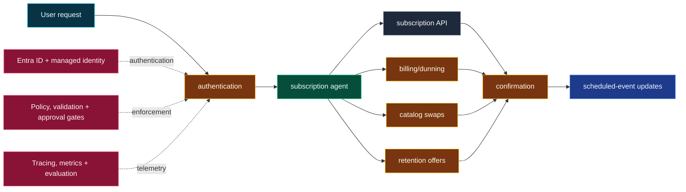

**Core components**
- Subscription billing engine (Recharge, Stripe Billing or Zuora).
- Subscription management API.
- Assistant with function calling.
- Retention offer rules engine.
- Reminder scheduler.
- Dunning and payment-update flow.

**Agent/workflow design**
The agent maps requests to atomic operations (skip, pause, swap, change interval, cancel) and shows the exact effect on next charge date and price before confirming. For cancellation it asks the reason and may present one relevant offer, but must always provide a clear path to cancel. Reminders before renewal are generated by the scheduler, not the LLM.

**Data and integrations**
Subscriptions, billing schedule, payment status, product substitutions, usage and consumption signals, cancellation reasons. Integrations: billing provider, OMS, catalog, email and SMS, payment-update hosted page.

**Security and safety**
Require authentication and step-up verification for payment changes. Make operations idempotent and logged. Avoid dark patterns and comply with consumer rules such as easy cancellation and renewal notices. Keep payment details out of the model through hosted forms.

**Reliability, observability and evaluation**
Track self-service rate, involuntary churn recovery, save-offer acceptance, complaint and chargeback rates, and wrong-action rate. Validate each tool result against the billing system and test date-calculation edge cases such as month-end and time zones.

**MVP build path**
Implement skip, pause and frequency change first. Add product swaps and pre-renewal reminders, then cancellation with offers, then dunning recovery.

## 15. Loyalty and rewards assistant

**Purpose and user journey**
Helps members understand and use loyalty programs. They ask about points, tier progress and expiry, get suggestions for redeeming rewards, and receive nudges to earn more in ways that fit their shopping habits.

**Reference architecture**
Member query/event -> identity -> loyalty agent -> [points ledger | tier engine | rewards catalog | offers] -> explanation or redemption -> ledger update

<!-- architecture-diagram:auto -->
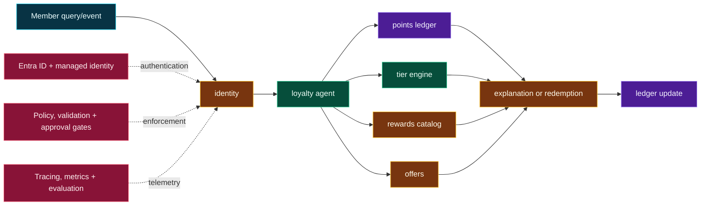

**Core components**
- Loyalty platform or ledger service (immutable transactions).
- Tier and rules engine.
- Rewards catalog.
- Assistant with read and redeem tools.
- Member profile and segmentation.
- Notification service for expiry and tier events.

**Agent/workflow design**
The agent answers account questions from ledger tools, never from memory. It explains how points were earned, how close the member is to the next tier, and which redemption gives the best value. Redemption is a two-step confirm action. Earn-more suggestions are generated from purchase history and ranked by member benefit and program cost.

**Data and integrations**
Point transactions, tier status, rewards inventory, purchase history, partner earn data, consent preferences. Integrations: POS and e-commerce order feed, CRM/CDP, rewards fulfillment, partners, email and push.

**Security and safety**
Protect against account takeover, since points have monetary value: use step-up authentication for redemptions and transfers, velocity limits, and anomaly detection. Keep the ledger append-only with reconciliation. Respect consent and privacy laws for profiling. Disclose terms and expiry clearly.

**Reliability, observability and evaluation**
Track balance-query accuracy, redemption success, active-member rate, breakage rate, support contacts about points and fraud losses. Reconcile earn events daily, test tier calculations with fixed scenarios, and monitor event-processing lag.

**MVP build path**
Start with balance, history and tier-progress Q&A. Add expiry reminders, then guided redemption, then personalized earn suggestions and partner offers.

## 16. Personalized promotion assistant

**Purpose and user journey**
Delivers relevant offers to the right customer at the right time within margin and fairness limits. A shopper sees tailored coupons or bundles in the app, email or on-site, and merchants control budgets and measure true incremental lift.

**Reference architecture**
Customer events -> feature store -> eligibility and propensity models -> offer optimizer (budget/margin rules) -> message generator -> channel delivery -> holdout measurement

<!-- architecture-diagram:auto -->
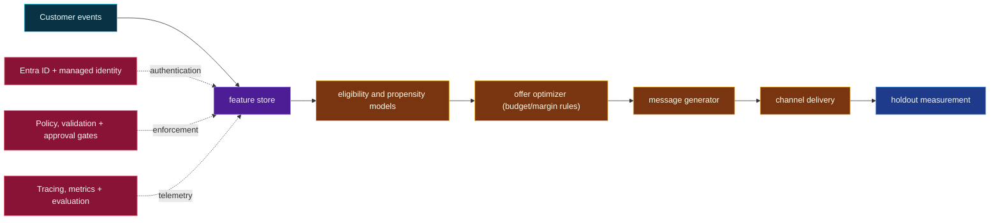

**Core components**
- Customer data platform and feature store (Azure Synapse or Fabric, Azure ML).
- Propensity and uplift models.
- Promotion rules engine and budget controller.
- LLM copy generator with brand-voice constraints.
- Channel orchestration (email, push, on-site).
- Experimentation platform.

**Agent/workflow design**
Models and rules decide who gets which offer; the LLM only writes the message copy and variants from a controlled template and offer data. Planner agents help marketers draft campaigns and simulate budget, but publishing requires approval. Every send is assigned to a treatment or holdout group to measure uplift rather than raw conversion.

**Data and integrations**
Order history, browsing events, consent flags, margin and inventory data, promotion catalog, past offer responses. Integrations: commerce platform promo codes, CDP, email/push providers, ad platforms, BI.

**Security and safety**
Honor consent, suppression lists and regional marketing laws (GDPR, ePrivacy). Do not target using sensitive traits or exploit vulnerability. Check for discriminatory pricing, limit discount abuse with single-use signed codes, and cap contact frequency. Use human approval for new campaigns and copy claims.

**Reliability, observability and evaluation**
Track incremental revenue, margin after discount, redemption rate, unsubscribe rate, budget burn and model drift. Run continuous holdout tests, offline policy evaluation before launch, and a kill switch per campaign. Monitor fairness across customer segments.

**MVP build path**
Begin with rule-based segments and holdout-measured campaigns. Add propensity scoring, then LLM-generated copy variants, then uplift-based optimization with budget control.
