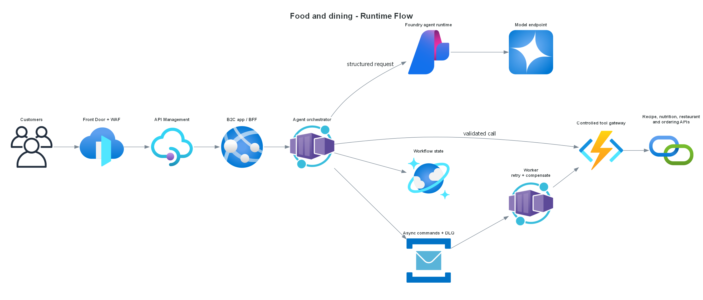
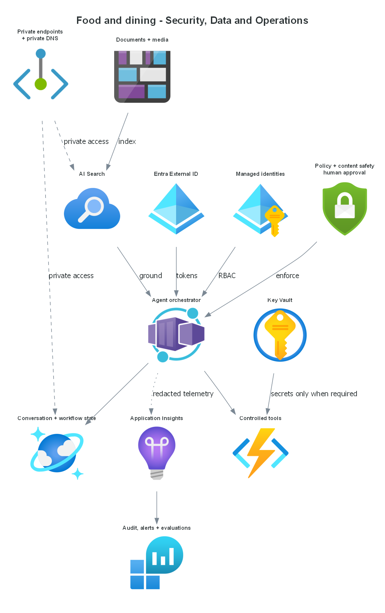

# Food and Dining

> **Reading guide:** See [how to interpret the system-context, runtime, security/data and application-flow views](README.md#how-to-read-the-architecture-views). Every diagram is a pre-rendered SVG; its editable Mermaid source is linked underneath.

<!-- azure-icon-views:auto -->
## Azure architecture views

These are **logical reference views**, not a claim that every app needs every service. Select services from the non-functional requirements, traffic, data classification and team constraints.

### 1. System context

Shows the customer, human approver, B2C AI system, identity provider, Microsoft Foundry and domain systems.

### 2. Runtime and transaction flow

Shows synchronous ingress, structured model reasoning, controlled tool calls, durable workflow state and asynchronous retry/compensation.

### 3. Security, data and operations

Shows identity, managed authorization, policy and approval gates, grounded retrieval, workflow state, private access, secrets and redacted telemetry.

**Notation:** solid arrows are primary runtime/data flows. Dashed arrows represent identity, policy, secrets or private-network controls. Dotted arrows represent telemetry. The diagrams deliberately split concerns to avoid an unreadable “everything” diagram.

<!-- category-architecture:auto -->
## Category deployment architecture

This Azure-oriented deployment separates deterministic business operations from probabilistic model reasoning. The application owns authorization, validation, workflow state and approval; the model proposes actions only through allowlisted tools.

_[Open editable Mermaid source](../diagrams/mermaid/02-food-dining/source/000-category-deployment.mmd)_

**Responsibility split**

- **Edge and API layer:** authentication, quotas, request validation and tenant routing.
- **Application/orchestration layer:** deterministic workflow, retries, approvals, state and tool authorization.
- **Model layer:** language understanding, planning and explanation; it never becomes the system of record.
- **Tool layer:** narrow typed operations with idempotency, schema validation and audit events.
- **Data layer:** retrieval indexes are separate from transactional state and sensitive records.
- **Control plane:** identity, secrets, policy, privacy, observability and evaluations apply across every request.

## 17. Grocery-shopping assistant

### Purpose and user journey
Helps households build a weekly grocery list, compare stores, and check out with minimal effort. The user states needs or approves a meal plan, reviews a substituted, priced basket, adjusts quantities, and confirms delivery or pickup.

### Reference architecture
`Chat UI -> Orchestrator agent -> Catalog/price tools -> Basket optimizer -> Retailer cart API -> Approval gate -> Order tracker`

<!-- architecture-diagram:auto -->

_[Open editable Mermaid source](../diagrams/mermaid/02-food-dining/source/017-grocery-shopping-assistant.mmd)_

<!-- main-logic:auto -->
**Main execution logic**

1. **Authenticate and validate:** the edge/API layer verifies identity, tenant, request schema, quotas and correlation ID before agent execution.
2. **Load trusted context:** the application loads the minimum required profile, conversation checkpoint, domain state and authorization scope; sensitive fields stay outside prompts unless necessary.
3. **Plan with bounded authority:** the Foundry/Agent Framework adapter receives only allowlisted tool schemas and returns a structured proposal. The app-specific path is `Chat UI -> Orchestrator agent -> Catalog/price tools -> Basket optimizer -> Retailer cart API -> Approval gate -> Order tracker`.
4. **Ground every decision:** current facts such as price, availability, policy, entitlement or status come from retrieval and typed tools—not model memory.
5. **Apply deterministic policy:** code validates tool name, arguments, user authority, limits, risk class and output schema. Invalid proposals are rejected and audited.
6. **Approve consequential actions:** writes, purchases, bookings, messages, account changes and other high-impact operations pause for explicit human approval.
7. **Execute safely:** the controlled gateway invokes the narrow business operation with an idempotency key, timeout, bounded retry and compensation or dead-letter behavior.
8. **Commit and learn:** persist the result, return a source-grounded response, emit redacted traces and feed curated outcomes into regression evaluations.

**Runnable code pattern:** [C# policy, approval, idempotency and audit sample](../../samples/agent-workflow-csharp/README.md).

### Core components
Conversation service, pantry inventory store, product-matching engine, price and promotion index, substitution ranker, basket optimizer, retailer connectors, approval screen, and a preference profile covering brands, budget, diet, and delivery windows.

### Agent/workflow design
A planner agent parses intent, expands generic items into SKUs, and calls the optimizer. Deterministic code handles totals, unit prices, and limits. The agent explains substitutions, asks only when ambiguity affects cost or allergens, and never submits an order without explicit approval.

### Data and integrations
Stores purchase history, pantry counts, and preferences in a relational database with a vector index for product search. Integrates retailer catalog and cart APIs, loyalty accounts, and recipe or meal-plan services, with fallback CSV or receipt import.

### Security and safety
Tokenize retailer credentials and use scoped OAuth. Enforce spending caps, confirm payment through the retailer, and flag allergens and dietary conflicts. Minimize retained receipt data, and make purchase history exportable and deletable.

### Reliability, observability and evaluation
Cache catalog data with freshness stamps and handle out-of-stock errors with retries. Trace each basket build, log substitution acceptance, and track price accuracy. Evaluate on replayed lists for match precision, savings, and allergen safety.

### MVP build path
Start with one retailer, text list to matched basket, and manual checkout handoff. Add pantry tracking and substitutions next, then price comparison across stores, then recurring lists and approval-gated cart submission.

## 18. Meal-planning coach

### Purpose and user journey
Creates weekly meal plans fitted to goals, time, budget, and tastes, then adapts as life changes. The user completes onboarding, receives a plan, swaps meals, gets a shopping list, and logs feedback that improves later weeks.

### Reference architecture
`Onboarding UI -> Planner agent -> Constraint solver -> Recipe retrieval -> Nutrition calculator -> Plan calendar -> Grocery list export`

<!-- architecture-diagram:auto -->

_[Open editable Mermaid source](../diagrams/mermaid/02-food-dining/source/018-meal-planning-coach.mmd)_

<!-- main-logic:auto -->
**Main execution logic**

1. **Authenticate and validate:** the edge/API layer verifies identity, tenant, request schema, quotas and correlation ID before agent execution.
2. **Load trusted context:** the application loads the minimum required profile, conversation checkpoint, domain state and authorization scope; sensitive fields stay outside prompts unless necessary.
3. **Plan with bounded authority:** the Foundry/Agent Framework adapter receives only allowlisted tool schemas and returns a structured proposal. The app-specific path is `Onboarding UI -> Planner agent -> Constraint solver -> Recipe retrieval -> Nutrition calculator -> Plan calendar -> Grocery list export`.
4. **Ground every decision:** current facts such as price, availability, policy, entitlement or status come from retrieval and typed tools—not model memory.
5. **Apply deterministic policy:** code validates tool name, arguments, user authority, limits, risk class and output schema. Invalid proposals are rejected and audited.
6. **Approve consequential actions:** writes, purchases, bookings, messages, account changes and other high-impact operations pause for explicit human approval.
7. **Execute safely:** the controlled gateway invokes the narrow business operation with an idempotency key, timeout, bounded retry and compensation or dead-letter behavior.
8. **Commit and learn:** persist the result, return a source-grounded response, emit redacted traces and feed curated outcomes into regression evaluations.

**Runnable code pattern:** [C# policy, approval, idempotency and audit sample](../../samples/agent-workflow-csharp/README.md).

### Core components
Profile service, constraint engine for calories, diet, allergens, and prep time, recipe retrieval index, nutrition calculator, plan calendar, leftovers scheduler, feedback store, and reminder service for prep and thawing.

### Agent/workflow design
The agent gathers constraints, calls the solver for candidate plans, and has the LLM rank them for variety and preference fit. Users edit conversationally; the agent re-solves only the affected days and keeps ingredient reuse high to reduce waste.

### Data and integrations
Stores profiles, ratings, plans, and pantry data. Integrates recipe databases, nutrition datasets such as USDA, grocery list export, calendar apps, and optional wearable or weight-tracking data with user consent.

### Security and safety
Treat health data as sensitive and encrypt it. Add medical disclaimers, avoid extreme calorie targets, escalate eating-disorder or medical-condition signals to professional resources, and hard-block declared allergens in every candidate.

### Reliability, observability and evaluation
Validate plans against constraints before display. Monitor swap rates, adherence, and solver failures. Evaluate with test personas for constraint satisfaction, nutrition accuracy, variety, and dietitian review of sampled plans.

### MVP build path
Ship a seven-day dinner planner with diet and allergen filters over a curated recipe set. Add shopping-list export, then swaps and feedback learning, then leftovers, pantry awareness, and multi-person household plans.

## 19. Recipe assistant

### Purpose and user journey
Finds, adapts, and guides cooking of recipes. The user describes ingredients, cuisine, or constraints, picks a result, scales or substitutes ingredients, and receives hands-free step-by-step guidance with timers and troubleshooting.

### Reference architecture
`Text/voice UI -> Intent router -> Recipe search (hybrid) -> Adaptation engine -> Cooking-mode session -> Timer/voice output`

<!-- architecture-diagram:auto -->

_[Open editable Mermaid source](../diagrams/mermaid/02-food-dining/source/019-recipe-assistant.mmd)_

<!-- main-logic:auto -->
**Main execution logic**

1. **Authenticate and validate:** the edge/API layer verifies identity, tenant, request schema, quotas and correlation ID before agent execution.
2. **Load trusted context:** the application loads the minimum required profile, conversation checkpoint, domain state and authorization scope; sensitive fields stay outside prompts unless necessary.
3. **Plan with bounded authority:** the Foundry/Agent Framework adapter receives only allowlisted tool schemas and returns a structured proposal. The app-specific path is `Text/voice UI -> Intent router -> Recipe search (hybrid) -> Adaptation engine -> Cooking-mode session -> Timer/voice output`.
4. **Ground every decision:** current facts such as price, availability, policy, entitlement or status come from retrieval and typed tools—not model memory.
5. **Apply deterministic policy:** code validates tool name, arguments, user authority, limits, risk class and output schema. Invalid proposals are rejected and audited.
6. **Approve consequential actions:** writes, purchases, bookings, messages, account changes and other high-impact operations pause for explicit human approval.
7. **Execute safely:** the controlled gateway invokes the narrow business operation with an idempotency key, timeout, bounded retry and compensation or dead-letter behavior.
8. **Commit and learn:** persist the result, return a source-grounded response, emit redacted traces and feed curated outcomes into regression evaluations.

**Runnable code pattern:** [C# policy, approval, idempotency and audit sample](../../samples/agent-workflow-csharp/README.md).

### Core components
Hybrid keyword and vector recipe index, ingredient parser, unit converter, substitution knowledge base, scaling engine, cooking-mode state machine, timer manager, and a pantry-aware ranker.

### Agent/workflow design
A router separates search, adaptation, and live-cooking questions. Adaptation uses deterministic scaling plus LLM-proposed substitutions validated against rules. Cooking mode tracks the current step, answers questions in context, and re-times steps when quantities change.

### Data and integrations
Uses licensed or user-imported recipes with structured ingredients, steps, and nutrition. Integrates the pantry, grocery list, smart speakers or displays, and URL import via schema.org Recipe markup with attribution.

### Security and safety
Respect recipe licensing and avoid verbatim copying of protected content. Surface allergen warnings, safe internal temperatures, and food-handling cautions. Flag risky substitutions in baking or canning and treat web imports as untrusted input.

### Reliability, observability and evaluation
Parse failures fall back to the raw text view. Log search success, substitution acceptance, and abandoned cooking sessions. Evaluate retrieval relevance, scaling accuracy, and substitution safety against curated test cases.

### MVP build path
Build ingredient-based search over a licensed set and a clean recipe view. Add scaling and unit conversion, then substitutions, then step-by-step cooking mode with timers, and finally URL import and voice control.

## 20. Nutrition coach

### Purpose and user journey
Helps users understand and improve eating habits through logging, insights, and goal-based guidance. The user logs meals by text or photo, sees nutrient trends against goals, and receives small weekly adjustments.

### Reference architecture
`Log UI (text/photo) -> Food parser -> Nutrient DB lookup -> Trend analyzer -> Coaching agent -> Safety filter -> Weekly report`

<!-- architecture-diagram:auto -->

_[Open editable Mermaid source](../diagrams/mermaid/02-food-dining/source/020-nutrition-coach.mmd)_

<!-- main-logic:auto -->
**Main execution logic**

1. **Authenticate and validate:** the edge/API layer verifies identity, tenant, request schema, quotas and correlation ID before agent execution.
2. **Load trusted context:** the application loads the minimum required profile, conversation checkpoint, domain state and authorization scope; sensitive fields stay outside prompts unless necessary.
3. **Plan with bounded authority:** the Foundry/Agent Framework adapter receives only allowlisted tool schemas and returns a structured proposal. The app-specific path is `Log UI (text/photo) -> Food parser -> Nutrient DB lookup -> Trend analyzer -> Coaching agent -> Safety filter -> Weekly report`.
4. **Ground every decision:** current facts such as price, availability, policy, entitlement or status come from retrieval and typed tools—not model memory.
5. **Apply deterministic policy:** code validates tool name, arguments, user authority, limits, risk class and output schema. Invalid proposals are rejected and audited.
6. **Approve consequential actions:** writes, purchases, bookings, messages, account changes and other high-impact operations pause for explicit human approval.
7. **Execute safely:** the controlled gateway invokes the narrow business operation with an idempotency key, timeout, bounded retry and compensation or dead-letter behavior.
8. **Commit and learn:** persist the result, return a source-grounded response, emit redacted traces and feed curated outcomes into regression evaluations.

**Runnable code pattern:** [C# policy, approval, idempotency and audit sample](../../samples/agent-workflow-csharp/README.md).

### Core components
Meal logging pipeline with photo recognition, food database matcher, portion estimator, goal engine, trend and insight analyzer, coaching agent, safety and referral filter, and notification scheduler.

### Agent/workflow design
The parser converts input to foods and portions, asking clarifying questions when confidence is low. Analytics are computed in code. The coaching agent turns trends into one or two achievable actions, using motivational-interviewing tone without moralizing about food.

### Data and integrations
Stores logs, goals, and measurements. Integrates nutrition databases, barcode lookups, wearables and health platforms such as Apple Health or Google Fit, and optional dietitian sharing, all consent-driven.

### Security and safety
Encrypt sensitive health data and give users granular consent and deletion. Do not diagnose or prescribe. Detect disordered-eating or medical-risk signals and redirect to professionals. Cap aggressive deficit goals and review claims against guidelines.

### Reliability, observability and evaluation
Show confidence for estimated entries and allow easy correction. Track logging retention, correction rates, and insight usefulness. Evaluate calorie and macro estimation error, and red-team safety responses for vulnerable users.

### MVP build path
Begin with text logging, database matching, and daily macro summaries. Add barcode and photo logging, then weekly insights and goal setting, then wearable integration and professional-sharing options.

## 21. Restaurant recommendation assistant

### Purpose and user journey
Recommends restaurants that fit a group's tastes, budget, location, and occasion. The user describes the situation, sees a short ranked list with reasons, refines by chatting, and moves on to booking or directions.

### Reference architecture
`Chat UI -> Preference parser -> Places search APIs -> Review/fit ranker -> Explanation generator -> Map/booking handoff`

<!-- architecture-diagram:auto -->

_[Open editable Mermaid source](../diagrams/mermaid/02-food-dining/source/021-restaurant-recommendation-assistant.mmd)_

<!-- main-logic:auto -->
**Main execution logic**

1. **Authenticate and validate:** the edge/API layer verifies identity, tenant, request schema, quotas and correlation ID before agent execution.
2. **Load trusted context:** the application loads the minimum required profile, conversation checkpoint, domain state and authorization scope; sensitive fields stay outside prompts unless necessary.
3. **Plan with bounded authority:** the Foundry/Agent Framework adapter receives only allowlisted tool schemas and returns a structured proposal. The app-specific path is `Chat UI -> Preference parser -> Places search APIs -> Review/fit ranker -> Explanation generator -> Map/booking handoff`.
4. **Ground every decision:** current facts such as price, availability, policy, entitlement or status come from retrieval and typed tools—not model memory.
5. **Apply deterministic policy:** code validates tool name, arguments, user authority, limits, risk class and output schema. Invalid proposals are rejected and audited.
6. **Approve consequential actions:** writes, purchases, bookings, messages, account changes and other high-impact operations pause for explicit human approval.
7. **Execute safely:** the controlled gateway invokes the narrow business operation with an idempotency key, timeout, bounded retry and compensation or dead-letter behavior.
8. **Commit and learn:** persist the result, return a source-grounded response, emit redacted traces and feed curated outcomes into regression evaluations.

**Runnable code pattern:** [C# policy, approval, idempotency and audit sample](../../samples/agent-workflow-csharp/README.md).

### Core components
Preference and constraint parser, geospatial search, review summarizer, hybrid ranker, group-preference merger, opening-hours validator, explanation generator, and a feedback loop recording choices.

### Agent/workflow design
The agent extracts hard constraints, such as diet, distance, and hours, and soft preferences, such as vibe and cuisine. Candidates come from search tools, deterministic filters apply, and the LLM ranks and explains with citations to review snippets.

### Data and integrations
Integrates map and places APIs, review sources, reservation platforms, menu data, and the user's saved places. Stores preference embeddings and choice feedback, respecting each provider's terms and caching limits.

### Security and safety
Minimize location sharing and retain only what is needed. Mark sponsored results clearly and avoid fabricated claims. Verify dietary and allergen claims against sources and caution that venues should be contacted to confirm them.

### Reliability, observability and evaluation
Handle API quota and stale-hours issues with caching and fallbacks. Log recommendations, clicks, and bookings. Evaluate relevance with labeled queries, hours accuracy, constraint violations, and hallucination rate in explanations.

### MVP build path
Start with one city, a places API, and filters plus LLM ranking with explanations. Add preference memory and group mode, then review-based fit summaries, then direct handoff to reservation and navigation.

## 22. Restaurant reservation assistant

### Purpose and user journey
Books, modifies, and cancels restaurant tables on the user's behalf. The user gives party size, time window, and preferences; the assistant checks availability, proposes options, confirms details, books, and adds the reservation to the calendar.

### Reference architecture
`Chat UI -> Reservation agent -> Availability connectors -> Booking executor -> Confirmation store -> Calendar/reminders`

<!-- architecture-diagram:auto -->

_[Open editable Mermaid source](../diagrams/mermaid/02-food-dining/source/022-restaurant-reservation-assistant.mmd)_

<!-- main-logic:auto -->
**Main execution logic**

1. **Authenticate and validate:** the edge/API layer verifies identity, tenant, request schema, quotas and correlation ID before agent execution.
2. **Load trusted context:** the application loads the minimum required profile, conversation checkpoint, domain state and authorization scope; sensitive fields stay outside prompts unless necessary.
3. **Plan with bounded authority:** the Foundry/Agent Framework adapter receives only allowlisted tool schemas and returns a structured proposal. The app-specific path is `Chat UI -> Reservation agent -> Availability connectors -> Booking executor -> Confirmation store -> Calendar/reminders`.
4. **Ground every decision:** current facts such as price, availability, policy, entitlement or status come from retrieval and typed tools—not model memory.
5. **Apply deterministic policy:** code validates tool name, arguments, user authority, limits, risk class and output schema. Invalid proposals are rejected and audited.
6. **Approve consequential actions:** writes, purchases, bookings, messages, account changes and other high-impact operations pause for explicit human approval.
7. **Execute safely:** the controlled gateway invokes the narrow business operation with an idempotency key, timeout, bounded retry and compensation or dead-letter behavior.
8. **Commit and learn:** persist the result, return a source-grounded response, emit redacted traces and feed curated outcomes into regression evaluations.

**Runnable code pattern:** [C# policy, approval, idempotency and audit sample](../../samples/agent-workflow-csharp/README.md).

### Core components
Request parser, availability search across platforms, slot ranker, booking executor with idempotency, policy reader for deposits and cancellations, confirmation store, calendar sync, and reminder service.

### Agent/workflow design
The agent searches flexible windows, offers two or three slots, and states the cancellation terms before booking. A state machine moves from searching to proposed to confirmed. Where no API exists, it escalates to a call-script or email handoff.

### Data and integrations
Integrates reservation platforms such as OpenTable or Resy where permitted, restaurant phone or email channels, calendars, and messaging. Stores bookings, party profiles, and dietary notes with user consent.

### Security and safety
Require explicit confirmation before booking or paying any deposit. Show fees and no-show penalties. Guard against double-booking, protect guests' personal data, and limit automatic retries to avoid spamming venues.

### Reliability, observability and evaluation
Use idempotency keys, confirmation re-verification, and reminder checks to avoid ghost bookings. Track booking success, time to confirm, and cancellation rates. Evaluate against sandbox availability and simulated conflicts.

### MVP build path
Build availability lookup and a booking link handoff first. Then add API booking for one platform with confirmation and calendar events, then modification and cancellation, then multi-platform search and phone-call fallback.

## 23. Food-ordering agent

### Purpose and user journey
Orders delivery or pickup meals from natural-language requests. The user asks for a dish or reorder, the agent finds matching menus, builds the cart with customizations, displays the total, and places the order after approval, then tracks it.

### Reference architecture
`Chat UI -> Ordering agent -> Menu search -> Cart builder -> Price/ETA check -> Approval -> Payment/order API -> Tracker`

<!-- architecture-diagram:auto -->

_[Open editable Mermaid source](../diagrams/mermaid/02-food-dining/source/023-food-ordering-agent.mmd)_

<!-- main-logic:auto -->
**Main execution logic**

1. **Authenticate and validate:** the edge/API layer verifies identity, tenant, request schema, quotas and correlation ID before agent execution.
2. **Load trusted context:** the application loads the minimum required profile, conversation checkpoint, domain state and authorization scope; sensitive fields stay outside prompts unless necessary.
3. **Plan with bounded authority:** the Foundry/Agent Framework adapter receives only allowlisted tool schemas and returns a structured proposal. The app-specific path is `Chat UI -> Ordering agent -> Menu search -> Cart builder -> Price/ETA check -> Approval -> Payment/order API -> Tracker`.
4. **Ground every decision:** current facts such as price, availability, policy, entitlement or status come from retrieval and typed tools—not model memory.
5. **Apply deterministic policy:** code validates tool name, arguments, user authority, limits, risk class and output schema. Invalid proposals are rejected and audited.
6. **Approve consequential actions:** writes, purchases, bookings, messages, account changes and other high-impact operations pause for explicit human approval.
7. **Execute safely:** the controlled gateway invokes the narrow business operation with an idempotency key, timeout, bounded retry and compensation or dead-letter behavior.
8. **Commit and learn:** persist the result, return a source-grounded response, emit redacted traces and feed curated outcomes into regression evaluations.

**Runnable code pattern:** [C# policy, approval, idempotency and audit sample](../../samples/agent-workflow-csharp/README.md).

### Core components
Menu index, item-to-modifier mapper, cart builder, fee and ETA estimator, approval step, payment handoff, order tracker, reorder history, and a dietary and allergen filter.

### Agent/workflow design
The agent resolves requests to menu items and modifiers, validates required options, and compares restaurants by price, fees, and ETA. It shows the complete cart and total before approval, then tracks status and handles substitutions or delays.

### Data and integrations
Integrates delivery platform or restaurant ordering APIs, payment providers, maps and tracking, and the user's address book. Stores order history, favorite items, and allergen preferences.

### Security and safety
Use tokenized payments, never raw card data. Enforce spending limits, explicit confirmation, and address verification. Treat allergen claims as unverified and recommend confirming with the restaurant. Log all actions for dispute resolution.

### Reliability, observability and evaluation
Handle unavailable items, price changes, and order failures with user prompts. Track conversion, error codes, and delivery-time accuracy. Evaluate menu-mapping accuracy, modifier correctness, and order success in sandbox tests.

### MVP build path
Begin with reorder of past orders on one platform with an approval screen. Add natural-language menu search and customizations, then multi-restaurant comparison, then live tracking, issue handling, and refund requests.
