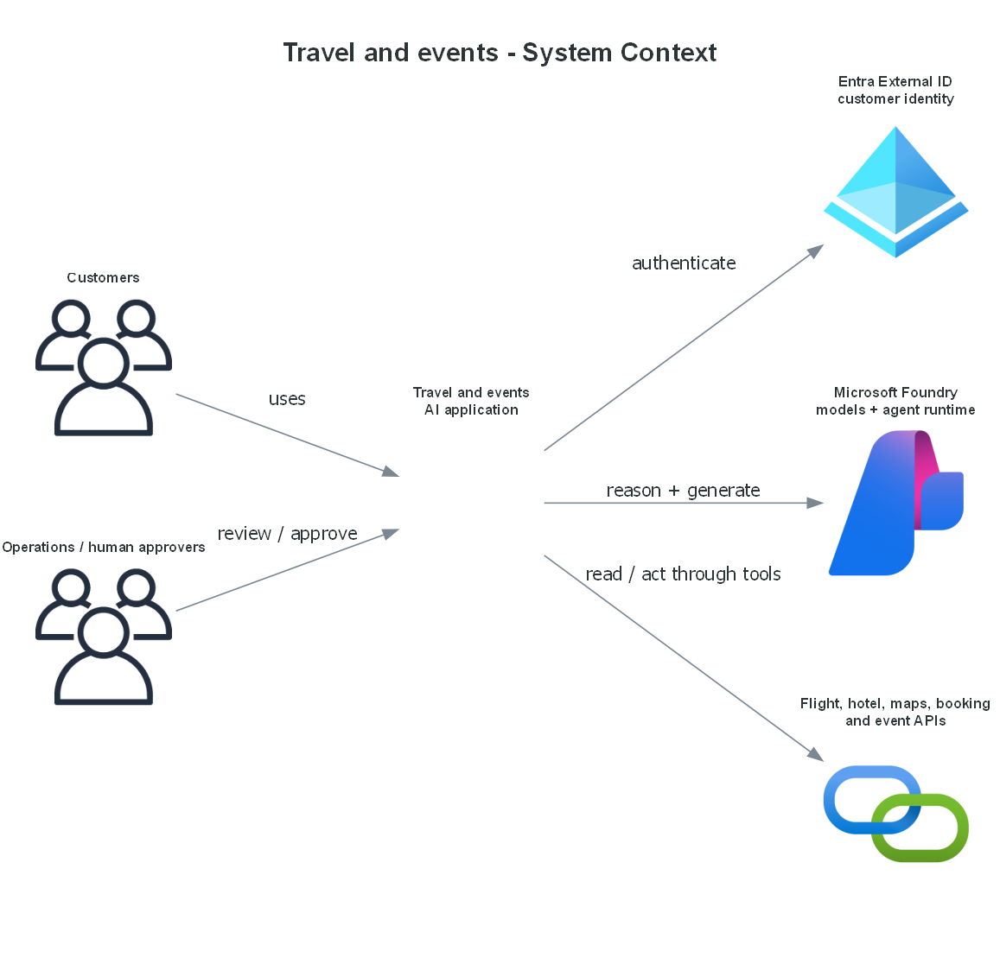
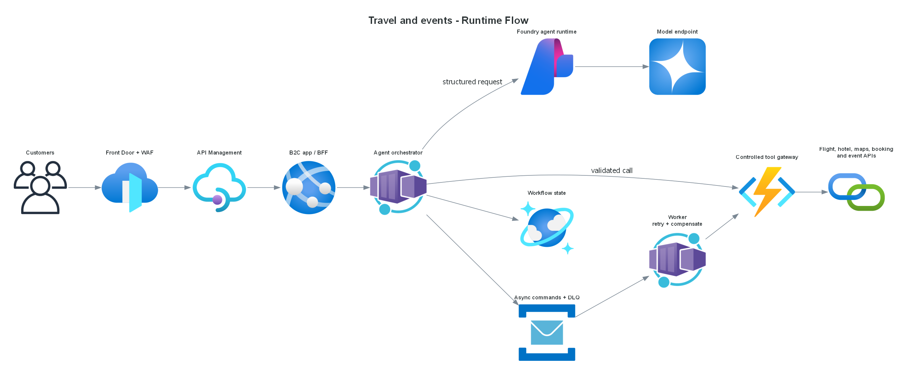
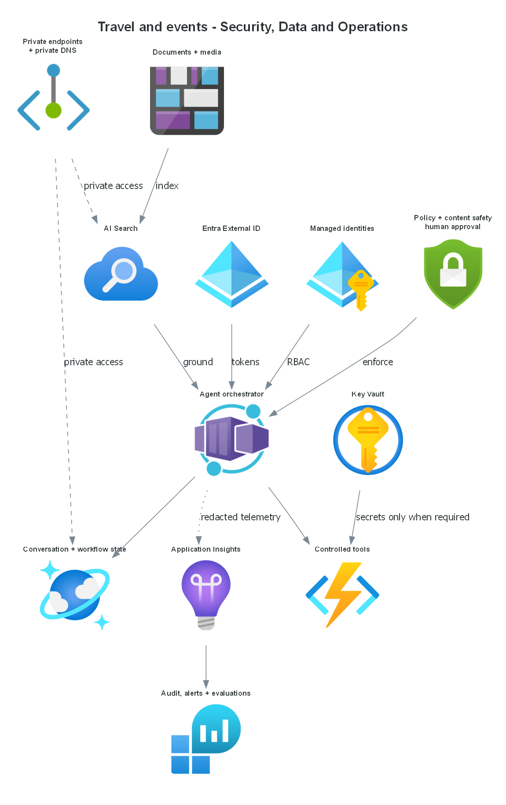

# Travel and Events

> **Reading guide:** See [how to interpret the system-context, runtime, security/data and application-flow views](README.md#how-to-read-the-architecture-views). Every diagram is a pre-rendered SVG; its editable Mermaid source is linked underneath.

<!-- azure-icon-views:auto -->
## Azure architecture views

These are **logical reference views**, not a claim that every app needs every service. Select services from the non-functional requirements, traffic, data classification and team constraints.

### 1. System context

Shows the customer, human approver, B2C AI system, identity provider, Microsoft Foundry and domain systems.

### 2. Runtime and transaction flow

Shows synchronous ingress, structured model reasoning, controlled tool calls, durable workflow state and asynchronous retry/compensation.

### 3. Security, data and operations

Shows identity, managed authorization, policy and approval gates, grounded retrieval, workflow state, private access, secrets and redacted telemetry.

**Notation:** solid arrows are primary runtime/data flows. Dashed arrows represent identity, policy, secrets or private-network controls. Dotted arrows represent telemetry. The diagrams deliberately split concerns to avoid an unreadable “everything” diagram.

<!-- category-architecture:auto -->
## Category deployment architecture

This Azure-oriented deployment separates deterministic business operations from probabilistic model reasoning. The application owns authorization, validation, workflow state and approval; the model proposes actions only through allowlisted tools.

_[Open editable Mermaid source](../diagrams/mermaid/03-travel-events/source/000-category-deployment.mmd)_

**Responsibility split**

- **Edge and API layer:** authentication, quotas, request validation and tenant routing.
- **Application/orchestration layer:** deterministic workflow, retries, approvals, state and tool authorization.
- **Model layer:** language understanding, planning and explanation; it never becomes the system of record.
- **Tool layer:** narrow typed operations with idempotency, schema validation and audit events.
- **Data layer:** retrieval indexes are separate from transactional state and sensitive records.
- **Control plane:** identity, secrets, policy, privacy, observability and evaluations apply across every request.

## 24. Travel-planning assistant

### Purpose and user journey
Turns vague travel ideas into a workable trip plan covering destination, dates, budget, and logistics. The user describes goals, compares shortlisted options, refines through conversation, and exports a plan ready for booking.

### Reference architecture
`Chat UI -> Trip planner agent -> Destination/price/weather tools -> Constraint scorer -> Plan builder -> Shareable trip workspace`

<!-- architecture-diagram:auto -->

_[Open editable Mermaid source](../diagrams/mermaid/03-travel-events/source/024-travel-planning-assistant.mmd)_

<!-- main-logic:auto -->
**Main execution logic**

1. **Authenticate and validate:** the edge/API layer verifies identity, tenant, request schema, quotas and correlation ID before agent execution.
2. **Load trusted context:** the application loads the minimum required profile, conversation checkpoint, domain state and authorization scope; sensitive fields stay outside prompts unless necessary.
3. **Plan with bounded authority:** the Foundry/Agent Framework adapter receives only allowlisted tool schemas and returns a structured proposal. The app-specific path is `Chat UI -> Trip planner agent -> Destination/price/weather tools -> Constraint scorer -> Plan builder -> Shareable trip workspace`.
4. **Ground every decision:** current facts such as price, availability, policy, entitlement or status come from retrieval and typed tools—not model memory.
5. **Apply deterministic policy:** code validates tool name, arguments, user authority, limits, risk class and output schema. Invalid proposals are rejected and audited.
6. **Approve consequential actions:** writes, purchases, bookings, messages, account changes and other high-impact operations pause for explicit human approval.
7. **Execute safely:** the controlled gateway invokes the narrow business operation with an idempotency key, timeout, bounded retry and compensation or dead-letter behavior.
8. **Commit and learn:** persist the result, return a source-grounded response, emit redacted traces and feed curated outcomes into regression evaluations.

**Runnable code pattern:** [C# policy, approval, idempotency and audit sample](../../samples/agent-workflow-csharp/README.md).

### Core components
Traveler profile, destination knowledge retrieval, budget estimator, seasonality and weather service, visa and entry requirement lookup, option comparer, trip workspace, and collaboration and sharing features.

### Agent/workflow design
The agent clarifies constraints, calls tools for fares, lodging price ranges, and weather, and scores destinations against preferences. It presents tradeoffs, drafts a high-level plan, and delegates detail work to flight, hotel, and itinerary agents.

### Data and integrations
Integrates travel search APIs, weather and climate data, government advisory and entry-requirement sources, maps, and calendars. Stores trips, preferences, and traveler documents' metadata, not the documents themselves.

### Security and safety
Protect passport and identity details and share trips by scoped links. Cite official sources for visa and safety advisories, show data freshness, and avoid presenting unverified entry rules as guaranteed.

### Reliability, observability and evaluation
Degrade gracefully when providers fail, labeling estimates. Trace tool calls and track plan acceptance. Evaluate budget estimate error, advisory accuracy, constraint satisfaction, and user-rated plan usefulness.

### MVP build path
Launch with destination suggestions and budget estimates from one data source. Add weather and entry requirements, then a shareable plan, then integrations to flight, hotel, and itinerary modules and collaborative editing.

## 25. Flight-search assistant

### Purpose and user journey
Finds and compares flights using natural-language preferences. The user states route, dates, flexibility, and priorities; the assistant returns ranked itineraries with tradeoffs, explains fare rules, and can set price alerts.

### Reference architecture
`Chat UI -> Query normalizer -> Flight search APIs -> Itinerary ranker -> Fare-rule explainer -> Price alert service`

<!-- architecture-diagram:auto -->

_[Open editable Mermaid source](../diagrams/mermaid/03-travel-events/source/025-flight-search-assistant.mmd)_

<!-- main-logic:auto -->
**Main execution logic**

1. **Authenticate and validate:** the edge/API layer verifies identity, tenant, request schema, quotas and correlation ID before agent execution.
2. **Load trusted context:** the application loads the minimum required profile, conversation checkpoint, domain state and authorization scope; sensitive fields stay outside prompts unless necessary.
3. **Plan with bounded authority:** the Foundry/Agent Framework adapter receives only allowlisted tool schemas and returns a structured proposal. The app-specific path is `Chat UI -> Query normalizer -> Flight search APIs -> Itinerary ranker -> Fare-rule explainer -> Price alert service`.
4. **Ground every decision:** current facts such as price, availability, policy, entitlement or status come from retrieval and typed tools—not model memory.
5. **Apply deterministic policy:** code validates tool name, arguments, user authority, limits, risk class and output schema. Invalid proposals are rejected and audited.
6. **Approve consequential actions:** writes, purchases, bookings, messages, account changes and other high-impact operations pause for explicit human approval.
7. **Execute safely:** the controlled gateway invokes the narrow business operation with an idempotency key, timeout, bounded retry and compensation or dead-letter behavior.
8. **Commit and learn:** persist the result, return a source-grounded response, emit redacted traces and feed curated outcomes into regression evaluations.

**Runnable code pattern:** [C# policy, approval, idempotency and audit sample](../../samples/agent-workflow-csharp/README.md).

### Core components
Query normalizer, airport and date flexibility expander, GDS or aggregator connectors, itinerary scorer weighing price, duration, and layovers, fare-rule parser, baggage calculator, and price-alert scheduler.

### Agent/workflow design
The agent translates preferences into structured searches, runs flexible-date and nearby-airport variants in parallel, and ranks results with a transparent score. It explains total cost with bags and seats and never guesses fares.

### Data and integrations
Integrates flight aggregator and airline APIs, airport and airline reference data, loyalty program balances, and calendars. Stores searches, alerts, and preferences such as airlines, seat, and maximum stops.

### Security and safety
Present only provider-returned prices with timestamps. Disclose affiliate relationships, avoid dark patterns, protect loyalty credentials with scoped tokens, and warn that fares change before booking.

### Reliability, observability and evaluation
Cache short-lived results, handle rate limits, and detect stale fares. Log search latency, result coverage, and alert accuracy. Evaluate ranking against human choices and price parity with provider booking pages.

### MVP build path
Start with one aggregator, round-trip search, and ranking with explanations. Add flexible dates and multi-city, then fare rules and baggage cost, then price alerts and loyalty-aware recommendations.

## 26. Hotel recommendation assistant

### Purpose and user journey
Recommends hotels and stays that match traveler needs such as location, budget, amenities, and trip purpose. The user describes the trip, reviews a ranked shortlist with neighborhood context, compares options, and proceeds to booking.

### Reference architecture
`Chat UI -> Requirement extractor -> Hotel inventory APIs -> Review/location analyzer -> Ranker -> Comparison view -> Booking handoff`

<!-- architecture-diagram:auto -->

_[Open editable Mermaid source](../diagrams/mermaid/03-travel-events/source/026-hotel-recommendation-assistant.mmd)_

<!-- main-logic:auto -->
**Main execution logic**

1. **Authenticate and validate:** the edge/API layer verifies identity, tenant, request schema, quotas and correlation ID before agent execution.
2. **Load trusted context:** the application loads the minimum required profile, conversation checkpoint, domain state and authorization scope; sensitive fields stay outside prompts unless necessary.
3. **Plan with bounded authority:** the Foundry/Agent Framework adapter receives only allowlisted tool schemas and returns a structured proposal. The app-specific path is `Chat UI -> Requirement extractor -> Hotel inventory APIs -> Review/location analyzer -> Ranker -> Comparison view -> Booking handoff`.
4. **Ground every decision:** current facts such as price, availability, policy, entitlement or status come from retrieval and typed tools—not model memory.
5. **Apply deterministic policy:** code validates tool name, arguments, user authority, limits, risk class and output schema. Invalid proposals are rejected and audited.
6. **Approve consequential actions:** writes, purchases, bookings, messages, account changes and other high-impact operations pause for explicit human approval.
7. **Execute safely:** the controlled gateway invokes the narrow business operation with an idempotency key, timeout, bounded retry and compensation or dead-letter behavior.
8. **Commit and learn:** persist the result, return a source-grounded response, emit redacted traces and feed curated outcomes into regression evaluations.

**Runnable code pattern:** [C# policy, approval, idempotency and audit sample](../../samples/agent-workflow-csharp/README.md).

### Core components
Requirement extractor, inventory search, neighborhood and distance scorer, review aspect summarizer, amenity filter, price and fee normalizer, comparison view, and a preference memory.

### Agent/workflow design
The agent applies hard filters, then ranks by weighted preferences such as quiet, walkability, or business facilities. The LLM summarizes review themes by aspect and flags mismatches, while totals including taxes and resort fees are calculated in code.

### Data and integrations
Integrates hotel supply APIs, review sources, maps and transit data, and calendars. Stores preferences, past stays, and shortlists, caching listings within provider terms.

### Security and safety
Disclose sponsored placement and fees. Avoid fabricating amenities and show source and freshness. Use accessibility data carefully and encourage verification with the hotel. Limit the personal data shared with suppliers.

### Reliability, observability and evaluation
Handle inventory changes and fallback providers. Track shortlist-to-booking conversion and complaints about mismatches. Evaluate ranking quality, review summary faithfulness, and fee accuracy against provider checkout totals.

### MVP build path
Build city-level search with filters and ranked results. Add review summaries and neighborhood analysis, then side-by-side comparison, then personalization from past stays and booking handoff.

## 27. Trip-booking assistant

### Purpose and user journey
Executes bookings for flights, hotels, and extras from an approved plan. The user reviews a consolidated itinerary and price, confirms traveler details and payment, and receives confirmations, receipts, and changes in one place.

### Reference architecture
`Approved plan -> Booking orchestrator -> Provider booking APIs -> Payment service -> Confirmation vault -> Itinerary sync/notifications`

<!-- architecture-diagram:auto -->

_[Open editable Mermaid source](../diagrams/mermaid/03-travel-events/source/027-trip-booking-assistant.mmd)_

<!-- main-logic:auto -->
**Main execution logic**

1. **Authenticate and validate:** the edge/API layer verifies identity, tenant, request schema, quotas and correlation ID before agent execution.
2. **Load trusted context:** the application loads the minimum required profile, conversation checkpoint, domain state and authorization scope; sensitive fields stay outside prompts unless necessary.
3. **Plan with bounded authority:** the Foundry/Agent Framework adapter receives only allowlisted tool schemas and returns a structured proposal. The app-specific path is `Approved plan -> Booking orchestrator -> Provider booking APIs -> Payment service -> Confirmation vault -> Itinerary sync/notifications`.
4. **Ground every decision:** current facts such as price, availability, policy, entitlement or status come from retrieval and typed tools—not model memory.
5. **Apply deterministic policy:** code validates tool name, arguments, user authority, limits, risk class and output schema. Invalid proposals are rejected and audited.
6. **Approve consequential actions:** writes, purchases, bookings, messages, account changes and other high-impact operations pause for explicit human approval.
7. **Execute safely:** the controlled gateway invokes the narrow business operation with an idempotency key, timeout, bounded retry and compensation or dead-letter behavior.
8. **Commit and learn:** persist the result, return a source-grounded response, emit redacted traces and feed curated outcomes into regression evaluations.

**Runnable code pattern:** [C# policy, approval, idempotency and audit sample](../../samples/agent-workflow-csharp/README.md).

### Core components
Booking orchestrator with saga pattern, traveler profile vault, price revalidation, payment integration, confirmation store, rollback and cancellation handler, receipts service, and notification service.

### Agent/workflow design
The agent assembles a booking checklist, revalidates prices and availability, and obtains one explicit approval summarizing total, fees, and cancellation terms. The orchestrator then books components in order, compensating or cancelling on partial failure.

### Data and integrations
Integrates airline, hotel, and rail booking APIs, payment processors, passport and loyalty profiles, calendars, and email parsing for confirmations. Stores bookings, PNRs, and policies as structured records.

### Security and safety
PCI-compliant tokenized payments, encrypted identity data, strong authentication, and spend limits. Require name-match checks against passports, show refund terms, and keep an immutable audit log of approvals and charges.

### Reliability, observability and evaluation
Use idempotency keys and reconciliation jobs to catch uncertain bookings. Alert on partial failures and price drift. Evaluate with sandbox providers, failure injection, and end-to-end tests for rollback correctness.

### MVP build path
Begin with hotel-only booking in a provider sandbox with approval and confirmation storage. Add flights, then bundled saga orchestration and rollback, then changes and cancellations and corporate policy rules.

## 28. Itinerary generator

### Purpose and user journey
Produces day-by-day itineraries balancing interests, pace, logistics, and opening hours. The user gives destination, dates, and interests, receives a map-aware schedule, and edits by chat or drag and drop.

### Reference architecture
`Preferences -> Candidate POI retrieval -> Route/time optimizer -> Itinerary composer -> Editable map/calendar view -> Export`

<!-- architecture-diagram:auto -->

_[Open editable Mermaid source](../diagrams/mermaid/03-travel-events/source/028-itinerary-generator.mmd)_

<!-- main-logic:auto -->
**Main execution logic**

1. **Authenticate and validate:** the edge/API layer verifies identity, tenant, request schema, quotas and correlation ID before agent execution.
2. **Load trusted context:** the application loads the minimum required profile, conversation checkpoint, domain state and authorization scope; sensitive fields stay outside prompts unless necessary.
3. **Plan with bounded authority:** the Foundry/Agent Framework adapter receives only allowlisted tool schemas and returns a structured proposal. The app-specific path is `Preferences -> Candidate POI retrieval -> Route/time optimizer -> Itinerary composer -> Editable map/calendar view -> Export`.
4. **Ground every decision:** current facts such as price, availability, policy, entitlement or status come from retrieval and typed tools—not model memory.
5. **Apply deterministic policy:** code validates tool name, arguments, user authority, limits, risk class and output schema. Invalid proposals are rejected and audited.
6. **Approve consequential actions:** writes, purchases, bookings, messages, account changes and other high-impact operations pause for explicit human approval.
7. **Execute safely:** the controlled gateway invokes the narrow business operation with an idempotency key, timeout, bounded retry and compensation or dead-letter behavior.
8. **Commit and learn:** persist the result, return a source-grounded response, emit redacted traces and feed curated outcomes into regression evaluations.

**Runnable code pattern:** [C# policy, approval, idempotency and audit sample](../../samples/agent-workflow-csharp/README.md).

### Core components
POI retrieval index, opening-hours and ticket checker, travel-time estimator, day clustering optimizer, pace and energy model, itinerary composer, editor, and calendar and offline export.

### Agent/workflow design
The agent retrieves candidates matching interests, clusters them geographically, and runs an optimizer under time constraints. The LLM writes rationale and alternatives, and local edits re-optimize only the affected day while locking pinned items.

### Data and integrations
Integrates places and maps APIs, transit and routing services, event listings, weather, and booked flights and hotels for anchors. Stores itineraries, saved places, and traveler preferences.

### Security and safety
Avoid recommending closed, unsafe, or restricted venues and surface advisories. Check accessibility needs where data exists. Limit location sharing in shared itineraries and mark unverified suggestions clearly.

### Reliability, observability and evaluation
Validate every item for hours and feasibility before display. Track edit rates as a quality signal. Evaluate with test trips for travel-time realism, constraint violations, diversity, and user satisfaction.

### MVP build path
Generate a one-city multi-day plan from curated POIs with travel-time checks. Add map editing and re-optimization, then hours and ticket validation, then booking anchors, offline export, and group preferences.

## 29. Travel-disruption assistant

### Purpose and user journey
Monitors trips for delays, cancellations, and other disruptions and helps recover quickly. The user's itinerary is tracked; on a disruption, the assistant explains impact, proposes rebooking options, and assists with claims.

### Reference architecture
`Itinerary store -> Flight/status monitors -> Disruption detector -> Recovery agent -> Rebooking options -> Approval -> Notifications/claims`

<!-- architecture-diagram:auto -->

_[Open editable Mermaid source](../diagrams/mermaid/03-travel-events/source/029-travel-disruption-assistant.mmd)_

<!-- main-logic:auto -->
**Main execution logic**

1. **Authenticate and validate:** the edge/API layer verifies identity, tenant, request schema, quotas and correlation ID before agent execution.
2. **Load trusted context:** the application loads the minimum required profile, conversation checkpoint, domain state and authorization scope; sensitive fields stay outside prompts unless necessary.
3. **Plan with bounded authority:** the Foundry/Agent Framework adapter receives only allowlisted tool schemas and returns a structured proposal. The app-specific path is `Itinerary store -> Flight/status monitors -> Disruption detector -> Recovery agent -> Rebooking options -> Approval -> Notifications/claims`.
4. **Ground every decision:** current facts such as price, availability, policy, entitlement or status come from retrieval and typed tools—not model memory.
5. **Apply deterministic policy:** code validates tool name, arguments, user authority, limits, risk class and output schema. Invalid proposals are rejected and audited.
6. **Approve consequential actions:** writes, purchases, bookings, messages, account changes and other high-impact operations pause for explicit human approval.
7. **Execute safely:** the controlled gateway invokes the narrow business operation with an idempotency key, timeout, bounded retry and compensation or dead-letter behavior.
8. **Commit and learn:** persist the result, return a source-grounded response, emit redacted traces and feed curated outcomes into regression evaluations.

**Runnable code pattern:** [C# policy, approval, idempotency and audit sample](../../samples/agent-workflow-csharp/README.md).

### Core components
Status polling and webhooks, disruption detector, connection-risk calculator, recovery option generator, rights and compensation rules engine, notification service, rebooking executor, and claim-document builder.

### Agent/workflow design
Events trigger a severity classifier. The agent assesses downstream impacts on connections, hotels, and transfers, ranks recovery options by arrival time and cost, and drafts airline messages. Rebooking or purchases require explicit approval.

### Data and integrations
Integrates flight status APIs, airline rebooking channels, airport and weather feeds, hotel and ground-transport bookings, and messaging or push channels. Stores itineraries, PNRs, and disruption timelines.

### Security and safety
Push alerts only to verified channels and avoid exposing booking codes in plaintext. Present passenger-rights information as guidance with jurisdiction caveats, and require approval before spending or cancelling.

### Reliability, observability and evaluation
Redundant status sources and deduplicated alerts prevent missed or noisy notifications. Track detection latency, false alarms, and recovery success. Evaluate with replayed historical disruptions and rights-rule test suites.

### MVP build path
Start with flight-status monitoring and timely alerts for imported itineraries. Add connection-risk analysis, then recovery option suggestions, then compensation guidance and claim drafting, then approved rebooking actions.

## 30. Local activity concierge

### Purpose and user journey
Suggests things to do nearby right now or later, matched to mood, group, weather, and budget. The user asks for ideas, gets a few time-aware options with logistics, and can save, share, or book.

### Reference architecture
`Context (location/time/weather) -> Concierge agent -> Places/events retrieval -> Context ranker -> Suggestions -> Save/share/book`

<!-- architecture-diagram:auto -->

_[Open editable Mermaid source](../diagrams/mermaid/03-travel-events/source/030-local-activity-concierge.mmd)_

<!-- main-logic:auto -->
**Main execution logic**

1. **Authenticate and validate:** the edge/API layer verifies identity, tenant, request schema, quotas and correlation ID before agent execution.
2. **Load trusted context:** the application loads the minimum required profile, conversation checkpoint, domain state and authorization scope; sensitive fields stay outside prompts unless necessary.
3. **Plan with bounded authority:** the Foundry/Agent Framework adapter receives only allowlisted tool schemas and returns a structured proposal. The app-specific path is `Context (location/time/weather) -> Concierge agent -> Places/events retrieval -> Context ranker -> Suggestions -> Save/share/book`.
4. **Ground every decision:** current facts such as price, availability, policy, entitlement or status come from retrieval and typed tools—not model memory.
5. **Apply deterministic policy:** code validates tool name, arguments, user authority, limits, risk class and output schema. Invalid proposals are rejected and audited.
6. **Approve consequential actions:** writes, purchases, bookings, messages, account changes and other high-impact operations pause for explicit human approval.
7. **Execute safely:** the controlled gateway invokes the narrow business operation with an idempotency key, timeout, bounded retry and compensation or dead-letter behavior.
8. **Commit and learn:** persist the result, return a source-grounded response, emit redacted traces and feed curated outcomes into regression evaluations.

**Runnable code pattern:** [C# policy, approval, idempotency and audit sample](../../samples/agent-workflow-csharp/README.md).

### Core components
Context collector, places and events retrieval, weather-aware ranker, travel-time calculator, group preference blender, novelty and diversity controller, saved list, and booking handoff.

### Agent/workflow design
The agent infers intent such as date night or kids' afternoon, retrieves open venues and events within reach, and ranks by fit, travel time, and weather. It offers a small set with one surprise pick and learns from selections.

### Data and integrations
Integrates places, events, weather, and transit APIs, local tourism feeds, and calendars. Stores interests, past choices, and saved places with location history kept on-device or short-lived.

### Security and safety
Use coarse location by default and ask before precise tracking. Filter age-appropriate and safety-relevant content, label sponsored items, and avoid steering users toward unsafe areas or closed venues.

### Reliability, observability and evaluation
Verify hours and event times at request time and cache with short TTLs. Track suggestion click-through and completion. Evaluate relevance, freshness, and diversity using scenario tests across times and weather.

### MVP build path
Build a single-city suggester using places data, weather, and distance. Add events feeds and preference learning, then group and kid modes, then saved plans, booking links, and proactive suggestions.

## 31. Event-planning assistant

### Purpose and user journey
Guides organizers through planning parties, meetings, and gatherings. The user states event type, size, budget, and date; the assistant builds a plan, shortlists venues and vendors, tracks tasks and RSVPs, and manages the timeline.

### Reference architecture
`Brief -> Planner agent -> Venue/vendor search -> Budget/task engine -> Guest/RSVP service -> Timeline dashboard -> Vendor messaging`

<!-- architecture-diagram:auto -->

_[Open editable Mermaid source](../diagrams/mermaid/03-travel-events/source/031-event-planning-assistant.mmd)_

<!-- main-logic:auto -->
**Main execution logic**

1. **Authenticate and validate:** the edge/API layer verifies identity, tenant, request schema, quotas and correlation ID before agent execution.
2. **Load trusted context:** the application loads the minimum required profile, conversation checkpoint, domain state and authorization scope; sensitive fields stay outside prompts unless necessary.
3. **Plan with bounded authority:** the Foundry/Agent Framework adapter receives only allowlisted tool schemas and returns a structured proposal. The app-specific path is `Brief -> Planner agent -> Venue/vendor search -> Budget/task engine -> Guest/RSVP service -> Timeline dashboard -> Vendor messaging`.
4. **Ground every decision:** current facts such as price, availability, policy, entitlement or status come from retrieval and typed tools—not model memory.
5. **Apply deterministic policy:** code validates tool name, arguments, user authority, limits, risk class and output schema. Invalid proposals are rejected and audited.
6. **Approve consequential actions:** writes, purchases, bookings, messages, account changes and other high-impact operations pause for explicit human approval.
7. **Execute safely:** the controlled gateway invokes the narrow business operation with an idempotency key, timeout, bounded retry and compensation or dead-letter behavior.
8. **Commit and learn:** persist the result, return a source-grounded response, emit redacted traces and feed curated outcomes into regression evaluations.

**Runnable code pattern:** [C# policy, approval, idempotency and audit sample](../../samples/agent-workflow-csharp/README.md).

### Core components
Event brief intake, checklist generator, budget tracker, venue and vendor search, guest list and RSVP service, timeline scheduler, message drafting, and collaborator permissions.

### Agent/workflow design
The agent produces a backward-planned timeline from the date, decomposes it into tasks with owners, and shortlists vendors against budget and capacity. It drafts invitations and quote requests but sends only after approval.

### Data and integrations
Integrates venue and vendor directories, email and SMS, calendars, payment and ticketing tools, and maps. Stores events, guest lists, budgets, quotes, and contracts as structured and file records.

### Security and safety
Protect guest personal data and honor opt-outs. Require confirmation before messaging or spending, review vendor contracts with human oversight, and flag capacity, permit, accessibility, and alcohol-related requirements.

### Reliability, observability and evaluation
Send reminders with retries and track delivery. Monitor task completion, budget variance, and RSVP response rates. Evaluate plan completeness against expert checklists and budget-estimate accuracy across event types.

### MVP build path
Start with a brief-to-checklist and budget planner for one event type. Add guest list and RSVP handling, then venue and vendor search with quote drafts, then timeline automation and collaborator roles.

## 32. Ticket-discovery assistant

### Purpose and user journey
Helps users find tickets to concerts, sports, and shows at fair prices. The user names artists or interests, sees upcoming events and seat or price options, sets alerts, and buys through trusted sellers.

### Reference architecture
`Chat UI -> Event search -> Ticket marketplace APIs -> Price/seat ranker -> Alert service -> Verified seller handoff`

<!-- architecture-diagram:auto -->

_[Open editable Mermaid source](../diagrams/mermaid/03-travel-events/source/032-ticket-discovery-assistant.mmd)_

<!-- main-logic:auto -->
**Main execution logic**

1. **Authenticate and validate:** the edge/API layer verifies identity, tenant, request schema, quotas and correlation ID before agent execution.
2. **Load trusted context:** the application loads the minimum required profile, conversation checkpoint, domain state and authorization scope; sensitive fields stay outside prompts unless necessary.
3. **Plan with bounded authority:** the Foundry/Agent Framework adapter receives only allowlisted tool schemas and returns a structured proposal. The app-specific path is `Chat UI -> Event search -> Ticket marketplace APIs -> Price/seat ranker -> Alert service -> Verified seller handoff`.
4. **Ground every decision:** current facts such as price, availability, policy, entitlement or status come from retrieval and typed tools—not model memory.
5. **Apply deterministic policy:** code validates tool name, arguments, user authority, limits, risk class and output schema. Invalid proposals are rejected and audited.
6. **Approve consequential actions:** writes, purchases, bookings, messages, account changes and other high-impact operations pause for explicit human approval.
7. **Execute safely:** the controlled gateway invokes the narrow business operation with an idempotency key, timeout, bounded retry and compensation or dead-letter behavior.
8. **Commit and learn:** persist the result, return a source-grounded response, emit redacted traces and feed curated outcomes into regression evaluations.

**Runnable code pattern:** [C# policy, approval, idempotency and audit sample](../../samples/agent-workflow-csharp/README.md).

### Core components
Event and artist resolver, multi-source listing aggregator, all-in price normalizer, seat-view and value ranker, alert and on-sale watcher, calendar conflict checker, and seller handoff.

### Agent/workflow design
The agent resolves entities, finds events near the user, and compares listings by all-in price, seat quality, and seller reliability. It sets on-sale and price-drop alerts and warns about resale markups and unverified listings.

### Data and integrations
Integrates primary ticketing and resale marketplace APIs, artist and venue databases, music or streaming profiles for taste, calendars, and maps. Stores watchlists, alerts, and price histories.

### Security and safety
Prefer verified sellers and flag likely scams, counterfeit listings, and off-platform payment requests. Show fees upfront, disclose affiliate links, and never complete purchases without user approval on the seller's checkout.

### Reliability, observability and evaluation
Handle rapid inventory changes with short caches and re-checks. Track alert timeliness, price accuracy, and handoff conversion. Evaluate event matching, all-in price parity, and scam-detection precision.

### MVP build path
Build event search and price comparison from one or two sources. Add all-in pricing and alerts, then seat-quality ranking and calendar checks, then on-sale watching and personalized discovery from taste profiles.
