# Home and Living

<!-- azure-icon-views:auto -->
## Azure architecture views

These are **logical reference views**, not a claim that every app needs every service. Select services from the non-functional requirements, traffic, data classification and team constraints.

### 1. System context

Shows the customer, human approver, B2C AI system, identity provider, Microsoft Foundry and domain systems.

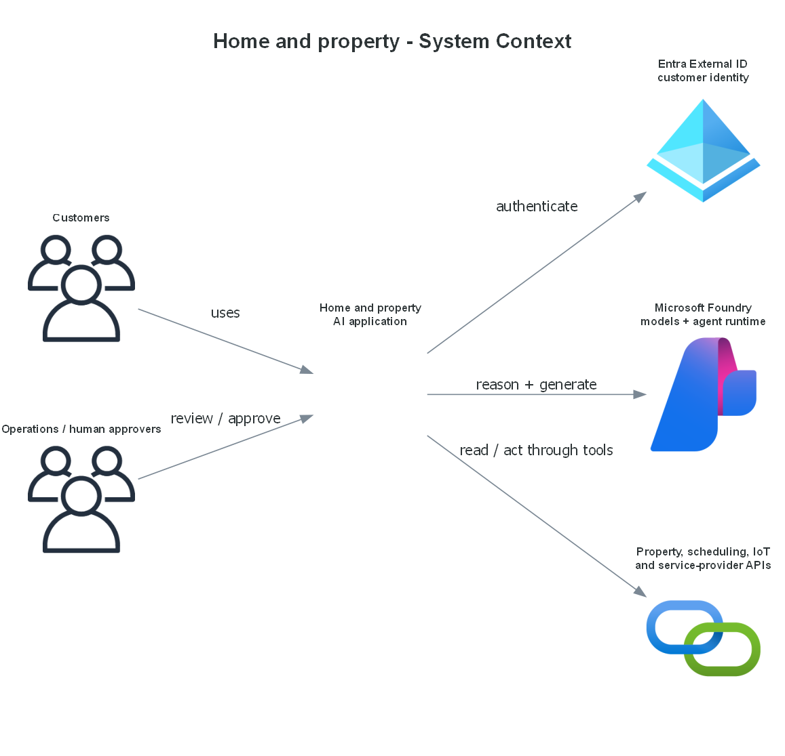

### 2. Runtime and transaction flow

Shows synchronous ingress, structured model reasoning, controlled tool calls, durable workflow state and asynchronous retry/compensation.

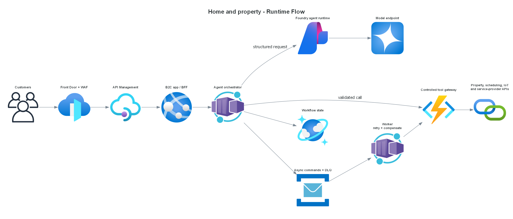

### 3. Security, data and operations

Shows identity, managed authorization, policy and approval gates, grounded retrieval, workflow state, private access, secrets and redacted telemetry.

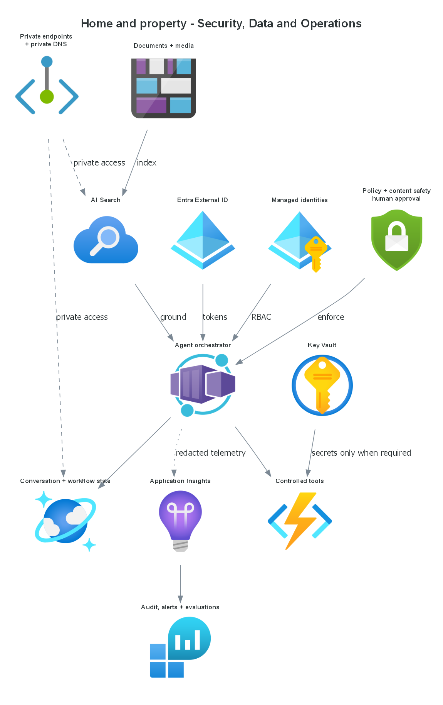

**Notation:** solid arrows are primary runtime/data flows. Dashed arrows represent identity, policy, secrets or private-network controls. Dotted arrows represent telemetry. The diagrams deliberately split concerns to avoid an unreadable “everything” diagram.

<!-- category-architecture:auto -->
## Category deployment architecture

This Azure-oriented deployment separates deterministic business operations from probabilistic model reasoning. The application owns authorization, validation, workflow state and approval; the model proposes actions only through allowlisted tools.

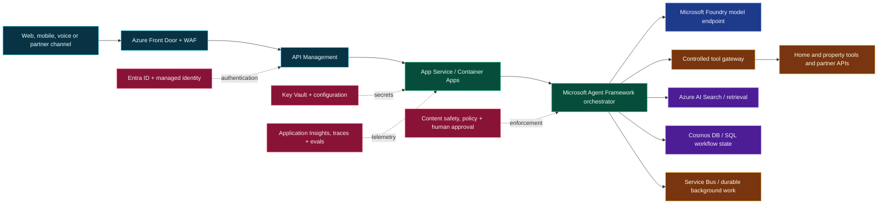

**Responsibility split**

- **Edge and API layer:** authentication, quotas, request validation and tenant routing.
- **Application/orchestration layer:** deterministic workflow, retries, approvals, state and tool authorization.
- **Model layer:** language understanding, planning and explanation; it never becomes the system of record.
- **Tool layer:** narrow typed operations with idempotency, schema validation and audit events.
- **Data layer:** retrieval indexes are separate from transactional state and sensitive records.
- **Control plane:** identity, secrets, policy, privacy, observability and evaluations apply across every request.

## 33. Home-services booking assistant

### Purpose and user journey
Finds, vets, and books home-service providers such as plumbers, cleaners, and electricians. The user describes the job, receives quotes and availability from vetted providers, compares them, books a slot, and follows up after the visit.

### Reference architecture
`Chat/photos -> Job intake agent -> Provider search -> Quote/availability connectors -> Comparison -> Approval -> Booking/follow-up`

<!-- architecture-diagram:auto -->
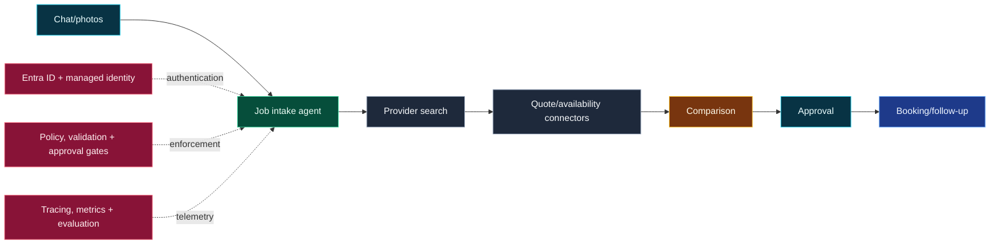

<!-- main-logic:auto -->
**Main execution logic**

1. **Authenticate and validate:** the edge/API layer verifies identity, tenant, request schema, quotas and correlation ID before agent execution.
2. **Load trusted context:** the application loads the minimum required profile, conversation checkpoint, domain state and authorization scope; sensitive fields stay outside prompts unless necessary.
3. **Plan with bounded authority:** the Foundry/Agent Framework adapter receives only allowlisted tool schemas and returns a structured proposal. The app-specific path is `Chat/photos -> Job intake agent -> Provider search -> Quote/availability connectors -> Comparison -> Approval -> Booking/follow-up`.
4. **Ground every decision:** current facts such as price, availability, policy, entitlement or status come from retrieval and typed tools—not model memory.
5. **Apply deterministic policy:** code validates tool name, arguments, user authority, limits, risk class and output schema. Invalid proposals are rejected and audited.
6. **Approve consequential actions:** writes, purchases, bookings, messages, account changes and other high-impact operations pause for explicit human approval.
7. **Execute safely:** the controlled gateway invokes the narrow business operation with an idempotency key, timeout, bounded retry and compensation or dead-letter behavior.
8. **Commit and learn:** persist the result, return a source-grounded response, emit redacted traces and feed curated outcomes into regression evaluations.

**Runnable code pattern:** [C# policy, approval, idempotency and audit sample](../../samples/agent-workflow-csharp/README.md).

### Core components
Job intake with photos, service taxonomy, provider directory with license and review checks, quote requester, scheduling engine, comparison view, booking and payment handoff, and post-job review collector.

### Agent/workflow design
The agent clarifies scope, urgency, and access, produces a structured job brief, and requests quotes from matched providers. It normalizes price and scope differences, recommends top options, and books only after the user confirms.

### Data and integrations
Integrates service marketplaces, license registries, review sources, calendars, messaging, and payment providers. Stores job briefs, photos, quotes, appointments, and the household's access instructions.

### Security and safety
Verify licenses and insurance where possible. Share addresses only after booking, protect entry codes, and warn about scams and upfront large payments. Escalate emergencies such as gas leaks to emergency services immediately.

### Reliability, observability and evaluation
Track provider response time, no-shows, and quote variance. Use reminders and rescheduling flows. Evaluate job-brief completeness, provider-match relevance, and satisfaction outcomes, and audit for biased ranking.

### MVP build path
Begin with one service category and a local provider directory, producing a job brief and quote-request emails. Add scheduling and comparison, then license verification, then booking, payments, and review follow-up.

## 34. Home-repair diagnostic assistant

### Purpose and user journey
Helps homeowners diagnose problems and decide between DIY and a professional. The user describes symptoms or uploads photos, answers targeted questions, receives likely causes with safety guidance, and gets a repair plan or a provider handoff.

### Reference architecture
`Symptoms/photos -> Triage agent -> Diagnostic knowledge retrieval -> Risk classifier -> Repair guide or pro referral -> Parts/tool list`

<!-- architecture-diagram:auto -->
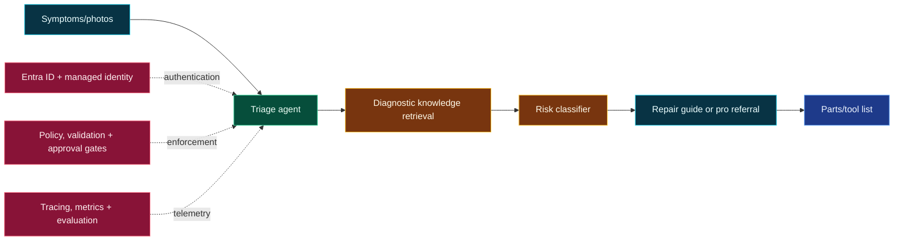

<!-- main-logic:auto -->
**Main execution logic**

1. **Authenticate and validate:** the edge/API layer verifies identity, tenant, request schema, quotas and correlation ID before agent execution.
2. **Load trusted context:** the application loads the minimum required profile, conversation checkpoint, domain state and authorization scope; sensitive fields stay outside prompts unless necessary.
3. **Plan with bounded authority:** the Foundry/Agent Framework adapter receives only allowlisted tool schemas and returns a structured proposal. The app-specific path is `Symptoms/photos -> Triage agent -> Diagnostic knowledge retrieval -> Risk classifier -> Repair guide or pro referral -> Parts/tool list`.
4. **Ground every decision:** current facts such as price, availability, policy, entitlement or status come from retrieval and typed tools—not model memory.
5. **Apply deterministic policy:** code validates tool name, arguments, user authority, limits, risk class and output schema. Invalid proposals are rejected and audited.
6. **Approve consequential actions:** writes, purchases, bookings, messages, account changes and other high-impact operations pause for explicit human approval.
7. **Execute safely:** the controlled gateway invokes the narrow business operation with an idempotency key, timeout, bounded retry and compensation or dead-letter behavior.
8. **Commit and learn:** persist the result, return a source-grounded response, emit redacted traces and feed curated outcomes into regression evaluations.

**Runnable code pattern:** [C# policy, approval, idempotency and audit sample](../../samples/agent-workflow-csharp/README.md).

### Core components
Multimodal intake, symptom question flow, repair knowledge base, hazard and risk classifier, cause ranker, step-by-step guide generator, parts and tools list builder, and a referral connector.

### Agent/workflow design
The triage agent first screens for hazards such as gas, electrical, structural, or mold. For safe cases, it asks discriminating questions, ranks causes with confidence, and offers guided steps; otherwise it recommends a licensed professional.

### Data and integrations
Uses vetted repair manuals, manufacturer documentation, building-code references, product databases, and retailers for parts. Stores case history, appliance model data, and photos, linked to the home-services assistant.

### Security and safety
Hard-coded safety rules override model output for gas, high-voltage electrical, asbestos, and structural issues. State uncertainty, avoid illegal or code-violating advice, and require shut-off and PPE reminders. Protect photos that show private interiors.

### Reliability, observability and evaluation
Log hazard classifications and escalation outcomes. Evaluate diagnosis accuracy on expert-labeled cases, safety-rule recall, and guide correctness with tradesperson review. Track follow-up success reports.

### MVP build path
Launch with a few common issues such as leaky faucets and tripped breakers, using text and photos with hard safety gates. Add model-specific manuals, then parts lists, then professional handoff and broader categories.

## 35. Property-search assistant

### Purpose and user journey
Helps buyers find homes matching budget, location, and lifestyle. The user describes needs, reviews ranked listings with neighborhood insights, saves favorites, gets alerts on new matches, and arranges viewings.

### Reference architecture
`Chat UI -> Requirement parser -> Listing search (MLS/portal) -> Neighborhood enrichment -> Ranker -> Alerts -> Viewing scheduler`

<!-- architecture-diagram:auto -->
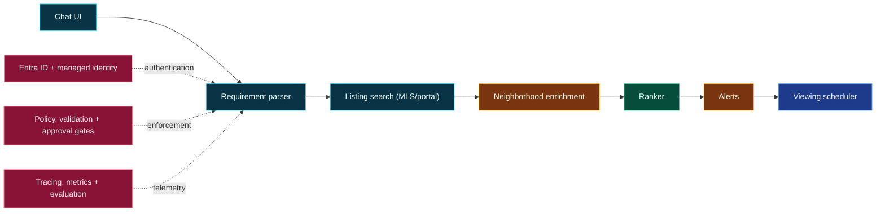

<!-- main-logic:auto -->
**Main execution logic**

1. **Authenticate and validate:** the edge/API layer verifies identity, tenant, request schema, quotas and correlation ID before agent execution.
2. **Load trusted context:** the application loads the minimum required profile, conversation checkpoint, domain state and authorization scope; sensitive fields stay outside prompts unless necessary.
3. **Plan with bounded authority:** the Foundry/Agent Framework adapter receives only allowlisted tool schemas and returns a structured proposal. The app-specific path is `Chat UI -> Requirement parser -> Listing search (MLS/portal) -> Neighborhood enrichment -> Ranker -> Alerts -> Viewing scheduler`.
4. **Ground every decision:** current facts such as price, availability, policy, entitlement or status come from retrieval and typed tools—not model memory.
5. **Apply deterministic policy:** code validates tool name, arguments, user authority, limits, risk class and output schema. Invalid proposals are rejected and audited.
6. **Approve consequential actions:** writes, purchases, bookings, messages, account changes and other high-impact operations pause for explicit human approval.
7. **Execute safely:** the controlled gateway invokes the narrow business operation with an idempotency key, timeout, bounded retry and compensation or dead-letter behavior.
8. **Commit and learn:** persist the result, return a source-grounded response, emit redacted traces and feed curated outcomes into regression evaluations.

**Runnable code pattern:** [C# policy, approval, idempotency and audit sample](../../samples/agent-workflow-csharp/README.md).

### Core components
Needs parser, listing search and deduplication, commute and amenity calculator, neighborhood data enricher, affordability estimator, ranker, saved-search alerts, and viewing scheduler.

### Agent/workflow design
The agent converts natural language into structured filters, expands soft preferences, and retrieves listings. It ranks with transparent tradeoffs, summarizes listing text with flags for missing information, and drafts viewing requests for approval.

### Data and integrations
Integrates licensed MLS or portal feeds, mapping and commute APIs, school, crime, flood, and noise datasets, mortgage calculators, and agent calendars. Stores searches, favorites, and feedback.

### Security and safety
Comply with fair-housing rules: do not steer based on protected characteristics, and be careful with neighborhood demographics. Treat financial data as sensitive, cite data sources, and state that estimates are not financial advice.

### Reliability, observability and evaluation
Refresh listings frequently and detect stale or sold entries. Track alert precision, saved-listing rates, and viewing conversions. Evaluate retrieval relevance, estimate accuracy, and bias with fair-housing test prompts.

### MVP build path
Build structured plus natural-language search on one data feed with map results. Add commute and neighborhood enrichment, then saved alerts, then affordability analysis, then viewing scheduling and agent handoff.

## 36. Rental assistant

### Purpose and user journey
Helps renters find apartments and manage the rental process. The user sets budget and needs, sees vetted listings with true monthly cost, receives scam warnings, schedules tours, and gets help with applications and lease questions.

### Reference architecture
`Chat UI -> Rental listing search -> Scam/cost analyzer -> Tour scheduler -> Application assistant -> Lease explainer`

<!-- architecture-diagram:auto -->
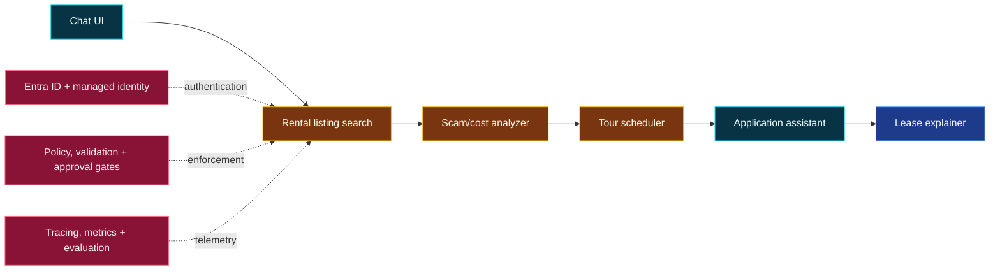

<!-- main-logic:auto -->
**Main execution logic**

1. **Authenticate and validate:** the edge/API layer verifies identity, tenant, request schema, quotas and correlation ID before agent execution.
2. **Load trusted context:** the application loads the minimum required profile, conversation checkpoint, domain state and authorization scope; sensitive fields stay outside prompts unless necessary.
3. **Plan with bounded authority:** the Foundry/Agent Framework adapter receives only allowlisted tool schemas and returns a structured proposal. The app-specific path is `Chat UI -> Rental listing search -> Scam/cost analyzer -> Tour scheduler -> Application assistant -> Lease explainer`.
4. **Ground every decision:** current facts such as price, availability, policy, entitlement or status come from retrieval and typed tools—not model memory.
5. **Apply deterministic policy:** code validates tool name, arguments, user authority, limits, risk class and output schema. Invalid proposals are rejected and audited.
6. **Approve consequential actions:** writes, purchases, bookings, messages, account changes and other high-impact operations pause for explicit human approval.
7. **Execute safely:** the controlled gateway invokes the narrow business operation with an idempotency key, timeout, bounded retry and compensation or dead-letter behavior.
8. **Commit and learn:** persist the result, return a source-grounded response, emit redacted traces and feed curated outcomes into regression evaluations.

**Runnable code pattern:** [C# policy, approval, idempotency and audit sample](../../samples/agent-workflow-csharp/README.md).

### Core components
Listing aggregator, true-cost calculator for fees and utilities, scam and anomaly detector, commute scorer, tour scheduler, application checklist, document vault, and lease clause explainer.

### Agent/workflow design
The agent retrieves listings, extracts fees and policies, and flags suspicious signs such as below-market rent or wire-transfer requests. It ranks by total cost and fit, and drafts inquiry messages that the user approves before sending.

### Data and integrations
Integrates rental listing feeds, maps, utility and transit data, calendars, messaging, and tenant-screening or document-upload services. Stores searches, applications, and lease documents securely.

### Security and safety
Encrypt IDs, income proofs, and leases, and share them only with explicit consent and verified landlords. Warn on scams and illegal fees. Provide lease explanations as information, not legal advice, with local tenant-rights resources.

### Reliability, observability and evaluation
Remove stale listings and deduplicate across sources. Track scam-flag precision, tour completion, and message response. Evaluate fee extraction accuracy, lease clause explanations against attorney review, and fair-housing compliance.

### MVP build path
Start with listing search, true-cost calculation, and scam flags. Add inquiry drafting and tour scheduling, then an application checklist and secure document vault, then lease clause analysis and tenant-rights guidance.

## 37. Moving and relocation assistant

### Purpose and user journey
Organizes a move from decision to settling in. The user enters origin, destination, and date; the assistant builds a timeline, compares movers, tracks tasks, handles address changes, and supplies a destination setup checklist.

### Reference architecture
`Move brief -> Planner agent -> Mover quotes/inventory tools -> Task timeline -> Address-change workflows -> Destination setup guide`

<!-- architecture-diagram:auto -->
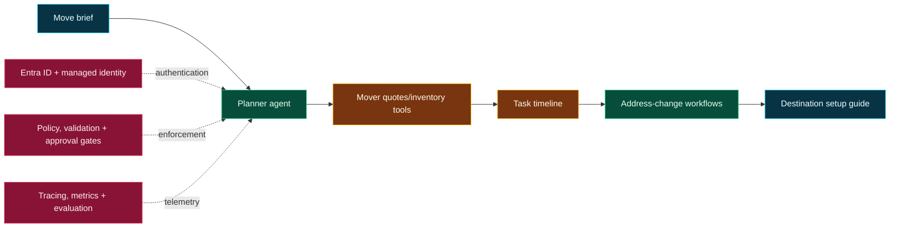

<!-- main-logic:auto -->
**Main execution logic**

1. **Authenticate and validate:** the edge/API layer verifies identity, tenant, request schema, quotas and correlation ID before agent execution.
2. **Load trusted context:** the application loads the minimum required profile, conversation checkpoint, domain state and authorization scope; sensitive fields stay outside prompts unless necessary.
3. **Plan with bounded authority:** the Foundry/Agent Framework adapter receives only allowlisted tool schemas and returns a structured proposal. The app-specific path is `Move brief -> Planner agent -> Mover quotes/inventory tools -> Task timeline -> Address-change workflows -> Destination setup guide`.
4. **Ground every decision:** current facts such as price, availability, policy, entitlement or status come from retrieval and typed tools—not model memory.
5. **Apply deterministic policy:** code validates tool name, arguments, user authority, limits, risk class and output schema. Invalid proposals are rejected and audited.
6. **Approve consequential actions:** writes, purchases, bookings, messages, account changes and other high-impact operations pause for explicit human approval.
7. **Execute safely:** the controlled gateway invokes the narrow business operation with an idempotency key, timeout, bounded retry and compensation or dead-letter behavior.
8. **Commit and learn:** persist the result, return a source-grounded response, emit redacted traces and feed curated outcomes into regression evaluations.

**Runnable code pattern:** [C# policy, approval, idempotency and audit sample](../../samples/agent-workflow-csharp/README.md).

### Core components
Move brief intake, inventory estimator, mover quote requester, backward-planned task timeline, address-change tracker, utilities setup checklist, budget tracker, and reminders.

### Agent/workflow design
The agent estimates volume from rooms or photos, requests comparable quotes, and builds a dated checklist that adapts to lease ends and deadlines. It drafts notices and utility requests and tracks completion across parties.

### Data and integrations
Integrates mover marketplaces, postal change-of-address, utility and internet provider lookups, calendars, and local-info sources for the new area. Stores inventory, quotes, contracts, and task states.

### Security and safety
Protect new and old addresses, as moves signal vacant homes. Verify mover licensing and insurance, warn about deposits and hostage-load scams, and require approval before submitting forms or sharing data.

### Reliability, observability and evaluation
Timeline reminders with escalation for critical tasks. Track task completion, quote variance, and move-day issues. Evaluate inventory estimate accuracy, checklist completeness by region, and quote comparability.

### MVP build path
Begin with a personalized timeline and checklist generator. Add inventory estimates and mover quote requests, then address-change and utilities workflows, then budget tracking and destination orientation content.

## 38. Interior-design assistant

### Purpose and user journey
Helps users plan and visualize room designs. The user uploads room photos and dimensions, states style and budget, receives layout and palette concepts with shoppable items, and refines them iteratively.

### Reference architecture
`Room photos/dims -> Vision analyzer -> Design agent -> Layout checker -> Product catalog search -> Render/mood board -> Shopping list`

<!-- architecture-diagram:auto -->
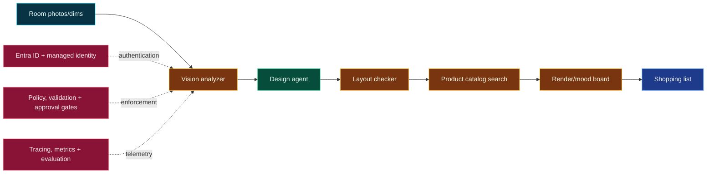

<!-- main-logic:auto -->
**Main execution logic**

1. **Authenticate and validate:** the edge/API layer verifies identity, tenant, request schema, quotas and correlation ID before agent execution.
2. **Load trusted context:** the application loads the minimum required profile, conversation checkpoint, domain state and authorization scope; sensitive fields stay outside prompts unless necessary.
3. **Plan with bounded authority:** the Foundry/Agent Framework adapter receives only allowlisted tool schemas and returns a structured proposal. The app-specific path is `Room photos/dims -> Vision analyzer -> Design agent -> Layout checker -> Product catalog search -> Render/mood board -> Shopping list`.
4. **Ground every decision:** current facts such as price, availability, policy, entitlement or status come from retrieval and typed tools—not model memory.
5. **Apply deterministic policy:** code validates tool name, arguments, user authority, limits, risk class and output schema. Invalid proposals are rejected and audited.
6. **Approve consequential actions:** writes, purchases, bookings, messages, account changes and other high-impact operations pause for explicit human approval.
7. **Execute safely:** the controlled gateway invokes the narrow business operation with an idempotency key, timeout, bounded retry and compensation or dead-letter behavior.
8. **Commit and learn:** persist the result, return a source-grounded response, emit redacted traces and feed curated outcomes into regression evaluations.

**Runnable code pattern:** [C# policy, approval, idempotency and audit sample](../../samples/agent-workflow-csharp/README.md).

### Core components
Room and object detection, dimension and layout validator, style profile, palette generator, furniture and decor catalog search, image generation or compositing, budget tracker, and shopping list.

### Agent/workflow design
The agent interprets the room, proposes two or three concepts, and validates furniture against measured clearances and walkways. Users refine by chat, and the agent re-searches products within budget and updates renders.

### Data and integrations
Integrates retailer product feeds, image generation or AR services, measurement tools, and color databases. Stores room models, style choices, saved products, and projects, with photos kept private.

### Security and safety
Strip photo metadata and protect home images. Label generated renders as concept art, not exact outcomes. Respect product dimensions and safety, such as load-bearing and fire clearances, and disclose affiliate links.

### Reliability, observability and evaluation
Validate dimensions before suggesting items and handle discontinued products. Track concept selection, purchases, and re-edit rates. Evaluate layout feasibility, style adherence, budget compliance, and render faithfulness with design-expert review.

### MVP build path
Start with a style questionnaire, one room's dimensions, and palette plus product suggestions. Add photo analysis and layout validation, then image mood boards, then multi-retailer shopping lists and AR preview.

## 39. Smart-home support assistant

### Purpose and user journey
Helps users set up, troubleshoot, and automate smart-home devices. The user reports a problem or goal, the assistant inspects device status, walks through diagnostics, fixes issues, and proposes automations in plain language.

### Reference architecture
`Chat UI -> Support agent -> Device inventory/status tools -> Diagnostic knowledge base -> Fix executor -> Automation builder`

<!-- architecture-diagram:auto -->
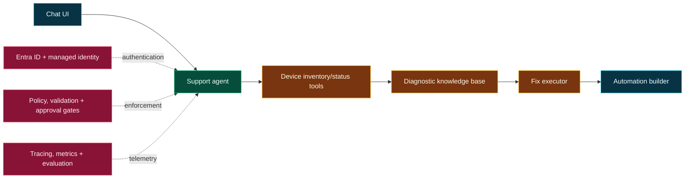

<!-- main-logic:auto -->
**Main execution logic**

1. **Authenticate and validate:** the edge/API layer verifies identity, tenant, request schema, quotas and correlation ID before agent execution.
2. **Load trusted context:** the application loads the minimum required profile, conversation checkpoint, domain state and authorization scope; sensitive fields stay outside prompts unless necessary.
3. **Plan with bounded authority:** the Foundry/Agent Framework adapter receives only allowlisted tool schemas and returns a structured proposal. The app-specific path is `Chat UI -> Support agent -> Device inventory/status tools -> Diagnostic knowledge base -> Fix executor -> Automation builder`.
4. **Ground every decision:** current facts such as price, availability, policy, entitlement or status come from retrieval and typed tools—not model memory.
5. **Apply deterministic policy:** code validates tool name, arguments, user authority, limits, risk class and output schema. Invalid proposals are rejected and audited.
6. **Approve consequential actions:** writes, purchases, bookings, messages, account changes and other high-impact operations pause for explicit human approval.
7. **Execute safely:** the controlled gateway invokes the narrow business operation with an idempotency key, timeout, bounded retry and compensation or dead-letter behavior.
8. **Commit and learn:** persist the result, return a source-grounded response, emit redacted traces and feed curated outcomes into regression evaluations.

**Runnable code pattern:** [C# policy, approval, idempotency and audit sample](../../samples/agent-workflow-csharp/README.md).

### Core components
Device inventory and topology map, status and log reader, diagnostic knowledge base, guided troubleshooting flows, automation rule builder, firmware and compatibility checker, and escalation to vendor support.

### Agent/workflow design
The agent identifies the affected device, reads status and connectivity data, and tests hypotheses in order from power and network to hub and app. Low-risk fixes run after consent; automations are drafted, simulated, and approved.

### Data and integrations
Integrates Matter, Home Assistant, and vendor cloud APIs, router and network diagnostics, manufacturer manuals, and voice assistants. Stores device graphs, event logs, and automation definitions locally where possible.

### Security and safety
Use least-privilege device scopes and local processing where possible. Require confirmation for locks, alarms, cameras, heating, and garage doors. Never expose credentials, validate firmware sources, and keep emergency devices out of automated changes.

### Reliability, observability and evaluation
Support offline and partial-connectivity modes, with rollback for changed settings. Track resolution rate, time to fix, and automation failures. Evaluate diagnoses on simulated device faults and safety tests for risky actions.

### MVP build path
Start with read-only diagnostics for one platform such as Home Assistant, using a troubleshooting knowledge base. Add guided fixes with consent, then natural-language automation drafting and simulation, then multi-vendor support and vendor escalation.
