# Finance, insurance, legal and automotive architecture overviews

<!-- azure-icon-views:auto -->
## Azure architecture views

These are **logical reference views**, not a claim that every app needs every service. Select services from the non-functional requirements, traffic, data classification and team constraints.

### 1. System context

Shows the customer, human approver, B2C AI system, identity provider, Microsoft Foundry and domain systems.

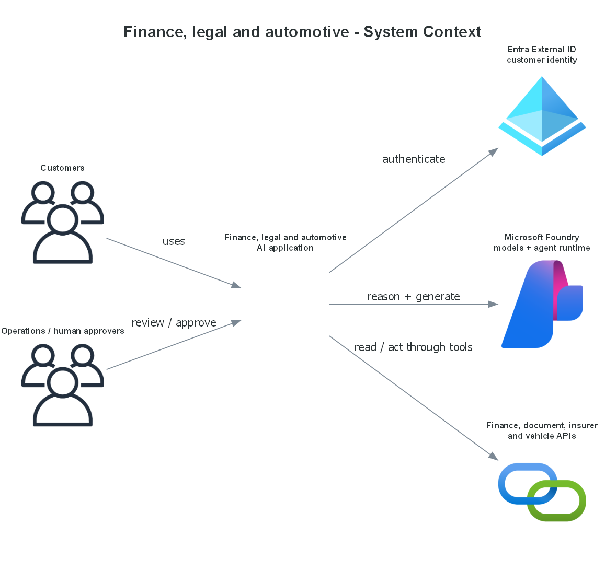

### 2. Runtime and transaction flow

Shows synchronous ingress, structured model reasoning, controlled tool calls, durable workflow state and asynchronous retry/compensation.

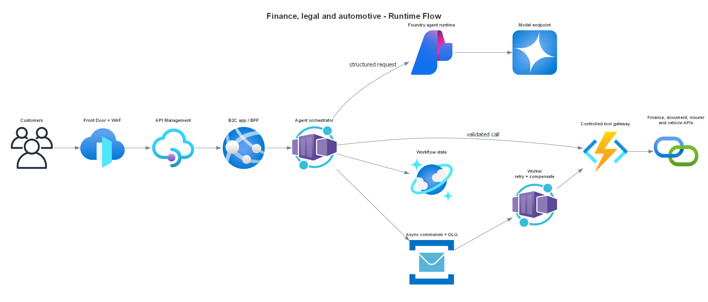

### 3. Security, data and operations

Shows identity, managed authorization, policy and approval gates, grounded retrieval, workflow state, private access, secrets and redacted telemetry.

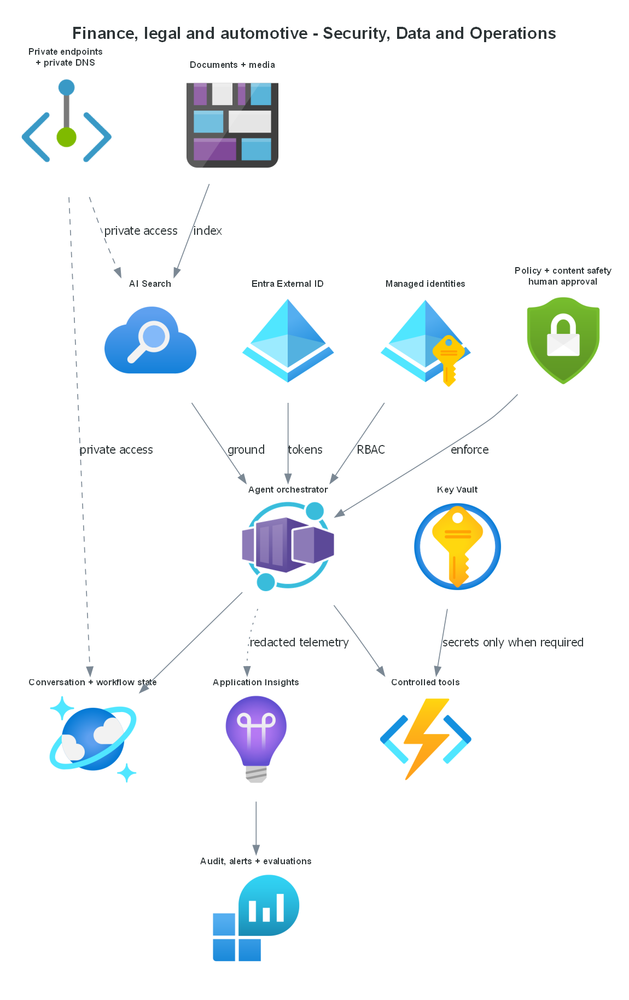

**Notation:** solid arrows are primary runtime/data flows. Dashed arrows represent identity, policy, secrets or private-network controls. Dotted arrows represent telemetry. The diagrams deliberately split concerns to avoid an unreadable “everything” diagram.

<!-- category-architecture:auto -->
## Category deployment architecture

This Azure-oriented deployment separates deterministic business operations from probabilistic model reasoning. The application owns authorization, validation, workflow state and approval; the model proposes actions only through allowlisted tools.

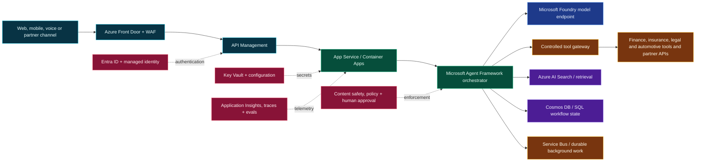

**Responsibility split**

- **Edge and API layer:** authentication, quotas, request validation and tenant routing.
- **Application/orchestration layer:** deterministic workflow, retries, approvals, state and tool authorization.
- **Model layer:** language understanding, planning and explanation; it never becomes the system of record.
- **Tool layer:** narrow typed operations with idempotency, schema validation and audit events.
- **Data layer:** retrieval indexes are separate from transactional state and sensitive records.
- **Control plane:** identity, secrets, policy, privacy, observability and evaluations apply across every request.

## 40. Personal finance coach

**Purpose and user journey.** A proposed assistant that gives a household one coherent view of its finances and a prioritized plan. The user connects or enters balances, income, debts and goals, receives a ranked action list (emergency fund, high-interest debt, employer retirement match), then returns for monthly check-ins that track progress and adjust the plan.

**Reference architecture.** `Web/mobile chat -> API gateway -> orchestrator agent -> [finance calc engine | data aggregator | knowledge base] -> encrypted store -> audit log`

<!-- architecture-diagram:auto -->
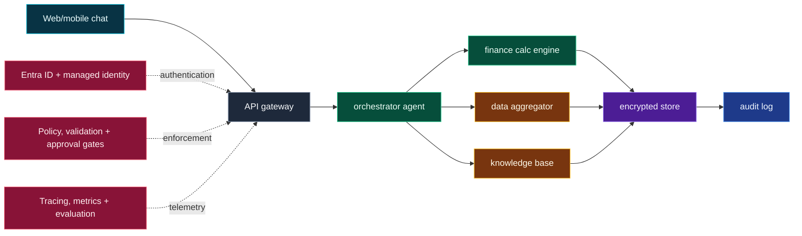

<!-- main-logic:auto -->
**Main execution logic**

1. **Authenticate and validate:** the edge/API layer verifies identity, tenant, request schema, quotas and correlation ID before agent execution.
2. **Load trusted context:** the application loads the minimum required profile, conversation checkpoint, domain state and authorization scope; sensitive fields stay outside prompts unless necessary.
3. **Plan with bounded authority:** the Foundry/Agent Framework adapter receives only allowlisted tool schemas and returns a structured proposal. The app-specific path is `Web/mobile chat -> API gateway -> orchestrator agent -> [finance calc engine | data aggregator | knowledge base] -> encrypted store -> audit log`.
4. **Ground every decision:** current facts such as price, availability, policy, entitlement or status come from retrieval and typed tools—not model memory.
5. **Apply deterministic policy:** code validates tool name, arguments, user authority, limits, risk class and output schema. Invalid proposals are rejected and audited.
6. **Approve consequential actions:** writes, purchases, bookings, messages, account changes and other high-impact operations pause for explicit human approval.
7. **Execute safely:** the controlled gateway invokes the narrow business operation with an idempotency key, timeout, bounded retry and compensation or dead-letter behavior.
8. **Commit and learn:** persist the result, return a source-grounded response, emit redacted traces and feed curated outcomes into regression evaluations.

**Runnable code pattern:** [C# policy, approval, idempotency and audit sample](../../samples/agent-workflow-csharp/README.md).

**Core components.** Conversation UI; profile and goal service; deterministic calculation engine (net worth, debt payoff, savings runway); account-aggregation connector; curated education knowledge base; plan store with versioning; notification scheduler; consent and audit service.

**Agent/workflow design.** One orchestrator agent routes to specialist tools rather than free-form reasoning. Arithmetic always goes through the calculation engine, never the model. Workflow: intake, data validation, priority rules (documented, human-reviewable), plan generation, plain-language explanation, monthly review loop.

**Data and integrations.** Inputs: user-entered figures, optional open-banking aggregation (read-only), CSV statement import. Outputs: plan documents, reminders, exports.

**Security and safety.** Regulated-domain caution: personalized investment, tax or credit recommendations can trigger licensing duties (for example adviser regulation) depending on jurisdiction; obtain legal review before launch. Use explicit consent, encryption at rest and in transit, read-only bank tokens, PII redaction in logs, no product commissions that bias advice, and prominent disclaimers. Block requests for guaranteed returns or market timing.

**Reliability, observability and evaluation.** Track tool-call traces, calculation-versus-model mismatches, and plan-change diffs. Evaluate with a golden set of household scenarios checked by a qualified reviewer, regression tests on the calculator, and red-team prompts for unsuitable advice.

**MVP build path.** Phase 1: manual-entry intake, calculator and rule-based priority plan with LLM explanation. Phase 2: CSV import and monthly check-ins. Phase 3: read-only aggregation, adviser-review mode, and pilot with a small consented cohort before any wider release.

## 41. Budget-planning assistant

**Purpose and user journey.** A proposed tool that helps a user build a realistic monthly or annual budget from income, fixed obligations and priorities. Journey: describe income and commitments (or import history), receive a draft budget using a chosen method (zero-based, 50/30/20, envelope), adjust categories conversationally, then get alerts when plans drift.

**Reference architecture.** `Chat UI -> budget agent -> [category model | budget engine | forecast module] -> ledger store -> alerts service`

<!-- architecture-diagram:auto -->
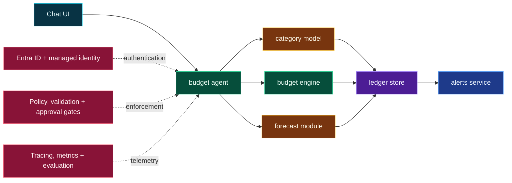

<!-- main-logic:auto -->
**Main execution logic**

1. **Authenticate and validate:** the edge/API layer verifies identity, tenant, request schema, quotas and correlation ID before agent execution.
2. **Load trusted context:** the application loads the minimum required profile, conversation checkpoint, domain state and authorization scope; sensitive fields stay outside prompts unless necessary.
3. **Plan with bounded authority:** the Foundry/Agent Framework adapter receives only allowlisted tool schemas and returns a structured proposal. The app-specific path is `Chat UI -> budget agent -> [category model | budget engine | forecast module] -> ledger store -> alerts service`.
4. **Ground every decision:** current facts such as price, availability, policy, entitlement or status come from retrieval and typed tools—not model memory.
5. **Apply deterministic policy:** code validates tool name, arguments, user authority, limits, risk class and output schema. Invalid proposals are rejected and audited.
6. **Approve consequential actions:** writes, purchases, bookings, messages, account changes and other high-impact operations pause for explicit human approval.
7. **Execute safely:** the controlled gateway invokes the narrow business operation with an idempotency key, timeout, bounded retry and compensation or dead-letter behavior.
8. **Commit and learn:** persist the result, return a source-grounded response, emit redacted traces and feed curated outcomes into regression evaluations.

**Runnable code pattern:** [C# policy, approval, idempotency and audit sample](../../samples/agent-workflow-csharp/README.md).

**Core components.** Budget engine with category hierarchy and period rollover; income and irregular-expense forecaster; scenario simulator ("what if rent rises 8%?"); conversational editor translating requests into structured diffs; template library; alerting service; export module.

**Agent/workflow design.** A planner agent proposes a draft, a validator checks that totals balance and nothing is negative, and the user approves before commit. Every change is a structured patch applied by the engine, so the model never edits numbers directly.

**Data and integrations.** Sources: manual entry, CSV or bank-feed transactions, calendar of bills. Integrations: optional read-only aggregation, spreadsheet export, push or email notifications.

**Security and safety.** Regulated-domain caution: budgeting guidance is generally educational, but avoid recommending specific credit, loan or investment products, and avoid debt-settlement advice that could amount to regulated activity. Apply data minimisation, encrypted storage, consent for each data source, deletion on request, and clear statements that outputs are estimates. Handle financial-distress signals with links to non-profit debt help.

**Reliability, observability and evaluation.** Monitor validation failures, patch rejection rates, forecast error (predicted versus actual spend), and alert usefulness. Evaluate with synthetic households, property tests ensuring budgets always reconcile, and human review of tone for users in hardship.

**MVP build path.** Phase 1: manual budget builder with deterministic engine and chat editing. Phase 2: CSV import, category suggestions, drift alerts. Phase 3: forecasting, shared household budgets, and optional bank-feed connection after a security review.

## 42. Spending-analysis assistant

**Purpose and user journey.** A proposed assistant that turns raw transactions into understandable insight. The user uploads or links transactions, sees categorized spending, trends, recurring charges and anomalies, asks natural-language questions ("why was March higher?"), and receives suggestions for review rather than orders.

**Reference architecture.** `Transaction feed -> normalizer -> categorizer -> analytics store (SQL) -> query agent -> insights UI`

<!-- architecture-diagram:auto -->
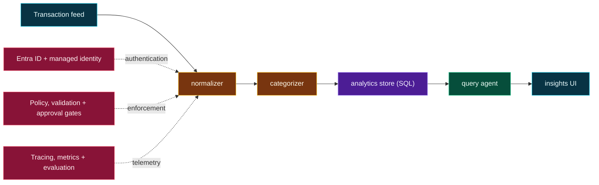

<!-- main-logic:auto -->
**Main execution logic**

1. **Authenticate and validate:** the edge/API layer verifies identity, tenant, request schema, quotas and correlation ID before agent execution.
2. **Load trusted context:** the application loads the minimum required profile, conversation checkpoint, domain state and authorization scope; sensitive fields stay outside prompts unless necessary.
3. **Plan with bounded authority:** the Foundry/Agent Framework adapter receives only allowlisted tool schemas and returns a structured proposal. The app-specific path is `Transaction feed -> normalizer -> categorizer -> analytics store (SQL) -> query agent -> insights UI`.
4. **Ground every decision:** current facts such as price, availability, policy, entitlement or status come from retrieval and typed tools—not model memory.
5. **Apply deterministic policy:** code validates tool name, arguments, user authority, limits, risk class and output schema. Invalid proposals are rejected and audited.
6. **Approve consequential actions:** writes, purchases, bookings, messages, account changes and other high-impact operations pause for explicit human approval.
7. **Execute safely:** the controlled gateway invokes the narrow business operation with an idempotency key, timeout, bounded retry and compensation or dead-letter behavior.
8. **Commit and learn:** persist the result, return a source-grounded response, emit redacted traces and feed curated outcomes into regression evaluations.

**Runnable code pattern:** [C# policy, approval, idempotency and audit sample](../../samples/agent-workflow-csharp/README.md).

**Core components.** Ingestion and deduplication pipeline; merchant normalizer; hybrid categorizer (rules, then model, then user correction); subscription and recurring-charge detector; anomaly detector; text-to-SQL query layer over a read-only analytics schema; chart and report generator.

**Agent/workflow design.** The query agent translates questions into parameterized, read-only SQL against a curated schema, executes it, and explains the returned rows. Numbers in answers are always quoted from query results. A categorization agent handles low-confidence merchants and queues them for user confirmation; corrections feed back as rules. Workflow: ingest, normalize, categorize, aggregate, detect, explain.

**Data and integrations.** Inputs: CSV/OFX/QIF files, optional open-banking feeds, receipts. Outputs: dashboards, CSV exports, monthly digests.

**Security and safety.** Regulated-domain caution: transaction data reveals sensitive attributes (health, religion, relationships); treat as high-risk personal data under GDPR-style rules, avoid inferring protected characteristics, and never use it for credit or eligibility decisions without compliance review. Enforce read-only SQL roles, row-level tenant isolation, SQL allow-lists, prompt-injection filtering of merchant strings, encryption, and retention limits.

**Reliability, observability and evaluation.** Measure categorization accuracy against labeled samples, query-correctness via execution-based tests, latency, and correction rates. Log generated SQL for audit. Run regression suites when models or schemas change, and show confidence indicators to users. Retry ingestion idempotently.

**MVP build path.** Phase 1: CSV upload, rule-based categories, dashboards. Phase 2: LLM categorization with correction loop and text-to-SQL Q&A. Phase 3: recurring detection, anomaly alerts, and bank-feed integration with penetration testing.

## 43. Savings-goal coach

**Purpose and user journey.** A proposed coach that helps users define, size and keep savings goals such as an emergency fund, deposit or holiday. The user states a target and deadline, receives a feasible contribution schedule, sees progress, and gets encouragement and re-planning when life changes.

**Reference architecture.** `Goal intake -> feasibility engine -> schedule planner -> progress tracker -> nudge agent -> notifications`

<!-- architecture-diagram:auto -->
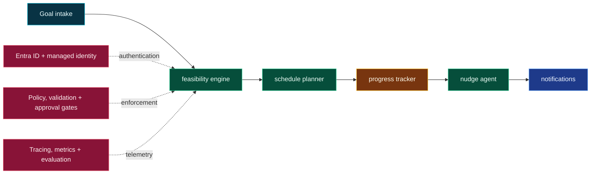

<!-- main-logic:auto -->
**Main execution logic**

1. **Authenticate and validate:** the edge/API layer verifies identity, tenant, request schema, quotas and correlation ID before agent execution.
2. **Load trusted context:** the application loads the minimum required profile, conversation checkpoint, domain state and authorization scope; sensitive fields stay outside prompts unless necessary.
3. **Plan with bounded authority:** the Foundry/Agent Framework adapter receives only allowlisted tool schemas and returns a structured proposal. The app-specific path is `Goal intake -> feasibility engine -> schedule planner -> progress tracker -> nudge agent -> notifications`.
4. **Ground every decision:** current facts such as price, availability, policy, entitlement or status come from retrieval and typed tools—not model memory.
5. **Apply deterministic policy:** code validates tool name, arguments, user authority, limits, risk class and output schema. Invalid proposals are rejected and audited.
6. **Approve consequential actions:** writes, purchases, bookings, messages, account changes and other high-impact operations pause for explicit human approval.
7. **Execute safely:** the controlled gateway invokes the narrow business operation with an idempotency key, timeout, bounded retry and compensation or dead-letter behavior.
8. **Commit and learn:** persist the result, return a source-grounded response, emit redacted traces and feed curated outcomes into regression evaluations.

**Runnable code pattern:** [C# policy, approval, idempotency and audit sample](../../samples/agent-workflow-csharp/README.md).

**Core components.** Goal model (amount, date, priority, flexibility); feasibility and contribution calculator including inflation and interest assumptions; surplus estimator from budget data; progress tracker; milestone and nudge generator; goal-conflict resolver; optional automation hooks for transfers.

**Agent/workflow design.** A coach agent runs a loop: clarify goal, check affordability using the engine, propose two or three options (longer timeline, higher contribution, smaller target), and obtain the user's choice. Weekly check-ins compare actual versus planned; if behind, the agent suggests adjustments instead of guilt-based messaging. Behavioral nudges follow a reviewed library, with frequency caps.

**Data and integrations.** Inputs: goal details, budget surplus, account balances. Integrations: read-only balance sync, optional user-authorized transfer initiation through a payment-initiation provider, calendar reminders.

**Security and safety.** Regulated-domain caution: do not recommend specific savings or investment products without suitability controls and licensing review; projections must be labeled as illustrative. Money movement needs strong authentication, per-transaction confirmation, spending limits, and strict separation of the agent from payment credentials. Avoid manipulative gamification, particularly for vulnerable users, and respect opt-outs.

**Reliability, observability and evaluation.** Track goal-completion rates, nudge opt-out rates, projection accuracy, and failed-transfer incidents. Test the calculator with property-based and known-answer cases, evaluate message tone with reviewers, and simulate missed-contribution scenarios.

**MVP build path.** Phase 1: goal calculator and schedule with manual progress logging. Phase 2: budget integration, check-ins and nudges. Phase 3: read-only balance sync, then optional transfer initiation behind explicit confirmation and a security assessment.

## 44. Insurance-policy assistant

**Purpose and user journey.** A proposed assistant that explains an existing insurance policy and helps users compare coverage with their needs. The user uploads a policy or schedule, asks what is covered, excluded, or required, sees citations to the exact clauses, and receives a list of questions to put to the insurer or broker.

**Reference architecture.** `Policy PDF -> OCR/parse -> clause index -> RAG agent with citations -> answer + gap checklist -> human-handoff`

<!-- architecture-diagram:auto -->
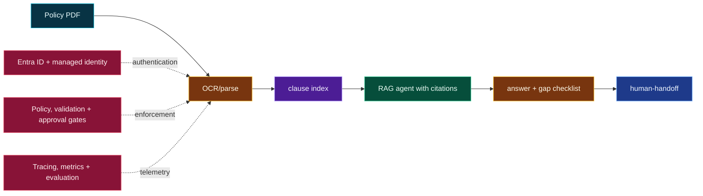

<!-- main-logic:auto -->
**Main execution logic**

1. **Authenticate and validate:** the edge/API layer verifies identity, tenant, request schema, quotas and correlation ID before agent execution.
2. **Load trusted context:** the application loads the minimum required profile, conversation checkpoint, domain state and authorization scope; sensitive fields stay outside prompts unless necessary.
3. **Plan with bounded authority:** the Foundry/Agent Framework adapter receives only allowlisted tool schemas and returns a structured proposal. The app-specific path is `Policy PDF -> OCR/parse -> clause index -> RAG agent with citations -> answer + gap checklist -> human-handoff`.
4. **Ground every decision:** current facts such as price, availability, policy, entitlement or status come from retrieval and typed tools—not model memory.
5. **Apply deterministic policy:** code validates tool name, arguments, user authority, limits, risk class and output schema. Invalid proposals are rejected and audited.
6. **Approve consequential actions:** writes, purchases, bookings, messages, account changes and other high-impact operations pause for explicit human approval.
7. **Execute safely:** the controlled gateway invokes the narrow business operation with an idempotency key, timeout, bounded retry and compensation or dead-letter behavior.
8. **Commit and learn:** persist the result, return a source-grounded response, emit redacted traces and feed curated outcomes into regression evaluations.

**Runnable code pattern:** [C# policy, approval, idempotency and audit sample](../../samples/agent-workflow-csharp/README.md).

**Core components.** Document ingestion with OCR; layout-aware clause segmenter; metadata extractor (limits, excess, dates, endorsements); vector and keyword index; retrieval-augmented answer agent; glossary service; coverage-gap checklist generator; renewal reminder scheduler.

**Agent/workflow design.** A retrieval agent answers only from the uploaded documents, quotes clause references, and says "not found" rather than guessing. A second verifier step checks each claim against cited passages. Workflow: ingest, extract structured terms, confirm with user, answer questions, produce comparison against stated needs, flag ambiguities for professional confirmation.

**Data and integrations.** Inputs: policy wording, schedule, endorsements, renewal notices. Optional integrations: insurer or broker portals via user-authorized access, calendar.

**Security and safety.** Regulated-domain caution: insurance advice and distribution are licensed activities in many jurisdictions; position the tool as explanatory, not a recommendation or contract interpretation, and obtain compliance review. The policy wording and insurer decide coverage. Encrypt documents, restrict retention, isolate tenants, strip prompt injections embedded in uploaded PDFs, and avoid health data beyond need.

**Reliability, observability and evaluation.** Evaluate extraction accuracy on annotated policies, citation faithfulness, and refusal behavior for unanswerable questions. Monitor OCR failures and low-confidence extractions with user-visible warnings. Use regression tests across insurer templates and track escalation rates.

**MVP build path.** Phase 1: single-document upload, cited Q&A, glossary. Phase 2: structured term extraction and gap checklist. Phase 3: renewal comparison across policy years and a licensed-broker handoff pilot.

## 45. Insurance-claim assistant

**Purpose and user journey.** A proposed assistant that guides a policyholder through preparing and tracking a claim. The user describes the incident, receives a checklist of evidence and deadlines, uploads photos and receipts, gets a drafted claim narrative to review, and tracks insurer correspondence through to settlement or dispute.

**Reference architecture.** `Incident intake -> claim workflow engine -> evidence manager -> drafting agent -> user approval -> insurer submission/tracker`

<!-- architecture-diagram:auto -->
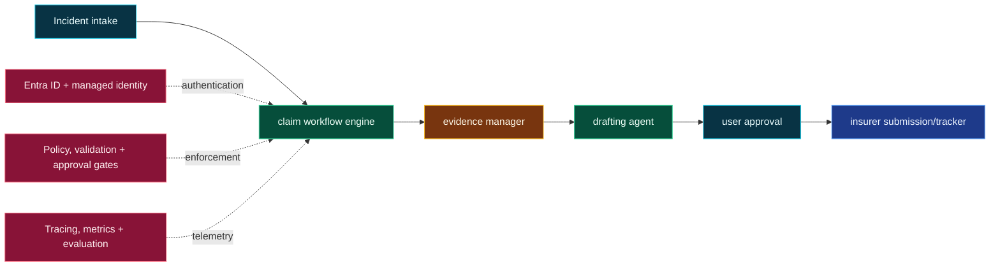

<!-- main-logic:auto -->
**Main execution logic**

1. **Authenticate and validate:** the edge/API layer verifies identity, tenant, request schema, quotas and correlation ID before agent execution.
2. **Load trusted context:** the application loads the minimum required profile, conversation checkpoint, domain state and authorization scope; sensitive fields stay outside prompts unless necessary.
3. **Plan with bounded authority:** the Foundry/Agent Framework adapter receives only allowlisted tool schemas and returns a structured proposal. The app-specific path is `Incident intake -> claim workflow engine -> evidence manager -> drafting agent -> user approval -> insurer submission/tracker`.
4. **Ground every decision:** current facts such as price, availability, policy, entitlement or status come from retrieval and typed tools—not model memory.
5. **Apply deterministic policy:** code validates tool name, arguments, user authority, limits, risk class and output schema. Invalid proposals are rejected and audited.
6. **Approve consequential actions:** writes, purchases, bookings, messages, account changes and other high-impact operations pause for explicit human approval.
7. **Execute safely:** the controlled gateway invokes the narrow business operation with an idempotency key, timeout, bounded retry and compensation or dead-letter behavior.
8. **Commit and learn:** persist the result, return a source-grounded response, emit redacted traces and feed curated outcomes into regression evaluations.

**Runnable code pattern:** [C# policy, approval, idempotency and audit sample](../../samples/agent-workflow-csharp/README.md).

**Core components.** Guided intake; policy-linked claim workflow state machine; evidence vault with metadata; document and image analyzer; deadline tracker; narrative drafting module; correspondence log; escalation pathways (complaints, ombudsman information).

**Agent/workflow design.** A workflow engine defines claim stages and required artifacts; the agent fills structured fields, asks only for missing items, and drafts factual statements the user must review. It does not decide coverage, estimate payouts as promises, or advise concealing facts. Image analysis is advisory; a human adjuster decides.

**Data and integrations.** Inputs: policy terms, photos, repair quotes, police or medical reports, correspondence. Integrations: insurer claim portals or email on user authorization, calendar, storage.

**Security and safety.** Regulated-domain caution: claims handling is regulated, and misstatements can amount to fraud. Require user attestation of accuracy, never fabricate or embellish details, avoid legal conclusions, and refer to licensed loss assessors or lawyers when disputes arise. Handle health and third-party data under strict consent, encrypt evidence, log all actions, and require explicit approval before any submission.

**Reliability, observability and evaluation.** Track stage completion time, missing-evidence rates, and deadline misses; audit drafted narratives against user-supplied facts to detect unsupported statements. Test with synthetic claims across motor, home and travel scenarios, and review with claims professionals.

**MVP build path.** Phase 1: checklist and deadline tracker for one claim type (e.g. motor). Phase 2: evidence vault and drafting with approval. Phase 3: insurer submission integration, further claim types, and dispute-escalation guidance.

## 46. Consumer contract explainer

**Purpose and user journey.** A proposed assistant that translates consumer contracts (subscriptions, leases, phone plans, gym memberships) into plain language. The user uploads or pastes a contract, receives a summary of key obligations, costs, renewal and cancellation terms, flagged unusual clauses with citations, and suggested questions before signing.

**Reference architecture.** `Contract upload -> parser -> clause classifier -> risk-flag rules + LLM explainer -> cited summary -> optional lawyer referral`

<!-- architecture-diagram:auto -->
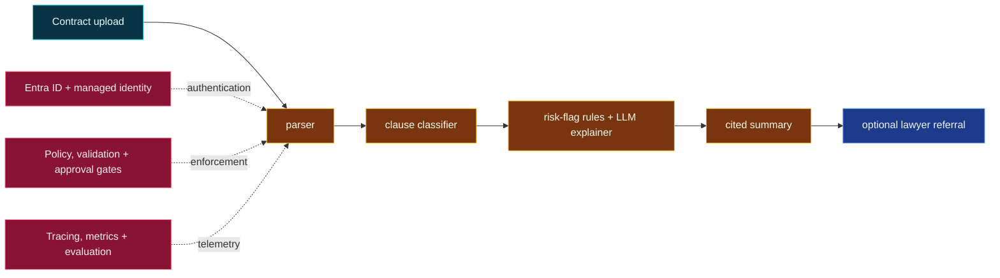

<!-- main-logic:auto -->
**Main execution logic**

1. **Authenticate and validate:** the edge/API layer verifies identity, tenant, request schema, quotas and correlation ID before agent execution.
2. **Load trusted context:** the application loads the minimum required profile, conversation checkpoint, domain state and authorization scope; sensitive fields stay outside prompts unless necessary.
3. **Plan with bounded authority:** the Foundry/Agent Framework adapter receives only allowlisted tool schemas and returns a structured proposal. The app-specific path is `Contract upload -> parser -> clause classifier -> risk-flag rules + LLM explainer -> cited summary -> optional lawyer referral`.
4. **Ground every decision:** current facts such as price, availability, policy, entitlement or status come from retrieval and typed tools—not model memory.
5. **Apply deterministic policy:** code validates tool name, arguments, user authority, limits, risk class and output schema. Invalid proposals are rejected and audited.
6. **Approve consequential actions:** writes, purchases, bookings, messages, account changes and other high-impact operations pause for explicit human approval.
7. **Execute safely:** the controlled gateway invokes the narrow business operation with an idempotency key, timeout, bounded retry and compensation or dead-letter behavior.
8. **Commit and learn:** persist the result, return a source-grounded response, emit redacted traces and feed curated outcomes into regression evaluations.

**Runnable code pattern:** [C# policy, approval, idempotency and audit sample](../../samples/agent-workflow-csharp/README.md).

**Core components.** Document parser with OCR; clause segmentation and classification (term, auto-renewal, fees, liability, arbitration, data use); jurisdiction-aware flag library; plain-language explainer; comparison view against a reference baseline; export and checklist generator.

**Agent/workflow design.** A pipeline agent segments clauses, classifies them, applies a reviewed rules library for red flags (auto-renewal, unilateral changes, hidden fees), and generates explanations that quote the original text. A verifier checks that every summary statement maps to a clause. The agent states uncertainty and never asserts that a clause is unenforceable or illegal. Workflow: parse, classify, flag, explain, user questions, summary.

**Data and integrations.** Inputs: PDFs, photos, web-page terms. Outputs: summary, flagged-clause report, question list.

**Security and safety.** Regulated-domain caution: explaining a contract can border on legal advice or unauthorized practice of law in some jurisdictions; label as general information, avoid outcome predictions, and provide lawyer or consumer-organization referral paths. Protect confidential documents with encryption and deletion options, defend against prompt injection in contract text, and never sign or send anything on the user's behalf.

**Reliability, observability and evaluation.** Evaluate clause-classification accuracy and flag precision and recall on lawyer-annotated contracts; measure citation faithfulness and hallucination rate. Log low-confidence segments and show them as such.

**MVP build path.** Phase 1: single contract type (subscriptions), cited summary. Phase 2: red-flag library and question checklist. Phase 3: additional contract types, multi-jurisdiction support, and a vetted lawyer-referral integration.

## 47. Tax-document organizer

**Purpose and user journey.** A proposed assistant that collects, classifies and checks tax paperwork for a tax year. The user uploads receipts, payslips, bank and broker statements, receives an organized folder with a checklist of expected documents, missing-item alerts, and an export package for themselves or their accountant.

**Reference architecture.** `Upload/email inbox -> OCR -> document classifier -> field extractor -> checklist engine -> reviewed export pack`

<!-- architecture-diagram:auto -->
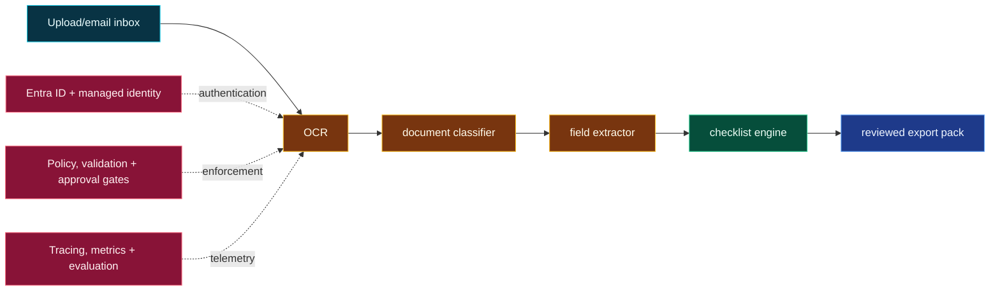

<!-- main-logic:auto -->
**Main execution logic**

1. **Authenticate and validate:** the edge/API layer verifies identity, tenant, request schema, quotas and correlation ID before agent execution.
2. **Load trusted context:** the application loads the minimum required profile, conversation checkpoint, domain state and authorization scope; sensitive fields stay outside prompts unless necessary.
3. **Plan with bounded authority:** the Foundry/Agent Framework adapter receives only allowlisted tool schemas and returns a structured proposal. The app-specific path is `Upload/email inbox -> OCR -> document classifier -> field extractor -> checklist engine -> reviewed export pack`.
4. **Ground every decision:** current facts such as price, availability, policy, entitlement or status come from retrieval and typed tools—not model memory.
5. **Apply deterministic policy:** code validates tool name, arguments, user authority, limits, risk class and output schema. Invalid proposals are rejected and audited.
6. **Approve consequential actions:** writes, purchases, bookings, messages, account changes and other high-impact operations pause for explicit human approval.
7. **Execute safely:** the controlled gateway invokes the narrow business operation with an idempotency key, timeout, bounded retry and compensation or dead-letter behavior.
8. **Commit and learn:** persist the result, return a source-grounded response, emit redacted traces and feed curated outcomes into regression evaluations.

**Runnable code pattern:** [C# policy, approval, idempotency and audit sample](../../samples/agent-workflow-csharp/README.md).

**Core components.** Multi-channel intake; OCR and layout extraction; document-type classifier; field extractor (issuer, amount, date, tax year); duplicate detector; jurisdiction-specific checklist engine; review queue; export builder with index and audit trail.

**Agent/workflow design.** Extraction agent produces structured fields with confidence scores; low-confidence items go to user confirmation. The checklist engine, driven by versioned rules, compares expected against received documents. The agent explains what a document is and why it may be needed but does not calculate liability or choose deductions. Workflow: ingest, classify, extract, confirm, reconcile, export, year-end rollover.

**Data and integrations.** Inputs: PDFs, images, email attachments, data downloads from banks or employers. Integrations: cloud storage, accountant sharing links, optionally official e-filing portals via user-authorized access.

**Security and safety.** Regulated-domain caution: preparing or advising on tax filings may be regulated; keep scope to organization and information, and recommend qualified tax professionals for decisions. Tax documents contain national IDs and account numbers, so apply field-level encryption, masking in the UI, short-lived share links, access logging, MFA, and no model training on user data. Never submit filings without explicit user action.

**Reliability, observability and evaluation.** Measure classification and extraction accuracy per document type, review-queue volume, and missing-document false alarms. Test against anonymized synthetic documents.

**MVP build path.** Phase 1: upload, classify, checklist for one jurisdiction and filer type. Phase 2: field extraction, duplicate detection, accountant export. Phase 3: email ingestion, additional jurisdictions, and optional portal data retrieval after security review.

## 48. Car-buying assistant

**Purpose and user journey.** A proposed assistant that guides a buyer from need definition to purchase decision, for new or used vehicles. The user states budget, usage and preferences, receives a shortlist with total-cost estimates, a listing-evaluation checklist, negotiation preparation, and a financing and paperwork guide.

**Reference architecture.** `Needs intake -> candidate search -> cost model + listing checker -> agent shortlist -> negotiation brief -> decision log`

<!-- architecture-diagram:auto -->
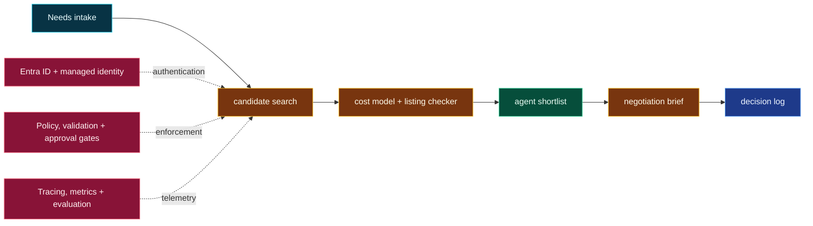

<!-- main-logic:auto -->
**Main execution logic**

1. **Authenticate and validate:** the edge/API layer verifies identity, tenant, request schema, quotas and correlation ID before agent execution.
2. **Load trusted context:** the application loads the minimum required profile, conversation checkpoint, domain state and authorization scope; sensitive fields stay outside prompts unless necessary.
3. **Plan with bounded authority:** the Foundry/Agent Framework adapter receives only allowlisted tool schemas and returns a structured proposal. The app-specific path is `Needs intake -> candidate search -> cost model + listing checker -> agent shortlist -> negotiation brief -> decision log`.
4. **Ground every decision:** current facts such as price, availability, policy, entitlement or status come from retrieval and typed tools—not model memory.
5. **Apply deterministic policy:** code validates tool name, arguments, user authority, limits, risk class and output schema. Invalid proposals are rejected and audited.
6. **Approve consequential actions:** writes, purchases, bookings, messages, account changes and other high-impact operations pause for explicit human approval.
7. **Execute safely:** the controlled gateway invokes the narrow business operation with an idempotency key, timeout, bounded retry and compensation or dead-letter behavior.
8. **Commit and learn:** persist the result, return a source-grounded response, emit redacted traces and feed curated outcomes into regression evaluations.

**Runnable code pattern:** [C# policy, approval, idempotency and audit sample](../../samples/agent-workflow-csharp/README.md).

**Core components.** Preference and budget profile; listing aggregator connectors; vehicle-history lookup integration; total-cost-of-ownership calculator (depreciation, fuel, insurance, tax, finance); price-benchmark service; listing analyzer for red flags; negotiation brief generator; document checklist.

**Agent/workflow design.** A research agent queries listing and specification sources through approved tools, scores candidates against stated priorities, and explains trade-offs. Cost figures come from the calculator with visible assumptions. A listing-check step flags missing history, odometer inconsistencies and price outliers. The agent drafts questions for sellers but sends nothing without approval. Workflow: clarify, search, score, verify, compare, prepare, decide.

**Data and integrations.** Sources: licensed listing APIs or feeds, manufacturer specifications, vehicle-history and recall databases, price guides, user-provided quotes. Respect site terms rather than unrestricted scraping.

**Security and safety.** Regulated-domain caution: finance, insurance and consumer-credit referrals are regulated; disclose any affiliate or dealer relationship, avoid steering to a lender without licensing, and present APR figures as examples. Do not guarantee vehicle condition; recommend independent inspection. Protect location and identity data, prevent scam-listing exposure through fraud heuristics, and require explicit consent for any dealer contact.

**Reliability, observability and evaluation.** Monitor source freshness, connector failures, recommendation click-through and user-reported errors. Evaluate calculator accuracy against known cases, ranking quality with human experts, and hallucinated-specification rates using source-grounded tests.

**MVP build path.** Phase 1: needs intake, TCO calculator, curated model database. Phase 2: listing connectors and red-flag checks. Phase 3: negotiation briefs, financing explainer, and dealer-contact flow with approvals and disclosures.

## 49. Vehicle comparison assistant

**Purpose and user journey.** A proposed assistant focused on side-by-side comparison of specific vehicles or variants. The user selects two to five candidates, states weighted priorities, and receives a normalized comparison of specifications, running costs, safety ratings, reliability signals and practical fit, with a transparent explanation of the ranking.

**Reference architecture.** `Vehicle selection -> spec normalizer -> multi-criteria scorer -> comparison agent -> table/charts with sources`

<!-- architecture-diagram:auto -->
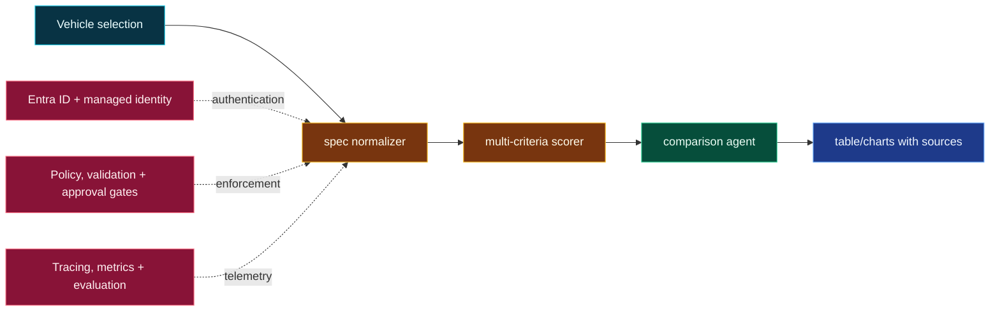

<!-- main-logic:auto -->
**Main execution logic**

1. **Authenticate and validate:** the edge/API layer verifies identity, tenant, request schema, quotas and correlation ID before agent execution.
2. **Load trusted context:** the application loads the minimum required profile, conversation checkpoint, domain state and authorization scope; sensitive fields stay outside prompts unless necessary.
3. **Plan with bounded authority:** the Foundry/Agent Framework adapter receives only allowlisted tool schemas and returns a structured proposal. The app-specific path is `Vehicle selection -> spec normalizer -> multi-criteria scorer -> comparison agent -> table/charts with sources`.
4. **Ground every decision:** current facts such as price, availability, policy, entitlement or status come from retrieval and typed tools—not model memory.
5. **Apply deterministic policy:** code validates tool name, arguments, user authority, limits, risk class and output schema. Invalid proposals are rejected and audited.
6. **Approve consequential actions:** writes, purchases, bookings, messages, account changes and other high-impact operations pause for explicit human approval.
7. **Execute safely:** the controlled gateway invokes the narrow business operation with an idempotency key, timeout, bounded retry and compensation or dead-letter behavior.
8. **Commit and learn:** persist the result, return a source-grounded response, emit redacted traces and feed curated outcomes into regression evaluations.

**Runnable code pattern:** [C# policy, approval, idempotency and audit sample](../../samples/agent-workflow-csharp/README.md).

**Core components.** Vehicle knowledge graph (make, model, trim, powertrain); specification normalizer with unit handling; weighted multi-criteria scoring engine; cost modeler; safety and recall data connectors; review-sentiment summarizer; comparison table and visual generator; saved-comparison store.

**Agent/workflow design.** The agent resolves ambiguous trims first, retrieves structured data, then calls the scoring engine with user weights. The language model writes the narrative only from retrieved facts and shows which figures are manufacturer claims versus independent test results. Sensitivity analysis shows how rankings change when weights shift. Workflow: disambiguate, retrieve, normalize, score, explain, adjust.

**Data and integrations.** Sources: manufacturer data, independent safety programs, fuel-economy and emissions registries, recall databases, aggregated owner reviews, price data. Handle regional differences in test cycles and trim names.

**Security and safety.** Regulated-domain caution: advertising and consumer-protection rules apply to comparative claims; avoid unsupported superiority statements, disclose sponsored or affiliate content, and attribute test results accurately. Treat emissions and safety data as reference information, not certification. Rate-limit connectors, honor licences, sanitize review text against prompt injection, and keep user preference data minimal.

**Reliability, observability and evaluation.** Evaluate specification accuracy against sampled manufacturer sheets, trim-resolution accuracy, and narrative faithfulness to retrieved data. Monitor stale-data ratios and connector errors.

**MVP build path.** Phase 1: curated dataset for a limited market, scoring engine, table output. Phase 2: cost model, recall and safety connectors. Phase 3: review summarization, sensitivity analysis, and integration with the car-buying assistant.

## 50. Vehicle-maintenance assistant

**Purpose and user journey.** A proposed assistant that helps owners keep a vehicle serviced and safe. The user adds a vehicle (VIN or registration), receives a manufacturer-based service schedule, logs work and mileage, gets reminders, and can describe symptoms to receive possible causes, urgency guidance and questions to ask a garage.

**Reference architecture.** `Vehicle profile -> schedule engine + service log -> symptom agent (RAG on manuals) -> reminders -> garage handoff`

<!-- architecture-diagram:auto -->
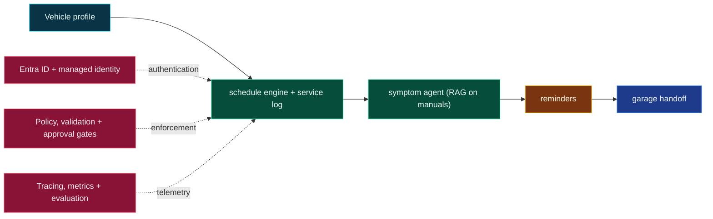

<!-- main-logic:auto -->
**Main execution logic**

1. **Authenticate and validate:** the edge/API layer verifies identity, tenant, request schema, quotas and correlation ID before agent execution.
2. **Load trusted context:** the application loads the minimum required profile, conversation checkpoint, domain state and authorization scope; sensitive fields stay outside prompts unless necessary.
3. **Plan with bounded authority:** the Foundry/Agent Framework adapter receives only allowlisted tool schemas and returns a structured proposal. The app-specific path is `Vehicle profile -> schedule engine + service log -> symptom agent (RAG on manuals) -> reminders -> garage handoff`.
4. **Ground every decision:** current facts such as price, availability, policy, entitlement or status come from retrieval and typed tools—not model memory.
5. **Apply deterministic policy:** code validates tool name, arguments, user authority, limits, risk class and output schema. Invalid proposals are rejected and audited.
6. **Approve consequential actions:** writes, purchases, bookings, messages, account changes and other high-impact operations pause for explicit human approval.
7. **Execute safely:** the controlled gateway invokes the narrow business operation with an idempotency key, timeout, bounded retry and compensation or dead-letter behavior.
8. **Commit and learn:** persist the result, return a source-grounded response, emit redacted traces and feed curated outcomes into regression evaluations.

**Runnable code pattern:** [C# policy, approval, idempotency and audit sample](../../samples/agent-workflow-csharp/README.md).

**Core components.** VIN decoder; maintenance schedule engine driven by mileage, time and usage; service-history log with receipts; manual and technical-bulletin retrieval index; recall checker; symptom triage module; reminder service; optional OBD-II or telematics ingestion.

**Agent/workflow design.** A scheduling engine computes due items deterministically from the manufacturer schedule. A symptom agent retrieves relevant manual sections and recall notices, asks clarifying questions, and classifies urgency (stop driving, book soon, monitor).

**Data and integrations.** Sources: VIN and registration databases, manufacturer manuals, recall and bulletin feeds, user logs, optional OBD-II dongle or connected-car APIs with owner consent. Outputs: reminders, service history exports (useful at resale), garage briefing sheets.

**Security and safety.** Regulated-domain caution: vehicle safety and roadworthiness rules are jurisdiction-specific; the assistant gives informational guidance, not inspection or certification. Warranty, recall and emissions-compliance statements must cite sources. Location and driving data is sensitive: use consent, minimization, encryption and clear deletion. Avoid DIY guidance on safety systems such as airbags, high-voltage batteries and brakes beyond referring to professionals.

**Reliability, observability and evaluation.** Track reminder accuracy, symptom-triage agreement with mechanics on a labeled case set, retrieval faithfulness, and recall-feed freshness. Test escalation rules with safety scenarios and require zero tolerance for missed stop-driving cases in the evaluation suite.

**MVP build path.** Phase 1: VIN profile, schedule engine, manual service log and reminders. Phase 2: recall checks and cited symptom triage with conservative escalation. Phase 3: OBD or telematics ingestion and garage-booking handoff.
