# Health, wellness and pets architecture overviews

<!-- category-architecture:auto -->
## Category deployment architecture

This Azure-oriented deployment separates deterministic business operations from probabilistic model reasoning. The application owns authorization, validation, workflow state and approval; the model proposes actions only through allowlisted tools.

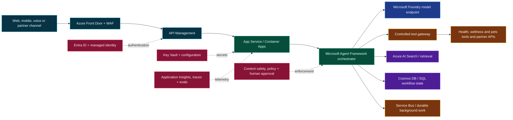

**Responsibility split**

- **Edge and API layer:** authentication, quotas, request validation and tenant routing.
- **Application/orchestration layer:** deterministic workflow, retries, approvals, state and tool authorization.
- **Model layer:** language understanding, planning and explanation; it never becomes the system of record.
- **Tool layer:** narrow typed operations with idempotency, schema validation and audit events.
- **Data layer:** retrieval indexes are separate from transactional state and sensitive records.
- **Control plane:** identity, secrets, policy, privacy, observability and evaluations apply across every request.

These are proposed reference architectures, not descriptions of existing repositories. Wellness and health apps here do not diagnose, treat, or replace licensed professionals. Each app shows emergency escalation and consent/privacy handling where relevant.

## 51. Fitness coach

**Purpose and user journey:** A proposed conversational coach that turns goals, equipment, and schedule into daily training guidance. Journey: consent and goal intake, readiness screening, plan, guided session with live adjustments, weekly review. It does not diagnose or replace doctors or qualified trainers.

**Reference architecture:** `Mobile app -> API gateway -> Coach agent -> Planner/Safety rules -> Profile + Activity store <- Wearable connectors`

<!-- architecture-diagram:auto -->
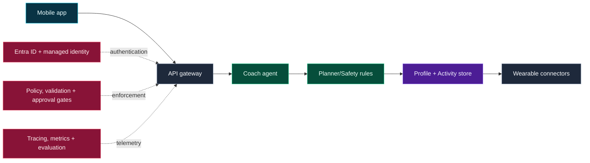

**Core components:** Chat and session UI, goal and readiness intake, coach orchestrator, exercise library, progression engine, wearable ingestion service, notification scheduler, consent manager, and an analytics pipeline with de-identified events.

**Agent/workflow design:** The LLM agent explains and adapts, while deterministic rules set load progression, volume caps, and deload weeks. Tools: get_profile, fetch_recent_activity, propose_session, log_set, flag_risk. Pain, dizziness, or chest symptoms stop the workflow and trigger the safety path.

**Data and integrations:** Profile, equipment, session logs, heart rate, and sleep from Apple Health, Health Connect, or Garmin via explicit OAuth scopes. Store minimal fields, encrypt at rest, and keep exercise content versioned.

**Security and safety:** Collect explicit consent per data category, with easy export and deletion. Run a PAR-Q style screen. Escalation: for chest pain, fainting, or severe symptoms, show emergency-number guidance and end coaching. Refuse medical, injury-diagnosis, and extreme-diet advice.

**Reliability, observability and evaluation:** Trace each plan with the rule set version. Test plans against safety constraints, run red-team prompts on injury questions, and track adherence, drop-off, and escalation false negatives. Fall back to a static template plan if the model is down.

**MVP build path:** Start with one goal type, a 40-exercise library, and manual logging. Add rule-based progression, then the LLM explanation layer, then one wearable integration, then trainer-reviewed evaluation sets before wider release.

## 52. Workout-planning assistant

**Purpose and user journey:** A proposed planner that builds and revises multi-week training programs from goals, available days, equipment, and constraints. Journey: consent, constraint intake, draft plan, user edits, calendar export, adjustment. It is not medical advice and does not replace professional trainers or clinicians.

**Reference architecture:** `Web/mobile UI -> Planner API -> Constraint solver + LLM drafter -> Exercise DB -> Calendar sync -> Feedback loop`

<!-- architecture-diagram:auto -->
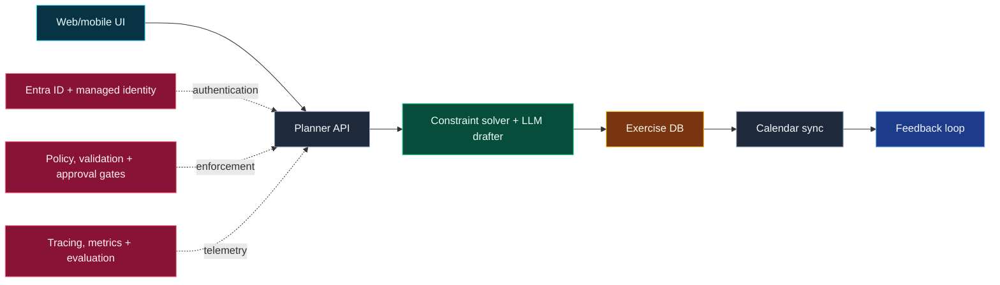

**Core components:** Intake form, program generator, exercise and substitution database, constraint solver for time and equipment, plan editor, calendar connector, progress tracker, and a template versioning service.

**Agent/workflow design:** A planner agent drafts a split, the solver validates volume, recovery spacing, and time budgets, and a critic step checks for contraindicated combinations from user-declared limitations. Tools: search_exercises, validate_plan, swap_exercise, export_calendar. Declared injuries route to conservative templates and a suggestion to consult a professional.

**Data and integrations:** Plans, preferences, completed workouts, and declared limitations. Integrations include Google or Outlook calendars, optional wearables, and a video-link library. Keep limitation data separated and minimally retained.

**Security and safety:** Obtain consent for health-related limitations, allow deletion, and avoid selling data. Emergency escalation text appears for reported severe pain or cardiac symptoms. No rehab prescriptions, no diagnosis, no supplement or drug advice.

**Reliability, observability and evaluation:** Validate every plan against schema and rules before display. Log solver failures and substitution rates, evaluate with expert-graded sample programs, and measure completion rate and edit rate. Cache last valid plan for offline use.

**MVP build path:** Ship a three-split generator with deterministic validation, then LLM-written rationale, plan editing, calendar export, and finally adaptive re-planning after missed sessions and expert review of templates.

## 53. Wellness coach

**Purpose and user journey:** A proposed whole-person coach helping users set small goals across movement, nutrition awareness, stress, and social connection. Journey: consent, values and goal discussion, weekly focus, check-ins, reflection. It does not diagnose or treat conditions and does not replace clinicians, therapists, or dietitians.

**Reference architecture:** `Chat UI -> Coach orchestrator -> Goal/Check-in services -> Guardrail classifier -> Memory store -> Integrations`

<!-- architecture-diagram:auto -->
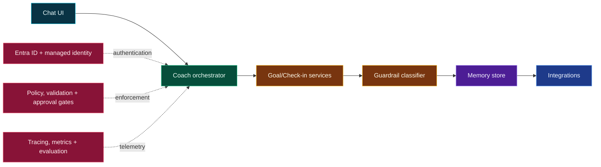

**Core components:** Conversation layer, goal tracker, check-in scheduler, evidence-based content library, memory service with user-editable notes, risk classifier, dashboard, and consent center.

**Agent/workflow design:** The agent uses motivational-interviewing style prompts and picks one small action weekly. Workflow: assess, select focus, commit, nudge, review. Tools: get_goals, schedule_checkin, retrieve_content, escalate. A classifier scans every turn for self-harm, abuse, or acute medical language and interrupts normal flow.

**Data and integrations:** Goals, mood ratings, optional wearable summaries, and reviewed content citations. Integrations are optional and OAuth-scoped; free-text notes receive the strictest retention and encryption policy.

**Security and safety:** Explicit, granular consent, data minimization, regional compliance review such as GDPR, and full deletion. Escalation: show crisis lines and local emergency numbers for self-harm or urgent danger, and suggest a clinician for persistent symptoms. Avoid medical claims.

**Reliability, observability and evaluation:** Monitor safety-trigger precision and recall on curated test sets, response groundedness, nudge opt-out rates, and weekly goal completion. Use human review of sampled, consented transcripts and keep a rollback path for prompts.

**MVP build path:** Launch with three focus areas, a curated content set, and scheduled check-ins. Add memory, then the risk classifier hardening, then wearable summaries, then clinical advisory review before expanding claims.

## 54. Sleep coach

**Purpose and user journey:** A proposed coach that helps users understand sleep habits and improve routines using diaries and optional wearable data. Journey: consent, baseline diary, routine experiments, weekly review. It does not diagnose sleep disorders and does not replace physicians or sleep specialists.

**Reference architecture:** `App -> Sleep coach agent -> Diary + Wearable ingest -> Pattern analyzer -> CBT-I style content -> Notifications`

<!-- architecture-diagram:auto -->
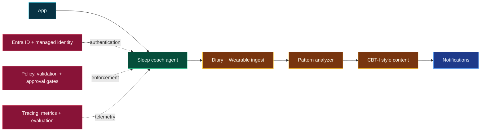

**Core components:** Sleep diary, wearable import adapter, pattern analyzer for regularity and latency trends, wind-down planner, content library, reminder service, and report generator.

**Agent/workflow design:** Deterministic analytics compute averages and variability; the agent explains them and suggests one experiment, such as a fixed wake time or caffeine cutoff. Tools: get_sleep_summary, create_experiment, schedule_reminder, escalate. Loud snoring with pauses, severe daytime sleepiness, or sleeping while driving prompts a recommendation to see a clinician.

**Data and integrations:** Bed and wake times, quality ratings, caffeine and screen notes, and device sleep stages from Apple Health, Health Connect, or Oura. Treat device stages as approximate and label confidence.

**Security and safety:** Consent per data source, encrypted storage, and no ad sharing. Emergency escalation for suicidal thoughts, breathing difficulty, or chest pain. Avoid recommending sleeping medication, dose changes, or strict sleep restriction without professional supervision.

**Reliability, observability and evaluation:** Handle missing nights gracefully, version analytics code, and unit test with synthetic sleep series. Evaluate advice with sleep-clinician review, measure diary completion and routine consistency, and track escalation triggers and wrongly confident claims.

**MVP build path:** Build manual diary and weekly summary first. Add one wearable import, the experiment loop, and reminders. Then add structured educational modules and a clinician-reviewed referral prompt set.

## 55. Habit-building assistant

**Purpose and user journey:** A proposed assistant that helps users define tiny habits, anchor them to routines, and recover from lapses. Journey: consent, choose a habit, set cue and reward, daily prompts, weekly reflection. It is a wellness tool, not therapy or medical care, and does not replace professionals.

**Reference architecture:** `Mobile app -> Habit agent -> Habit engine (cues, streaks) -> Scheduler -> Push/SMS -> Insights store`

<!-- architecture-diagram:auto -->
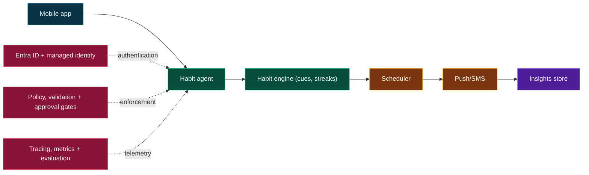

**Core components:** Habit designer, cue and context scheduler, streak and flexibility logic, reflection prompts, push gateway, preference center, and analytics module.

**Agent/workflow design:** The agent decomposes goals into tiny behaviors, proposes implementation intentions, and adapts after missed days using supportive framing. Tools: create_habit, schedule_nudge, log_completion, adjust_difficulty. Language suggesting self-harm, eating disorders, or addiction crises triggers a supportive handoff with local help resources.

**Data and integrations:** Habit definitions, completion logs, time zones, and optional calendar or health activity signals. Limit notification content to avoid exposing sensitive habits on lock screens.

**Security and safety:** Consent for notifications and data use, easy pause or deletion, and age-appropriate defaults. Emergency escalation for crisis language. Avoid shaming mechanics and excessive streak pressure; do not support habits involving medication changes or restrictive dieting.

**Reliability, observability and evaluation:** Idempotent scheduling, time-zone tests, delivery monitoring, and nudge fatigue metrics. Evaluate with A/B tests on message tone, ethical review of engagement features, and success measured by sustained completion rather than app opens.

**MVP build path:** Release single-habit tracking with fixed reminders. Add the LLM habit designer, then adaptive scheduling, then weekly reflection and optional integrations, followed by tone evaluation and safety classifier tests.

## 56. Skincare advisor

**Purpose and user journey:** A proposed advisor that builds simple routines from skin type, preferences, allergies, and climate. Journey: consent, profile quiz, optional photo upload, routine suggestion, patch-test guidance, review. It does not diagnose skin conditions and does not replace dermatologists or other clinicians.

**Reference architecture:** `App -> Advisor agent -> Ingredient KB + Rules -> Product catalog -> Photo processing (optional) -> Profile store`

<!-- architecture-diagram:auto -->
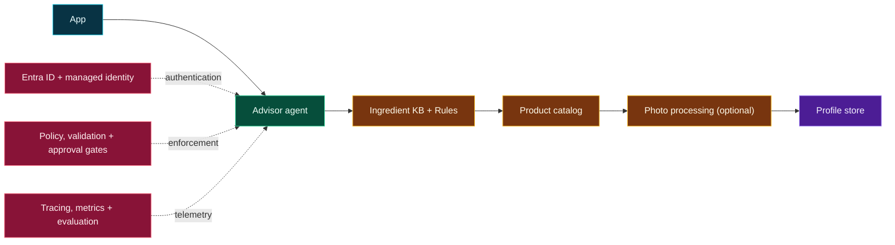

**Core components:** Skin quiz, ingredient knowledge base, interaction checker, routine builder, optional image-quality checker, product connector, reminder service, and consent center.

**Agent/workflow design:** The agent gathers context, then rules check ingredient conflicts, pregnancy and allergy flags, and routine complexity. Tools: lookup_ingredient, check_conflicts, build_routine, search_products, escalate. Changing moles, bleeding lesions, severe rash, swelling, or breathing issues produce urgent clinician or emergency guidance, with no analysis attempted.

**Data and integrations:** Skin concerns, allergies, product lists, climate data, and optional photos. Integrations include retailer catalogs and ingredient databases. Process photos with short retention and never use them for model training without separate opt-in.

**Security and safety:** Photos and health traits are sensitive; encrypt, obtain explicit consent, and offer deletion. Avoid prescription, steroid, retinoid dosing, or condition labels. Add a patch-test warning and a disclosure for sponsored placements.

**Reliability, observability and evaluation:** Version ingredient data, test conflict rules with dermatology-reviewed cases, monitor hallucinated ingredients, and measure irritation reports and routine adherence. Fall back to rule output if the model fails.

**MVP build path:** Start with a quiz-driven routine and curated ingredient rules. Add product search, then Q&A grounded in the knowledge base, then optional photo-quality guidance after privacy review.

## 57. Beauty-product assistant

**Purpose and user journey:** A proposed shopping assistant that helps users compare makeup, haircare, and personal-care products by preference, shade, budget, and ingredient sensitivities. Journey: consent, preferences, shortlist, comparison, purchase handoff. It gives cosmetic guidance only, not medical diagnosis or treatment.

**Reference architecture:** `Chat UI -> Recommender agent -> Catalog search + Reviews index -> Ingredient filter -> Affiliate/checkout links -> Feedback`

<!-- architecture-diagram:auto -->
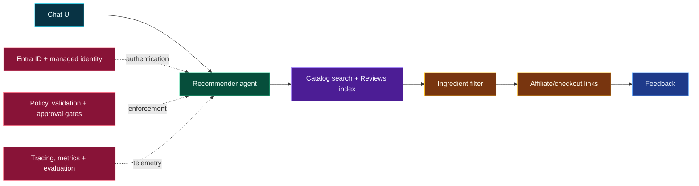

**Core components:** Preference profile, product catalog ingestion, hybrid semantic and structured search, shade matcher, review summarizer, ingredient and allergen filter, price tracker, and disclosure module.

**Agent/workflow design:** The agent clarifies needs, calls search tools, ranks candidates with transparent criteria, and explains trade-offs. Tools: search_catalog, filter_allergens, compare_products, get_price_history. Reports of severe allergic reaction, swelling, or breathing trouble trigger emergency guidance; skin-condition questions are redirected to clinicians.

**Data and integrations:** Product feeds, ingredient lists, review aggregates, inventory, and user preferences. Use retailer APIs where permitted and keep review sources attributed and fresh.

**Security and safety:** Consent for personalization and tracking, allergen data minimized and deletable, and clear sponsorship labeling. No claims of treating acne, eczema, or hair loss. Check recalls and regulatory alerts, and validate affiliate URLs.

**Reliability, observability and evaluation:** Monitor catalog freshness, broken links, price mismatches, and unsupported claims. Evaluate relevance with labeled queries, allergen-filter recall, and shade-match user feedback. Use caching and graceful degradation to plain search.

**MVP build path:** Begin with one retailer feed and structured filters. Add semantic search, then comparison explanations, ingredient exclusion, price alerts, and finally shade matching with careful bias and lighting evaluation.

## 58. Medication reminder

**Purpose and user journey:** A proposed reminder service that helps users and caregivers remember prescribed medicines. Journey: consent, enter or scan regimen, confirm schedule, receive reminders, log doses, share summaries. It does not diagnose, prescribe, or change doses, and does not replace physicians or pharmacists.

**Reference architecture:** `App/SMS -> Reminder API -> Regimen store -> Scheduler -> Notification service -> Adherence log -> Caregiver alerts`

<!-- architecture-diagram:auto -->
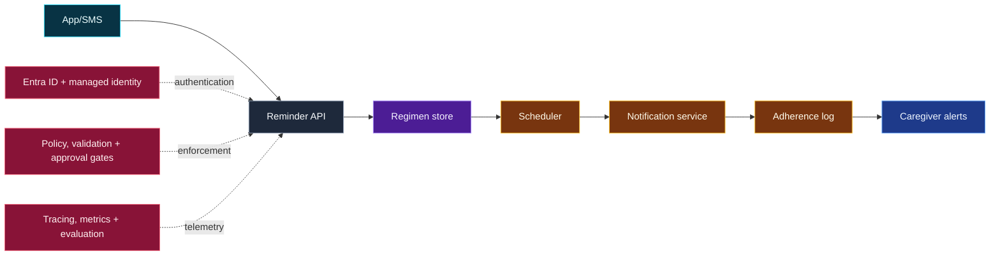

**Core components:** Regimen entry and verification, optional label OCR, time-zone aware scheduler, notification channels, dose log, refill tracker, caregiver permissions, and audit service.

**Agent/workflow design:** The core is a deterministic scheduler; an optional agent helps parse text and answer logistics questions. Every parsed regimen requires user confirmation. Tools: parse_regimen, schedule_dose, log_dose, notify_caregiver. Dose, interaction, or side-effect questions route to a pharmacist or prescriber; severe reactions or overdose show emergency numbers.

**Data and integrations:** Medication names, times, adherence, and refill dates. Integrate with calendars, SMS, push, and optionally pharmacy or drug-reference APIs for name normalization, not clinical decisions.

**Security and safety:** Strong consent, caregiver consent separate from user consent, encryption, access logs, minimal lock-screen detail, and healthcare privacy review such as HIPAA or GDPR where applicable. Never advise skipping, doubling, or stopping medicines.

**Reliability, observability and evaluation:** Reminders need redundancy, retries, delivery receipts, and missed-notification alerts. Test daylight saving and travel cases, monitor delivery latency, and audit parsing accuracy with pharmacist-reviewed cases.

**MVP build path:** Build manual regimens with push reminders and dose logging. Add SMS fallback and caregiver sharing, then OCR or text parsing with confirmation, then refill tracking and compliance review.

## 59. Healthcare navigation assistant

**Purpose and user journey:** A proposed assistant that helps users understand care options, insurance terms, referrals, and next administrative steps. Journey: consent, describe need, identify care setting, prepare questions and documents, follow up. It does not diagnose or provide treatment advice and does not replace clinicians or insurers.

**Reference architecture:** `Chat/voice -> Navigation agent -> Triage-safe router -> Provider directory + Insurance rules -> Document checklist -> Handoff`

<!-- architecture-diagram:auto -->
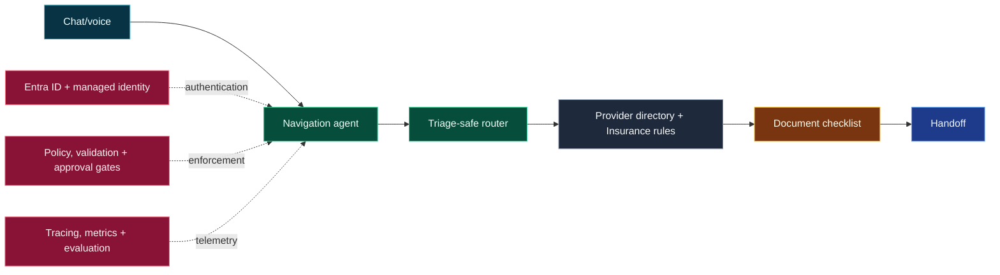

**Core components:** Conversational interface, urgency screener, provider and facility directory, coverage explainer, document checklist generator, visit-preparation module, human navigator handoff, and consent vault.

**Agent/workflow design:** The agent clarifies the administrative goal, retrieves cited policy and directory data, and drafts next steps. Tools: search_providers, explain_coverage, build_checklist, request_human. Red-flag symptoms such as chest pain, stroke signs, severe bleeding, or suicidal thoughts bypass the workflow and show emergency escalation immediately.

**Data and integrations:** Directories, plan documents, referral requirements, and user-provided records. Integrate with insurer or provider APIs, FHIR where authorized, and maps. Retrieval should cite effective dates.

**Security and safety:** Explicit consent for each record source, role-based access, encryption, audit trails, data-retention limits, and regulatory review. State uncertainty about coverage and costs. Do not interpret test results or recommend treatments.

**Reliability, observability and evaluation:** Evaluate answer accuracy against plan documents, emergency-routing recall, directory freshness, and handoff quality. Monitor retrieval failures, stale data, and escalation latency, and provide human fallback.

**MVP build path:** Start with FAQ and checklist generation for one insurer or health system. Add directory search, document upload with consent, then human navigator handoff and carefully reviewed FHIR integrations.

## 60. Appointment-booking assistant

**Purpose and user journey:** A proposed assistant that finds, books, reschedules, and reminds users about healthcare appointments. Journey: consent, choose provider and reason category, select slot, confirm, receive reminders, update. It does not diagnose or decide medical urgency and does not replace clinical staff.

**Reference architecture:** `Chat/voice -> Booking agent -> Availability service -> EHR/scheduling APIs -> Confirmation + Reminders -> Audit log`

<!-- architecture-diagram:auto -->

**Core components:** Intent parser, provider search, availability connector, booking transaction service, eligibility checker, reminder engine, calendar sync, and clinic staff handoff queue.

**Agent/workflow design:** The agent collects only needed booking details, proposes slots, and requires explicit user confirmation before committing. Tools: search_slots, hold_slot, book, cancel, notify_clinic. Booking uses idempotency keys. Urgent symptom language skips booking and shows emergency or urgent-care guidance.

**Data and integrations:** Identity details, visit type, preferences, insurance basics, and appointment times. Integrate with FHIR Scheduling, vendor scheduling APIs, SMS, email, and calendars. Avoid storing reason-for-visit details beyond what is required.

**Security and safety:** Verify identity before access, collect consent for reminders, minimize health details in messages, encrypt data, and keep audit logs. Escalate chest pain, breathing difficulty, severe bleeding, or suicidal intent to emergency resources.

**Reliability, observability and evaluation:** Prevent double bookings with holds and idempotency, monitor booking success and API latency, test time zones and cancellations, and evaluate no-show reduction. Provide clinic phone fallback.

**MVP build path:** Start with one clinic scheduling API and a booking-confirmation flow. Add reminders, rescheduling, multi-provider search, and then voice access after privacy and accessibility testing.

## 61. Symptom-intake assistant

**Purpose and user journey:** A proposed intake assistant that collects structured symptom history before a clinician visit. Journey: consent, red-flag screening, guided questions, review and edit summary, submit to clinic. It does not diagnose, recommend treatments, or replace professional triage or clinical judgment.

**Reference architecture:** `Patient UI -> Red-flag screener -> Intake agent -> Structured summary -> Clinician review queue -> EHR/FHIR`

<!-- architecture-diagram:auto -->
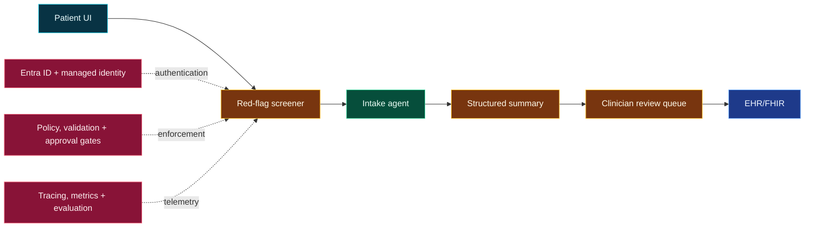

**Core components:** Emergency screener, adaptive questionnaire, medical-term normalizer, summary generator, user confirmation view, clinician dashboard, consent service, and audit store.

**Agent/workflow design:** Deterministic, clinician-approved rules run first for red flags. The agent then asks adaptive follow-ups, never offers a diagnosis, and produces an editable summary. Tools: screen_red_flags, ask_followup, summarize_intake, submit_to_clinic. Emergency signs end intake and instruct users to call local emergency services.

**Data and integrations:** Symptoms, duration, severity, medications, allergies, and history. Integrations: FHIR QuestionnaireResponse, EHR inboxes, and terminology mappings such as SNOMED where licensed. Retain only what the clinic needs.

**Security and safety:** Explicit consent, purpose limitation, encryption, role-based access, retention rules, and legal and clinical safety review, potentially medical-device regulation depending on claims. Keep language descriptive and non-diagnostic, and show uncertainty plainly.

**Reliability, observability and evaluation:** Evaluate red-flag sensitivity with clinician-built cases, summary fidelity, omission rate, and user edit rates. Monitor escalations, abandoned sessions, and model drift. Store prompt and rule versions, and ensure a manual form fallback.

**MVP build path:** Launch a rule-based questionnaire for one complaint area with a clinician-approved red-flag set. Add LLM-written summaries with human review, then adaptive questions and EHR submission after a safety study.

## 62. Mental-wellness journaling assistant

**Purpose and user journey:** A proposed private journaling companion offering reflective prompts, mood tracking, and gentle pattern summaries. Journey: consent, choose privacy settings, journal, receive optional reflections, review trends. It does not diagnose, provide therapy, or replace mental-health professionals.

**Reference architecture:** `App -> Local encrypted journal -> Reflection agent -> Crisis classifier -> Insight service -> Optional clinician export`

<!-- architecture-diagram:auto -->
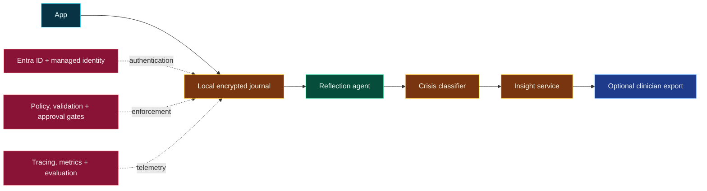

**Core components:** Journal editor, mood tracker, prompt library, privacy-first storage, crisis classifier, reflection generator, trend viewer, export module, and consent dashboard.

**Agent/workflow design:** The agent asks open reflective questions, summarizes themes without judging, and avoids diagnostic language. Tools: suggest_prompt, summarize_entries, track_mood, escalate. The crisis classifier runs before and after generation; self-harm, abuse, or acute danger triggers compassionate messaging, local crisis lines, emergency numbers, and optional trusted-contact action only with prior consent.

**Data and integrations:** Entries, mood scores, tags, and optional wearable context. Prefer on-device or end-to-end encrypted storage, with explicit opt-in for cloud AI processing. Clinician export is user-initiated.

**Security and safety:** Treat entries as highly sensitive: granular consent, no training or advertising use, deletion, secure keys, and minimal logs. Avoid dependency-fostering language, claims of treatment, and false reassurance. Provide professional-help resources.

**Reliability, observability and evaluation:** Evaluate crisis recall and false alarms with clinician-reviewed synthetic cases, measure tone safety, and monitor latency using privacy-preserving metrics. Ensure the journal works offline when AI is unavailable.

**MVP build path:** Build the encrypted journal and mood tracker first. Add prompts, the crisis classifier, then opt-in reflections, followed by trend summaries and clinician advisory review.

## 63. Pet-care assistant

**Purpose and user journey:** A proposed assistant helping owners manage routines for feeding, exercise, grooming, vaccines, and general care. Journey: consent, pet profile, schedule setup, daily reminders, Q&A, record storage. It does not diagnose animals or replace veterinarians.

**Reference architecture:** `App -> Pet-care agent -> Pet profile + Care calendar -> Knowledge base -> Urgency rules -> Vet handoff`

<!-- architecture-diagram:auto -->
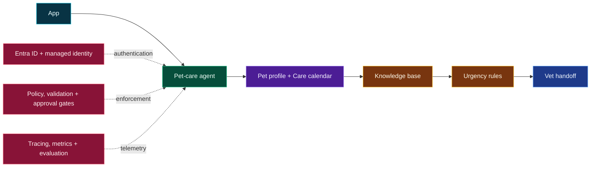

**Core components:** Multi-pet profiles, care calendar, reminder service, species and breed knowledge base, document vault, symptom-urgency screener, household sharing, and notification service.

**Agent/workflow design:** The agent answers general-care questions from a vetted knowledge base and creates routines. Tools: get_pet_profile, schedule_care, retrieve_guidance, flag_urgency, find_vet. Signs such as difficulty breathing, seizures, bloat signs, toxin ingestion, heavy bleeding, or collapse trigger immediate emergency veterinary guidance and poison-hotline suggestions.

**Data and integrations:** Species, age, weight, vaccination dates, medications, and owner details. Integrate with calendars, maps, vet records through owner-approved exports, and optional smart feeders or trackers.

**Security and safety:** Obtain owner consent, household role controls, encryption, and deletion. Owner personal data and vet documents still deserve protection. Avoid dosing, diagnosis, or home-treatment advice for medical conditions, and warn that human medicines can be toxic to pets.

**Reliability, observability and evaluation:** Evaluate answers against veterinary-reviewed content, urgent-case recall, and reminder delivery. Monitor stale guidance, unsupported species, and hallucination rates. Version the knowledge base and show citations.

**MVP build path:** Start with dog and cat profiles, vaccine and feeding reminders, and a small reviewed guide set. Add retrieval Q&A, the urgency screener, document storage, then household sharing and device integrations.

## 64. Veterinary appointment assistant

**Purpose and user journey:** A proposed assistant that helps owners find, book, prepare for, and follow up on veterinary appointments. Journey: consent, select pet and reason, check urgency, choose clinic and slot, receive prep reminders, share notes. It does not diagnose animals or replace veterinary triage or care.

**Reference architecture:** `Chat/app -> Vet booking agent -> Urgency screener -> Clinic availability APIs -> Booking service -> Reminders + Pet records`

<!-- architecture-diagram:auto -->
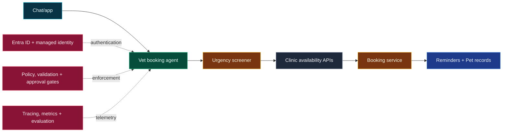

**Core components:** Pet and owner profiles, reason categorizer, clinic directory, availability connectors, booking engine, preparation checklist, reminder service, and clinic handoff.

**Agent/workflow design:** The agent screens urgency first, then collects reason, preferences, and records. Tools: screen_urgency, search_clinics, hold_slot, book_appointment, send_prep_notes. Emergency signs, such as trouble breathing, seizures, suspected poisoning, or major trauma, direct owners to the nearest emergency vet or poison line instead of routine scheduling.

**Data and integrations:** Pet identity, vaccination history, symptoms described by owners, clinic hours, and appointments. Integrate with practice-management schedulers, maps, calendar, SMS, and email, using clinic-approved fields only.

**Security and safety:** Collect owner consent before sharing records with clinics, protect contact and location data, use encrypted storage and audit logs, and minimize message content. Do not give diagnoses, medication instructions, or reassurance that delays urgent care.

**Reliability, observability and evaluation:** Use idempotent bookings, holds, retries, and clinic fallback by phone. Monitor booking success, urgent-routing recall, no-shows, and API errors. Evaluate against veterinarian-written triage scenarios and test time-zone and cancellation cases.

**MVP build path:** Begin with a clinic directory and request-based booking for one practice. Add live availability, emergency screening, reminders and prep notes, then multi-clinic support and record sharing with clinic review.

## 65. Pet-product recommendation assistant

**Purpose and user journey:** A proposed shopping assistant recommending food, toys, grooming items, and supplies matched to species, size, age, preferences, and budget. Journey: consent, pet profile, needs discussion, shortlist, comparison, purchase handoff. It does not diagnose animals or prescribe diets, and veterinarians remain the authority for medical needs.

**Reference architecture:** `Chat UI -> Recommendation agent -> Pet profile -> Product catalog/search -> Safety filters -> Retailer links -> Feedback loop`

<!-- architecture-diagram:auto -->
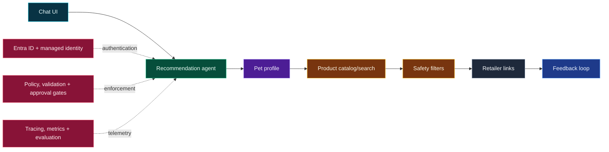

**Core components:** Pet profile, catalog ingestion, hybrid search, ingredient and size filters, safety and recall checker, review summarizer, price tracker, and sponsorship disclosure layer.

**Agent/workflow design:** The agent clarifies needs, searches the catalog, applies hard filters for species, age, size, and declared allergies, and explains ranked options. Tools: search_products, check_recalls, compare_items, get_prices. Requests about sick pets, therapeutic diets, toxins, or ingestion of objects trigger veterinarian or emergency-vet guidance.

**Data and integrations:** Product feeds, ingredient lists, safety notices, reviews, prices, and pet attributes. Use retailer and manufacturer APIs, recall sources, and affiliate links with clear disclosure.

**Security and safety:** Owner consent for personalization, minimal personal data, opt-out of tracking, and deletion. Exclude unsafe toys and toxic ingredients, avoid health claims, and warn about choking hazards, supervision, and diet changes needing veterinary advice.

**Reliability, observability and evaluation:** Evaluate filter correctness with veterinary-reviewed cases, recommendation relevance, recall-detection latency, and price accuracy. Monitor stale feeds, broken links, and unsupported claims. Fall back to structured search when generation fails.

**MVP build path:** Launch with dog and cat supplies from one catalog and hard filters. Add semantic search, comparison explanations, recall checks, price alerts, and expert audits for safety-critical categories.
