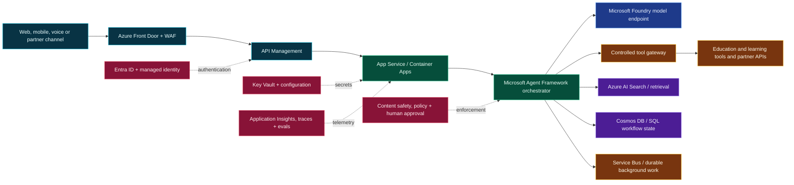
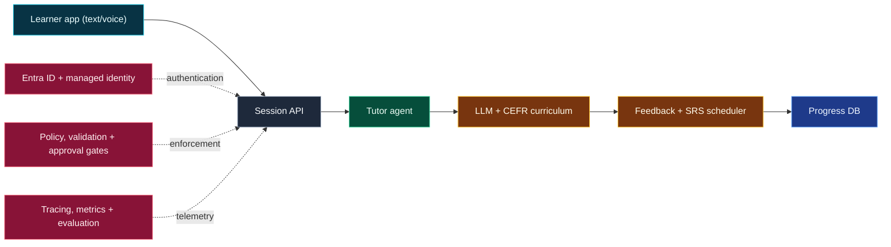
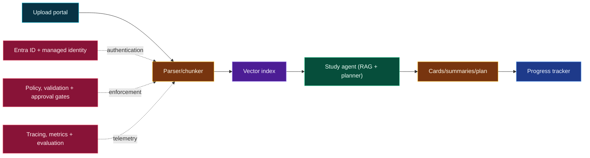
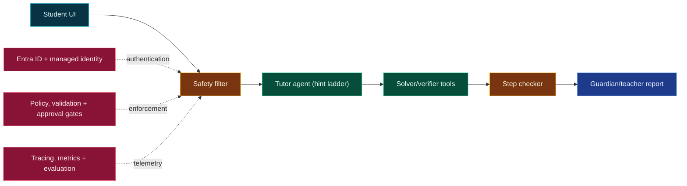
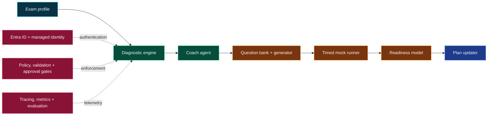
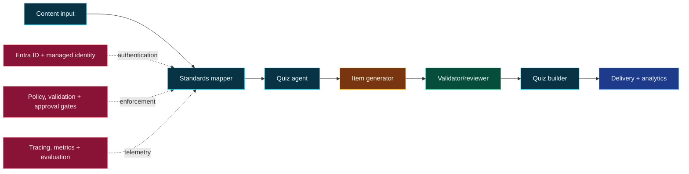

# Education and Learning Assistants (Apps 66-71)

<!-- category-architecture:auto -->
## Category deployment architecture

This Azure-oriented deployment separates deterministic business operations from probabilistic model reasoning. The application owns authorization, validation, workflow state and approval; the model proposes actions only through allowlisted tools.

**Responsibility split**

- **Edge and API layer:** authentication, quotas, request validation and tenant routing.
- **Application/orchestration layer:** deterministic workflow, retries, approvals, state and tool authorization.
- **Model layer:** language understanding, planning and explanation; it never becomes the system of record.
- **Tool layer:** narrow typed operations with idempotency, schema validation and audit events.
- **Data layer:** retrieval indexes are separate from transactional state and sensitive records.
- **Control plane:** identity, secrets, policy, privacy, observability and evaluations apply across every request.

## 66. Language-learning tutor

**Purpose and user journey:** Gives learners conversational practice, corrections and spaced review in a target language. A learner sets a goal and level, chats or speaks through a scenario, receives gentle feedback, then reviews personalized flashcards and weekly progress summaries.

**Reference architecture:** `Learner app (text/voice) -> Session API -> Tutor agent -> LLM + CEFR curriculum -> Feedback + SRS scheduler -> Progress DB`

<!-- architecture-diagram:auto -->

**Core components:** Speech-to-text and text-to-speech, pronunciation scorer, CEFR-tagged lesson library, learner model, spaced-repetition scheduler, conversation planner, feedback renderer, optional teacher dashboard.

**Agent/workflow design:** A planner picks a scenario and target vocabulary. The tutor persona converses at the learner's level plus one. A corrector tool marks errors and explains them. A summarizer writes mistakes to the learner model, and the scheduler queues reviews. Teachers can override plans.

**Data and integrations:** Learner profile, error taxonomy, frequency word lists, licensed lesson content, speech APIs, LMS connection via LTI, reminder notifications. Audio is stored only with consent and a short retention period.

**Security and safety:** Child safety: age gating, parental consent where required, no open-ended companionship, moderated roleplays, and never soliciting personal details. Academic integrity: graded-writing help stays off unless a teacher enables it. Minimize voice data and avoid voiceprints.

**Reliability, observability and evaluation:** Set a voice-turn latency budget and fall back to text. Trace each turn and track correction acceptance, retention and completion. Evaluate with native-speaker-rated dialogues, CEFR drift tests, invalid grammar-rule checks and per-language regression suites.

**MVP build path:** Launch one language pair with text chat, corrections, a 200-item A1-A2 deck and spaced repetition. Then add voice, pronunciation scoring and a teacher dashboard. Add languages only after native-speaker review.

## 67. Study assistant

**Purpose and user journey:** Helps students turn their own notes, slides and readings into a study plan, summaries, flashcards and practice questions. A student uploads materials, picks a deadline, follows a daily plan and asks questions grounded in the sources.

**Reference architecture:** `Upload portal -> Parser/chunker -> Vector index -> Study agent (RAG + planner) -> Cards/summaries/plan -> Progress tracker`

<!-- architecture-diagram:auto -->

**Core components:** Document parser with OCR, chunk index with citations, summarizer, flashcard generator, planner with calendar logic, mastery tracker, source viewer, export tools.

**Agent/workflow design:** Ingest materials, extract topics, and build a concept map. The planner schedules sessions by deadline and weak areas. Each answer retrieves source passages, cites them and says when the materials lack support. Quizzes update mastery estimates.

**Data and integrations:** Student-owned files, LMS imports, calendar sync, reference-manager exports, optional Anki export. Keep each workspace isolated and let students delete sources and derived embeddings.

**Security and safety:** Child safety: age-appropriate settings, parent or school controls for minors, and no unnecessary personal data. Academic integrity: supports learning from the student's own materials, labels generated content, and does not produce submit-ready assignments. Scan uploads for malware and prompt injection.

**Reliability, observability and evaluation:** Log retrieval hits, citation coverage and unsupported-answer rate. Run faithfulness checks against source passages, flashcard accuracy sampling, and plan feasibility tests. Monitor parsing failures and report them to the user.

**MVP build path:** Start with PDF and text upload, cited chat, summaries and flashcards. Add the deadline planner and mastery tracking next. Pilot with one course, collect error reports, then add OCR, LMS import and shared teacher-approved decks.

## 68. Homework tutor

**Purpose and user journey:** Guides students through homework by asking questions, giving hints and checking reasoning rather than handing over answers. A student photographs or types a problem, chooses a hint level, works step by step and receives a reflection summary.

**Reference architecture:** `Student UI -> Safety filter -> Tutor agent (hint ladder) -> Solver/verifier tools -> Step checker -> Guardian/teacher report`

<!-- architecture-diagram:auto -->

**Core components:** Problem parser, subject solver tools, hidden reference solution, hint-ladder controller, step checker, misconception library, age-based tone settings, activity report.

**Agent/workflow design:** Classify the subject, solve privately, and verify with calculators or code. Reveal Socratic hints first, then worked parallel examples, and the full answer only under teacher policy. Detect frustration or repeated errors and recommend human help.

**Data and integrations:** Curriculum standards, textbook-aligned examples, math and science engines, LMS assignment context, optional guardian reports. Retain minimal history and avoid storing images beyond the session unless the user opts in.

**Security and safety:** Child safety: parental consent, age-appropriate language, private-information blocking, bullying and self-harm escalation paths, and no chat with strangers. Academic integrity: answer-reveal limits, assignment-mode policies, and activity logs visible to teachers. Guard against jailbreak attempts for answers.

**Reliability, observability and evaluation:** Verify solutions independently before hinting. Track hint depth, answer-leak rate, wrong-hint rate and escalation events. Evaluate on graded problem sets, adversarial answer-extraction prompts and teacher review of sampled sessions.

**MVP build path:** Begin with middle-school math text problems, a three-step hint ladder, a calculator and verifier. Add photo input and science subjects, then guardian reports and teacher policies. Expand only after pedagogy review.

## 69. Exam-preparation coach

**Purpose and user journey:** Prepares learners for a specific exam through a diagnostic test, a personalized plan, timed practice and review. The user selects an exam and date, receives a readiness estimate, practices weak topics and sits mock exams.

**Reference architecture:** `Exam profile -> Diagnostic engine -> Coach agent -> Question bank + generator -> Timed mock runner -> Readiness model -> Plan updater`

<!-- architecture-diagram:auto -->

**Core components:** Syllabus map, licensed question bank, item-difficulty model, mock exam runner, rubric-based marker, error analyzer, spaced review scheduler, readiness dashboard, reminders.

**Agent/workflow design:** Run a diagnostic, map errors to syllabus topics and build a backward-planned schedule. Select questions by difficulty and forgetting risk. The marker applies rubrics to open answers, and the coach explains misses and adjusts the plan after every session.

**Data and integrations:** Official syllabi, past-paper licensing, calendars, LMS or school-tutor connections, accessibility settings. Store scores as sensitive learning data and let users export or delete them.

**Security and safety:** Child safety: avoid pressure tactics, show wellbeing prompts for exam anxiety, and require guardian consent for minors. Academic integrity: no leaked or live exam content, no impersonation in proctored tests, and clear separation of practice from official assessment.

**Reliability, observability and evaluation:** Calibrate readiness predictions against real outcomes. Monitor item quality, marking disagreement with teachers, plan adherence and drop-off. Evaluate generated questions through expert review and test marker consistency with blind double-marking.

**MVP build path:** Choose one exam. Ship syllabus mapping, a diagnostic, multiple-choice practice and a spaced schedule. Add rubric marking for short answers and timed mocks, then calibrate readiness predictions with pilot cohort data.

## 70. Reading assistant

**Purpose and user journey:** Supports comprehension of texts for learners, including struggling readers and multilingual students. A reader opens a passage, gets leveled explanations, vocabulary help, read-aloud and comprehension questions, then reflects on understanding.

**Reference architecture:** `Reader UI -> Text processor -> Reading agent -> Readability + glossary tools -> TTS/translation -> Comprehension checks -> Progress log`

<!-- architecture-diagram:auto -->

**Core components:** Text segmenter, readability scorer, glossary and definition service, text-to-speech with highlighting, translation module, question generator, annotation store, accessibility controls.

**Agent/workflow design:** Estimate reading level, chunk the text and offer optional support. When asked, explain in simpler words while preserving the original. Pose predictive and inferential questions, check answers against the passage, and recommend next texts.

**Data and integrations:** Public-domain and licensed libraries, school reading lists, dictionary APIs, OCR for scans, LMS integration, dyslexia-friendly fonts and display settings. Store annotations privately by default.

**Security and safety:** Child safety: curated or age-rated texts, blocked unsafe web content, no profile building for advertising, and guardian visibility. Academic integrity: summaries cannot replace assigned reading in teacher-controlled mode, and copyright limits are respected.

**Reliability, observability and evaluation:** Measure answer-grounding, readability accuracy, simplification fidelity, and TTS pronunciation errors. Compare question quality with teacher ratings. Use offline fallback for read-aloud and log accessibility-feature usage without storing sensitive text.

**MVP build path:** Start with pasted text and public-domain books, definitions, read-aloud and five comprehension questions. Add leveled simplification, annotation and progress tracking. Run pilots with teachers and readers with accessibility needs before translation and LMS features.

## 71. Educational quiz generator

**Purpose and user journey:** Lets teachers and learners create quizzes from lesson materials with chosen difficulty, standards and question types. A creator uploads content, reviews generated items, publishes a quiz and analyzes results.

**Reference architecture:** `Content input -> Standards mapper -> Quiz agent -> Item generator -> Validator/reviewer -> Quiz builder -> Delivery + analytics`

<!-- architecture-diagram:auto -->

**Core components:** Content ingestion, learning-objective extractor, item templates, distractor generator, answer verifier, bias and readability checker, review queue, quiz export, item analytics.

**Agent/workflow design:** Extract objectives, draft items for each objective and difficulty, and independently solve them to verify keys. Flag ambiguity, duplicates and bias. A human approves items before publishing, and later results retire poor questions.

**Data and integrations:** Teacher-supplied materials, curriculum standards, QTI export, Google Classroom or LMS gradebook, item-statistics store. Separate private banks from shared community banks with explicit permissions.

**Security and safety:** Child safety: no personal questions, age-appropriate wording, anonymized results for minors and aggregate reporting. Academic integrity: secure question banks, randomization, access controls, review before high-stakes use, and prohibition on copying copyrighted exam items.

**Reliability, observability and evaluation:** Track key-validation failure, teacher edit rate, item difficulty, discrimination and bias flags. Evaluate against expert-written benchmark items and regenerate failing items. Version every quiz so that results stay interpretable.

**MVP build path:** Build multiple-choice generation from pasted text with teacher approval, answer verification and CSV or QTI export. Add standards tagging, analytics and shared banks later. Pilot formative quizzes before any high-stakes assessment.
