# Career, productivity and family architecture overviews

<!-- azure-icon-views:auto -->
## Azure architecture views

These are **logical reference views**, not a claim that every app needs every service. Select services from the non-functional requirements, traffic, data classification and team constraints.

### 1. System context

Shows the customer, human approver, B2C AI system, identity provider, Microsoft Foundry and domain systems.

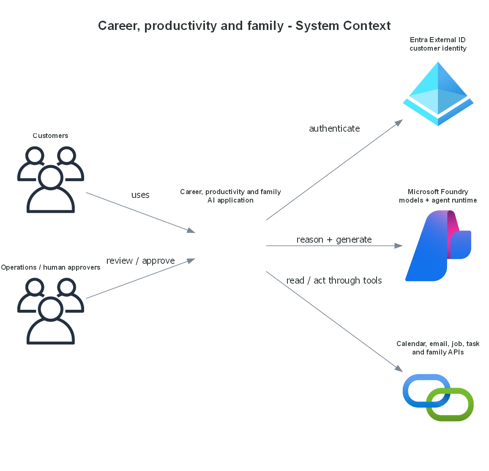

### 2. Runtime and transaction flow

Shows synchronous ingress, structured model reasoning, controlled tool calls, durable workflow state and asynchronous retry/compensation.

### 3. Security, data and operations

Shows identity, managed authorization, policy and approval gates, grounded retrieval, workflow state, private access, secrets and redacted telemetry.

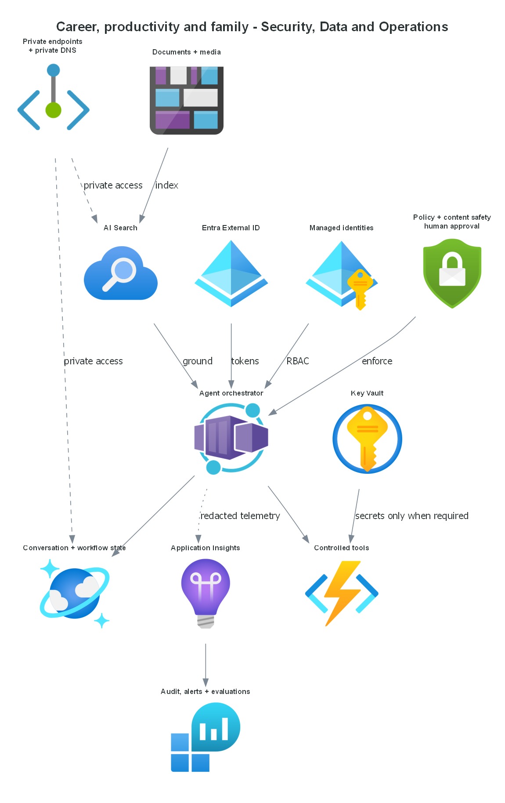

**Notation:** solid arrows are primary runtime/data flows. Dashed arrows represent identity, policy, secrets or private-network controls. Dotted arrows represent telemetry. The diagrams deliberately split concerns to avoid an unreadable “everything” diagram.

<!-- category-architecture:auto -->
## Category deployment architecture

This Azure-oriented deployment separates deterministic business operations from probabilistic model reasoning. The application owns authorization, validation, workflow state and approval; the model proposes actions only through allowlisted tools.

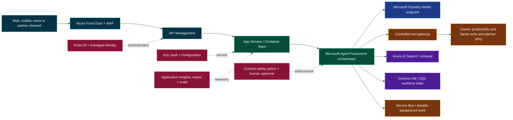

**Responsibility split**

- **Edge and API layer:** authentication, quotas, request validation and tenant routing.
- **Application/orchestration layer:** deterministic workflow, retries, approvals, state and tool authorization.
- **Model layer:** language understanding, planning and explanation; it never becomes the system of record.
- **Tool layer:** narrow typed operations with idempotency, schema validation and audit events.
- **Data layer:** retrieval indexes are separate from transactional state and sensitive records.
- **Control plane:** identity, secrets, policy, privacy, observability and evaluations apply across every request.

## 72. Career-planning assistant

**Purpose and user journey:** A proposed assistant that helps professionals explore roles, identify skill gaps and build a 6–24 month career plan. Journey: onboarding questionnaire and optional résumé import, goal exploration, role and skill-gap map, milestone plan, then monthly check-ins that revise the plan.

**Reference architecture:** `Web/mobile chat -> API gateway -> planner agent -> skills-taxonomy + labor-market tools -> profile store -> plan and reminder service`

<!-- architecture-diagram:auto -->
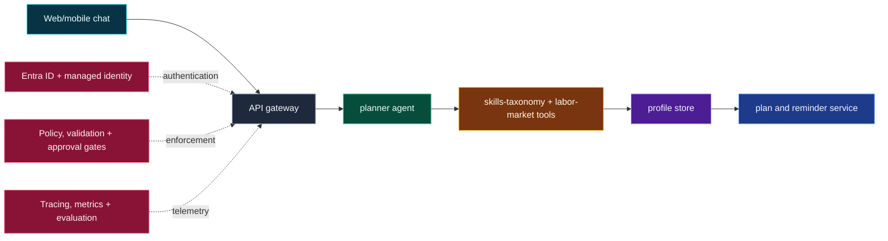

<!-- main-logic:auto -->
**Main execution logic**

1. **Authenticate and validate:** the edge/API layer verifies identity, tenant, request schema, quotas and correlation ID before agent execution.
2. **Load trusted context:** the application loads the minimum required profile, conversation checkpoint, domain state and authorization scope; sensitive fields stay outside prompts unless necessary.
3. **Plan with bounded authority:** the Foundry/Agent Framework adapter receives only allowlisted tool schemas and returns a structured proposal. The app-specific path is `Web/mobile chat -> API gateway -> planner agent -> skills-taxonomy + labor-market tools -> profile store -> plan and reminder service`.
4. **Ground every decision:** current facts such as price, availability, policy, entitlement or status come from retrieval and typed tools—not model memory.
5. **Apply deterministic policy:** code validates tool name, arguments, user authority, limits, risk class and output schema. Invalid proposals are rejected and audited.
6. **Approve consequential actions:** writes, purchases, bookings, messages, account changes and other high-impact operations pause for explicit human approval.
7. **Execute safely:** the controlled gateway invokes the narrow business operation with an idempotency key, timeout, bounded retry and compensation or dead-letter behavior.
8. **Commit and learn:** persist the result, return a source-grounded response, emit redacted traces and feed curated outcomes into regression evaluations.

**Runnable code pattern:** [C# policy, approval, idempotency and audit sample](../../samples/agent-workflow-csharp/README.md).

**Core components:** Conversational UI, profile and goals store, skills-taxonomy mapper (ESCO or O*NET-style), gap-analysis engine, learning-resource recommender, plan tracker, and PDF or calendar export.

**Agent/workflow design:** One planner agent with tool calls and staged workflow: elicit, research, propose options, user chooses, commit plan. Nothing is saved without user confirmation. A separate critic pass checks that market claims carry a cited source and flags weak evidence.

**Data and integrations:** Profile, skills, goals, milestones and check-in notes. Optional integrations: user-uploaded LinkedIn data export, public labor-market datasets, course catalogs and calendar. Prefer user-supplied files over scraping.

**Security and safety:** Encrypt data at rest and in transit, isolate users, minimize personal data and obtain explicit consent before retaining résumés. Offer export and deletion. Never promise salary or hiring outcomes, label uncertainty, and exclude protected attributes from recommendations.

**Reliability, observability and evaluation:** Log tool calls, sources and latency without storing raw personal text. Track plan acceptance and milestone completion. Evaluate with rubric-graded test personas, citation-accuracy checks and regression suites on every model or prompt change; fall back to cached taxonomy data if live sources fail.

**MVP build path:** Weeks 1–2: intake and chat with taxonomy lookup. Weeks 3–4: gap analysis and plan export. Weeks 5–6: check-ins and the evaluation harness. Then pilot with about 20 users and compare plan usefulness ratings against a baseline of generic advice.

## 73. CV and résumé assistant

**Purpose and user journey:** A proposed assistant that turns a user's experience into targeted, honest CVs and résumés. Journey: upload or enter history, choose a target role or job description, review suggested rewrites and gaps, select a template, then export ATS-friendly PDF or DOCX versions.

**Reference architecture:** `Upload/editor UI -> parser -> structured profile -> tailoring agent -> truthfulness checker -> template renderer -> PDF/DOCX export`

<!-- architecture-diagram:auto -->
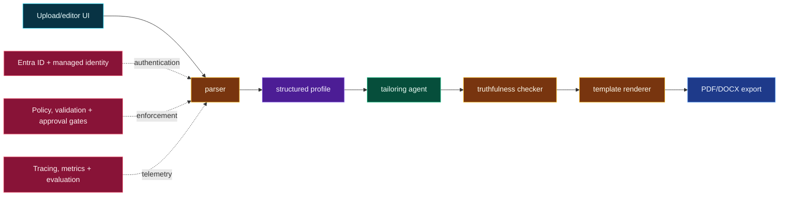

<!-- main-logic:auto -->
**Main execution logic**

1. **Authenticate and validate:** the edge/API layer verifies identity, tenant, request schema, quotas and correlation ID before agent execution.
2. **Load trusted context:** the application loads the minimum required profile, conversation checkpoint, domain state and authorization scope; sensitive fields stay outside prompts unless necessary.
3. **Plan with bounded authority:** the Foundry/Agent Framework adapter receives only allowlisted tool schemas and returns a structured proposal. The app-specific path is `Upload/editor UI -> parser -> structured profile -> tailoring agent -> truthfulness checker -> template renderer -> PDF/DOCX export`.
4. **Ground every decision:** current facts such as price, availability, policy, entitlement or status come from retrieval and typed tools—not model memory.
5. **Apply deterministic policy:** code validates tool name, arguments, user authority, limits, risk class and output schema. Invalid proposals are rejected and audited.
6. **Approve consequential actions:** writes, purchases, bookings, messages, account changes and other high-impact operations pause for explicit human approval.
7. **Execute safely:** the controlled gateway invokes the narrow business operation with an idempotency key, timeout, bounded retry and compensation or dead-letter behavior.
8. **Commit and learn:** persist the result, return a source-grounded response, emit redacted traces and feed curated outcomes into regression evaluations.

**Runnable code pattern:** [C# policy, approval, idempotency and audit sample](../../samples/agent-workflow-csharp/README.md).

**Core components:** Document parser with OCR fallback, canonical profile schema (roles, achievements, skills), job-description analyzer, rewrite engine, keyword-coverage scorer, template renderer, version manager and side-by-side diff viewer.

**Agent/workflow design:** A tailoring agent proposes bullet rewrites using only facts in the profile. A verifier agent compares every claim to the source profile and flags invented metrics or titles. The user accepts or edits each change; quantification prompts ask for real numbers rather than guessing them.

**Data and integrations:** Stores structured profile, CV versions and job-description snapshots. Integrations: file upload, Google Drive or OneDrive import, optional job-board URL fetch, and export to PDF and DOCX. No automatic submission to employers in the MVP.

**Security and safety:** Résumés contain sensitive personal data, so apply encryption, short default retention, consent for model processing and one-click deletion. Redact contact details from logs. Block fabrication of credentials, warn about inflated claims, and avoid inferring age, gender or ethnicity.

**Reliability, observability and evaluation:** Monitor parse success rate, fabrication-flag rate and export failures. Evaluate with a gold set of résumés scored on factual fidelity, readability and ATS parseability; run tests that confirm output text matches source facts. Keep template rendering deterministic and unit tested.

**MVP build path:** Weeks 1–2: parser plus profile schema. Weeks 3–4: single-template tailoring with truthfulness checks. Weeks 5–6: diff review, versions and DOCX export. Later: multiple templates, languages and cover-letter generation.

## 74. Interview-practice coach

**Purpose and user journey:** A proposed coach that lets candidates rehearse interviews and receive structured feedback. Journey: pick role and interview type, optionally paste a job description, answer questions by text or voice, receive scored feedback with improved sample structures, then track progress across sessions.

**Reference architecture:** `Voice/text client -> session orchestrator -> interviewer agent -> speech-to-text -> evaluator agent -> feedback store -> progress dashboard`

<!-- architecture-diagram:auto -->
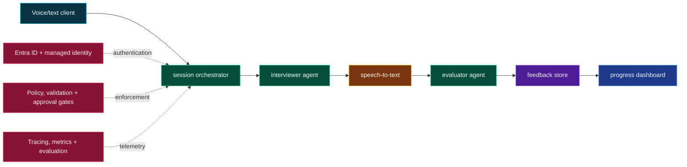

<!-- main-logic:auto -->
**Main execution logic**

1. **Authenticate and validate:** the edge/API layer verifies identity, tenant, request schema, quotas and correlation ID before agent execution.
2. **Load trusted context:** the application loads the minimum required profile, conversation checkpoint, domain state and authorization scope; sensitive fields stay outside prompts unless necessary.
3. **Plan with bounded authority:** the Foundry/Agent Framework adapter receives only allowlisted tool schemas and returns a structured proposal. The app-specific path is `Voice/text client -> session orchestrator -> interviewer agent -> speech-to-text -> evaluator agent -> feedback store -> progress dashboard`.
4. **Ground every decision:** current facts such as price, availability, policy, entitlement or status come from retrieval and typed tools—not model memory.
5. **Apply deterministic policy:** code validates tool name, arguments, user authority, limits, risk class and output schema. Invalid proposals are rejected and audited.
6. **Approve consequential actions:** writes, purchases, bookings, messages, account changes and other high-impact operations pause for explicit human approval.
7. **Execute safely:** the controlled gateway invokes the narrow business operation with an idempotency key, timeout, bounded retry and compensation or dead-letter behavior.
8. **Commit and learn:** persist the result, return a source-grounded response, emit redacted traces and feed curated outcomes into regression evaluations.

**Runnable code pattern:** [C# policy, approval, idempotency and audit sample](../../samples/agent-workflow-csharp/README.md).

**Core components:** Question bank by role and level, interviewer persona engine, speech-to-text and optional text-to-speech, rubric-based evaluator (STAR structure, clarity, relevance, pacing), feedback generator, session recorder and progress dashboard.

**Agent/workflow design:** An interviewer agent asks adaptive follow-ups; an independent evaluator agent scores answers against a published rubric. The user sets difficulty and may pause for hints. Feedback separates content, structure and delivery, and suggests rewrites without inventing the user's experience.

**Data and integrations:** Stores transcripts, scores, optional audio and chosen role goals. Integrations: browser microphone APIs, speech services, calendar for practice reminders, and optional import of the user's CV for tailored questions.

**Security and safety:** Audio is highly personal: record only with explicit opt-in, keep audio short-lived by default, and let users delete transcripts. Avoid scoring accent, appearance or protected traits. State that practice scores do not predict real hiring decisions, and provide a calm mode for anxious users.

**Reliability, observability and evaluation:** Track transcription error rate, latency per turn and session completion. Evaluate rubric agreement between model scores and human coach ratings on a sample set, check consistency across repeated runs, and review feedback for bias across accents using test recordings.

**MVP build path:** Weeks 1–2: text-only behavioral interviews with rubric scoring. Weeks 3–4: voice input and progress tracking. Weeks 5–6: technical and role-specific banks plus human-coach calibration. Pilot with job seekers before adding video analysis, if ever.

## 75. Job-search assistant

**Purpose and user journey:** A proposed assistant that organizes and accelerates a job search. Journey: set preferences and constraints, receive ranked postings from permitted sources, review fit explanations, track applications in a pipeline, draft follow-ups, and get weekly summaries with next actions.

**Reference architecture:** `Preferences UI -> scheduler -> source connectors -> dedupe and ranking agent -> application tracker -> notifier and draft generator`

<!-- architecture-diagram:auto -->
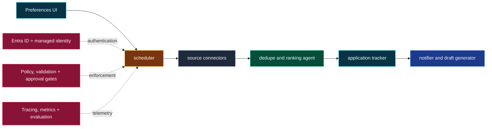

<!-- main-logic:auto -->
**Main execution logic**

1. **Authenticate and validate:** the edge/API layer verifies identity, tenant, request schema, quotas and correlation ID before agent execution.
2. **Load trusted context:** the application loads the minimum required profile, conversation checkpoint, domain state and authorization scope; sensitive fields stay outside prompts unless necessary.
3. **Plan with bounded authority:** the Foundry/Agent Framework adapter receives only allowlisted tool schemas and returns a structured proposal. The app-specific path is `Preferences UI -> scheduler -> source connectors -> dedupe and ranking agent -> application tracker -> notifier and draft generator`.
4. **Ground every decision:** current facts such as price, availability, policy, entitlement or status come from retrieval and typed tools—not model memory.
5. **Apply deterministic policy:** code validates tool name, arguments, user authority, limits, risk class and output schema. Invalid proposals are rejected and audited.
6. **Approve consequential actions:** writes, purchases, bookings, messages, account changes and other high-impact operations pause for explicit human approval.
7. **Execute safely:** the controlled gateway invokes the narrow business operation with an idempotency key, timeout, bounded retry and compensation or dead-letter behavior.
8. **Commit and learn:** persist the result, return a source-grounded response, emit redacted traces and feed curated outcomes into regression evaluations.

**Runnable code pattern:** [C# policy, approval, idempotency and audit sample](../../samples/agent-workflow-csharp/README.md).

**Core components:** Source connectors (job-board APIs, RSS, user-pasted links), normalizer and deduplicator, fit-ranking engine, application pipeline tracker, reminder scheduler, company-research summarizer and notification service.

**Agent/workflow design:** A scheduled ranking agent scores new postings against preferences and the user's profile, giving reasons and uncertainty. A research agent summarizes employers from cited public sources. Applying, messaging or sharing data always requires explicit user approval; no unattended submissions.

**Data and integrations:** Stores preferences, postings, pipeline states, notes and contacts. Integrations: official job-board APIs and feeds, email and calendar for interview scheduling, and CV assistant exports. Respect site terms and robots rules instead of aggressive scraping.

**Security and safety:** Minimize stored personal data, encrypt tokens with scoped OAuth, and keep the search private from current employers by never contacting anyone automatically. Warn about scam postings, upfront-fee requests and suspicious links, and exclude discriminatory filters.

**Reliability, observability and evaluation:** Monitor connector uptime, duplicate rate, notification latency and stale postings. Evaluate ranking with labeled relevance sets and user thumbs-up or down feedback, and measure scam-detection precision. Use retries with backoff and show source freshness timestamps.

**MVP build path:** Weeks 1–2: preference form, two sources and a tracker. Weeks 3–4: ranking with explanations and email digests. Weeks 5–6: follow-up drafts, scam checks and feedback loop. Later: more regions, calendar integration and salary-range context.

## 76. Personal productivity assistant

**Purpose and user journey:** A proposed assistant that helps individuals capture tasks, set priorities and sustain good work habits. Journey: connect task sources, capture commitments by chat or voice, receive a prioritized view, run focus sessions, and complete a brief weekly review with suggested adjustments.

**Reference architecture:** `Chat/voice capture -> inbox normalizer -> priority agent -> task store -> calendar and notification connectors -> weekly review generator`

<!-- architecture-diagram:auto -->
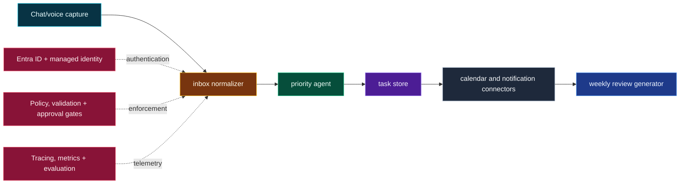

<!-- main-logic:auto -->
**Main execution logic**

1. **Authenticate and validate:** the edge/API layer verifies identity, tenant, request schema, quotas and correlation ID before agent execution.
2. **Load trusted context:** the application loads the minimum required profile, conversation checkpoint, domain state and authorization scope; sensitive fields stay outside prompts unless necessary.
3. **Plan with bounded authority:** the Foundry/Agent Framework adapter receives only allowlisted tool schemas and returns a structured proposal. The app-specific path is `Chat/voice capture -> inbox normalizer -> priority agent -> task store -> calendar and notification connectors -> weekly review generator`.
4. **Ground every decision:** current facts such as price, availability, policy, entitlement or status come from retrieval and typed tools—not model memory.
5. **Apply deterministic policy:** code validates tool name, arguments, user authority, limits, risk class and output schema. Invalid proposals are rejected and audited.
6. **Approve consequential actions:** writes, purchases, bookings, messages, account changes and other high-impact operations pause for explicit human approval.
7. **Execute safely:** the controlled gateway invokes the narrow business operation with an idempotency key, timeout, bounded retry and compensation or dead-letter behavior.
8. **Commit and learn:** persist the result, return a source-grounded response, emit redacted traces and feed curated outcomes into regression evaluations.

**Runnable code pattern:** [C# policy, approval, idempotency and audit sample](../../samples/agent-workflow-csharp/README.md).

**Core components:** Capture interface, task and project store, priority and effort estimator, focus-session timer, habit tracker, review generator, notification service and connectors for task apps and calendars.

**Agent/workflow design:** A coordinator agent turns raw captures into tasks with due dates, context and estimates, then proposes a priority order using a transparent method such as Eisenhower or energy-based scheduling. Users approve changes; low-confidence items go to a clarification queue instead of being guessed.

**Data and integrations:** Stores tasks, projects, habits, estimates and review notes. Integrations: Google or Microsoft calendar, Todoist-style task APIs, email-to-task forwarding and optional notes tools, all through scoped OAuth with revocable access.

**Security and safety:** Request least-privilege scopes, encrypt stored data and let users see exactly what the assistant read or changed. Require confirmation for deletes and bulk edits, avoid manipulative nudges, and respect do-not-disturb hours and wellbeing, such as not encouraging overwork.

**Reliability, observability and evaluation:** Track sync errors, task-capture accuracy and notification opt-outs. Evaluate parsing of dates and priorities on a labeled capture set, run idempotent sync tests, and survey users on perceived overwhelm. Keep an undo log so every automated change is reversible.

**MVP build path:** Weeks 1–2: capture, task store and prioritization. Weeks 3–4: calendar connector and focus sessions. Weeks 5–6: weekly review and undo log. Later: habit tracking, team sharing and voice capture.

## 77. Daily-planning assistant

**Purpose and user journey:** A proposed assistant that builds a realistic plan for each day. Journey: each morning it gathers calendar events, tasks and energy preferences, proposes a time-blocked schedule, adapts to interruptions during the day, and closes with a short evening reflection that feeds tomorrow's plan.

**Reference architecture:** `Calendar + task connectors -> context aggregator -> scheduling agent -> constraint solver -> proposed day plan -> notifier -> replan loop`

<!-- architecture-diagram:auto -->
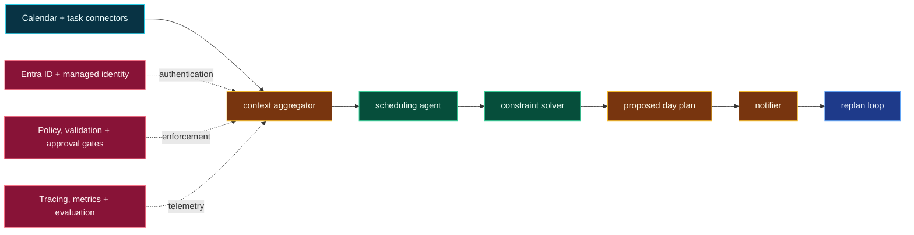

<!-- main-logic:auto -->
**Main execution logic**

1. **Authenticate and validate:** the edge/API layer verifies identity, tenant, request schema, quotas and correlation ID before agent execution.
2. **Load trusted context:** the application loads the minimum required profile, conversation checkpoint, domain state and authorization scope; sensitive fields stay outside prompts unless necessary.
3. **Plan with bounded authority:** the Foundry/Agent Framework adapter receives only allowlisted tool schemas and returns a structured proposal. The app-specific path is `Calendar + task connectors -> context aggregator -> scheduling agent -> constraint solver -> proposed day plan -> notifier -> replan loop`.
4. **Ground every decision:** current facts such as price, availability, policy, entitlement or status come from retrieval and typed tools—not model memory.
5. **Apply deterministic policy:** code validates tool name, arguments, user authority, limits, risk class and output schema. Invalid proposals are rejected and audited.
6. **Approve consequential actions:** writes, purchases, bookings, messages, account changes and other high-impact operations pause for explicit human approval.
7. **Execute safely:** the controlled gateway invokes the narrow business operation with an idempotency key, timeout, bounded retry and compensation or dead-letter behavior.
8. **Commit and learn:** persist the result, return a source-grounded response, emit redacted traces and feed curated outcomes into regression evaluations.

**Runnable code pattern:** [C# policy, approval, idempotency and audit sample](../../samples/agent-workflow-csharp/README.md).

**Core components:** Context aggregator, travel and duration estimator, constraint-based time-block solver, plan preview UI, replanning trigger service, notification channel and reflection log.

**Agent/workflow design:** The scheduling agent drafts options, while a deterministic solver enforces hard constraints such as meetings, commute and breaks. The agent explains tradeoffs in plain language. Events are written to the calendar only after the user accepts the plan, and replans are offered rather than silently applied.

**Data and integrations:** Stores preferences (chronotype, break rules), historical task durations and daily reflections. Integrations: calendar APIs, task lists, weather and maps for travel time, and optional wearable sleep summaries with separate opt-in.

**Security and safety:** Calendars reveal sensitive routines, so use minimal scopes, encrypt data and avoid sharing location beyond the travel query. Make health-related inputs optional, never give medical advice, keep plans editable, and avoid over-scheduling by reserving buffer time.

**Reliability, observability and evaluation:** Monitor plan acceptance rate, replan frequency, estimate error and connector failures. Evaluate the solver with property-based tests for conflicts, and the agent's explanations with rubric reviews. Degrade gracefully to a plain task list if calendar access fails.

**MVP build path:** Weeks 1–2: calendar read-only and a morning plan with the solver. Weeks 3–4: acceptance flow, calendar writes and notifications. Weeks 5–6: replanning and evening reflection. Later: learn personal duration estimates and travel-aware planning.

## 78. Email-writing assistant

**Purpose and user journey:** A proposed assistant that helps users draft, rewrite and reply to email with the right tone. Journey: select a thread or start a new message, state intent, receive draft options with tone controls, edit, and send manually or via an approved action.

**Reference architecture:** `Mail client plugin -> thread reader -> context retriever -> drafting agent -> tone and safety checker -> user review -> send`

<!-- architecture-diagram:auto -->
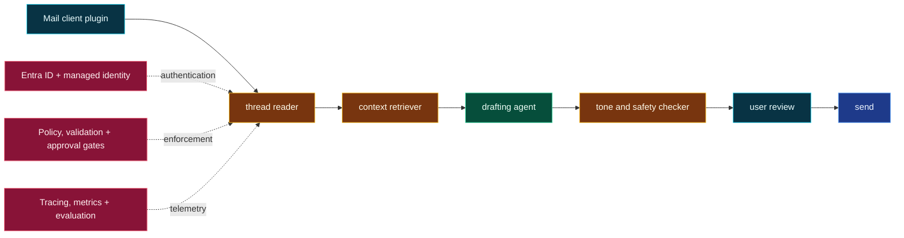

<!-- main-logic:auto -->
**Main execution logic**

1. **Authenticate and validate:** the edge/API layer verifies identity, tenant, request schema, quotas and correlation ID before agent execution.
2. **Load trusted context:** the application loads the minimum required profile, conversation checkpoint, domain state and authorization scope; sensitive fields stay outside prompts unless necessary.
3. **Plan with bounded authority:** the Foundry/Agent Framework adapter receives only allowlisted tool schemas and returns a structured proposal. The app-specific path is `Mail client plugin -> thread reader -> context retriever -> drafting agent -> tone and safety checker -> user review -> send`.
4. **Ground every decision:** current facts such as price, availability, policy, entitlement or status come from retrieval and typed tools—not model memory.
5. **Apply deterministic policy:** code validates tool name, arguments, user authority, limits, risk class and output schema. Invalid proposals are rejected and audited.
6. **Approve consequential actions:** writes, purchases, bookings, messages, account changes and other high-impact operations pause for explicit human approval.
7. **Execute safely:** the controlled gateway invokes the narrow business operation with an idempotency key, timeout, bounded retry and compensation or dead-letter behavior.
8. **Commit and learn:** persist the result, return a source-grounded response, emit redacted traces and feed curated outcomes into regression evaluations.

**Runnable code pattern:** [C# policy, approval, idempotency and audit sample](../../samples/agent-workflow-csharp/README.md).

**Core components:** Mail plugin or web editor, thread summarizer, style profile learned from sent items (opt-in), drafting engine, tone and clarity checker, template library, attachment and recipient validator and audit log.

**Agent/workflow design:** A drafting agent produces two or three variants from the user's stated intent and the thread context. A checker verifies recipients, flags promised dates or attachments not present, and detects sensitive content. The user always reviews before sending; no autonomous sending in the MVP.

**Data and integrations:** Reads only selected threads, stores optional style examples and templates. Integrations: Gmail and Microsoft 365 APIs via OAuth, contacts for validation, calendar for proposing meeting times, and the user's signature settings.

**Security and safety:** Email contains third-party personal data, so process the minimum needed, avoid training on content, encrypt, and honor retention limits. Defend against prompt injection from email bodies by treating message text as untrusted data. Warn on wrong-recipient, reply-all and confidential-information risks.

**Reliability, observability and evaluation:** Monitor draft acceptance and edit distance, latency and API errors. Evaluate with a test set of threads for tone, factual faithfulness and injection resistance, including adversarial emails. Keep versioned prompts and a kill switch for model regressions.

**MVP build path:** Weeks 1–2: web editor with intent-based drafts. Weeks 3–4: Gmail thread reading and tone controls. Weeks 5–6: safety checker, injection tests and style profile. Later: Outlook support and multilingual drafting.

## 79. Personal knowledge assistant

**Purpose and user journey:** A proposed assistant that lets users capture notes, documents and web clips and query them in natural language with source citations. Journey: connect sources, ingest and index, ask questions, receive cited answers, and review automatically suggested links and summaries.

**Reference architecture:** `Source connectors -> ingestion pipeline -> chunker and embeddings -> vector and keyword index + knowledge graph -> retrieval agent -> cited answer UI`

<!-- architecture-diagram:auto -->
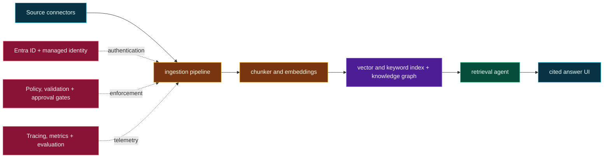

<!-- main-logic:auto -->
**Main execution logic**

1. **Authenticate and validate:** the edge/API layer verifies identity, tenant, request schema, quotas and correlation ID before agent execution.
2. **Load trusted context:** the application loads the minimum required profile, conversation checkpoint, domain state and authorization scope; sensitive fields stay outside prompts unless necessary.
3. **Plan with bounded authority:** the Foundry/Agent Framework adapter receives only allowlisted tool schemas and returns a structured proposal. The app-specific path is `Source connectors -> ingestion pipeline -> chunker and embeddings -> vector and keyword index + knowledge graph -> retrieval agent -> cited answer UI`.
4. **Ground every decision:** current facts such as price, availability, policy, entitlement or status come from retrieval and typed tools—not model memory.
5. **Apply deterministic policy:** code validates tool name, arguments, user authority, limits, risk class and output schema. Invalid proposals are rejected and audited.
6. **Approve consequential actions:** writes, purchases, bookings, messages, account changes and other high-impact operations pause for explicit human approval.
7. **Execute safely:** the controlled gateway invokes the narrow business operation with an idempotency key, timeout, bounded retry and compensation or dead-letter behavior.
8. **Commit and learn:** persist the result, return a source-grounded response, emit redacted traces and feed curated outcomes into regression evaluations.

**Runnable code pattern:** [C# policy, approval, idempotency and audit sample](../../samples/agent-workflow-csharp/README.md).

**Core components:** Connectors for notes, files, email and browser clips; ingestion and OCR pipeline; hybrid search index; entity and link extractor; retrieval-augmented answering service; memory and tagging layer; and an audit view of sources.

**Agent/workflow design:** A retrieval agent decomposes questions, runs hybrid search, reranks and answers only with cited passages, saying so when evidence is missing. Scheduled jobs produce digests and link suggestions; users approve any note edits. Source text is treated as untrusted to resist injected instructions.

**Data and integrations:** Stores documents, embeddings, metadata and access tags. Integrations: Obsidian or Markdown folders, Notion, cloud drives, read-it-later tools and calendar. Prefer local or user-controlled storage and incremental sync using content hashes.

**Security and safety:** Encrypt the index, support local-first deployment, and keep per-source permissions so private notes never surface in the wrong context. Provide exclusion rules, deletion that also removes embeddings, and no third-party sharing without consent. Show provenance to reduce hallucination reliance.

**Reliability, observability and evaluation:** Monitor ingestion lag, index freshness and retrieval latency. Evaluate with question sets built from the user's own corpus measuring recall at k, citation correctness and abstention accuracy. Re-run evaluations when embedding models change and keep reproducible index rebuilds.

**MVP build path:** Weeks 1–2: Markdown folder ingestion and cited Q&A. Weeks 3–4: hybrid search, reranking and deletion handling. Weeks 5–6: PDFs, web clips and digests. Later: knowledge graph, email sources and mobile capture.

## 80. Family schedule assistant

**Purpose and user journey:** A proposed assistant that coordinates shared family calendars, school events, activities and chores. Journey: adult members create a household, link calendars and school feeds, review detected conflicts, accept suggested solutions, and get role-based reminders and a weekly family overview.

**Reference architecture:** `Member calendars + school feeds -> ingest -> conflict detector -> coordination agent -> household calendar -> role-based notifications`

<!-- architecture-diagram:auto -->
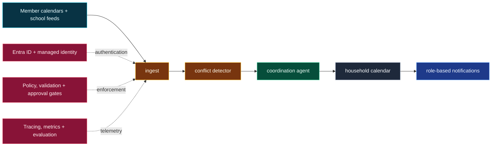

<!-- main-logic:auto -->
**Main execution logic**

1. **Authenticate and validate:** the edge/API layer verifies identity, tenant, request schema, quotas and correlation ID before agent execution.
2. **Load trusted context:** the application loads the minimum required profile, conversation checkpoint, domain state and authorization scope; sensitive fields stay outside prompts unless necessary.
3. **Plan with bounded authority:** the Foundry/Agent Framework adapter receives only allowlisted tool schemas and returns a structured proposal. The app-specific path is `Member calendars + school feeds -> ingest -> conflict detector -> coordination agent -> household calendar -> role-based notifications`.
4. **Ground every decision:** current facts such as price, availability, policy, entitlement or status come from retrieval and typed tools—not model memory.
5. **Apply deterministic policy:** code validates tool name, arguments, user authority, limits, risk class and output schema. Invalid proposals are rejected and audited.
6. **Approve consequential actions:** writes, purchases, bookings, messages, account changes and other high-impact operations pause for explicit human approval.
7. **Execute safely:** the controlled gateway invokes the narrow business operation with an idempotency key, timeout, bounded retry and compensation or dead-letter behavior.
8. **Commit and learn:** persist the result, return a source-grounded response, emit redacted traces and feed curated outcomes into regression evaluations.

**Runnable code pattern:** [C# policy, approval, idempotency and audit sample](../../samples/agent-workflow-csharp/README.md).

**Core components:** Household and role model, calendar connectors, event extractor from emails or PDFs, conflict and logistics detector (pickups, travel), chore rotation engine, notification service and a shared dashboard.

**Agent/workflow design:** A coordination agent extracts events, detects overlaps and proposes options such as who handles pickup. Suggestions are sent for approval to the relevant adults, and changes touching others are never applied silently. Fairness rules balance chores over time.

**Data and integrations:** Stores household members, roles, events, locations and chore history. Integrations: Google, Apple and Microsoft calendars, school and club iCal feeds, email forwarding, maps for travel times and messaging for reminders.

**Security and safety:** Family data is sensitive, especially for children. Require an adult account holder, explicit consent from each adult for calendar linking, and minimal child data such as first name and schedule only. Apply role-based visibility, avoid precise location sharing, delete data when a member leaves, and respect teenagers' privacy through agreed settings. Make no use of child data for advertising or model training.

**Reliability, observability and evaluation:** Monitor sync failures, duplicate events and notification delivery. Evaluate event extraction on sample school newsletters and conflict detection with simulated households. Provide idempotent sync, audit history of every change and a rollback option.

**MVP build path:** Weeks 1–2: household model and two calendar connectors. Weeks 3–4: conflict detection and approval flow. Weeks 5–6: school-feed extraction, chores and weekly digest. Pilot with a few families and a consent review first.

## 81. Parenting assistant

**Purpose and user journey:** A proposed assistant offering evidence-based parenting guidance, routines and activity ideas. Journey: a parent creates a profile for the child's age band, asks questions about sleep, behavior or development, receives sourced, age-appropriate suggestions and can save routines or reminders.

**Reference architecture:** `Parent chat -> safety triage -> retrieval over vetted sources -> guidance agent -> age-aware response with citations -> routine and reminder service`

<!-- architecture-diagram:auto -->
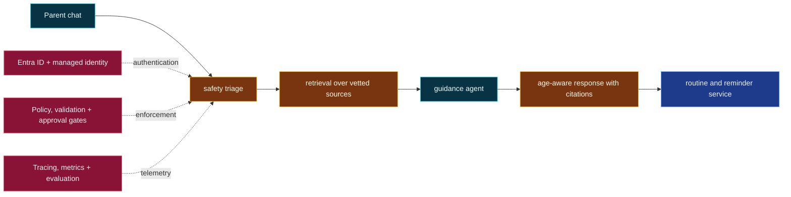

<!-- main-logic:auto -->
**Main execution logic**

1. **Authenticate and validate:** the edge/API layer verifies identity, tenant, request schema, quotas and correlation ID before agent execution.
2. **Load trusted context:** the application loads the minimum required profile, conversation checkpoint, domain state and authorization scope; sensitive fields stay outside prompts unless necessary.
3. **Plan with bounded authority:** the Foundry/Agent Framework adapter receives only allowlisted tool schemas and returns a structured proposal. The app-specific path is `Parent chat -> safety triage -> retrieval over vetted sources -> guidance agent -> age-aware response with citations -> routine and reminder service`.
4. **Ground every decision:** current facts such as price, availability, policy, entitlement or status come from retrieval and typed tools—not model memory.
5. **Apply deterministic policy:** code validates tool name, arguments, user authority, limits, risk class and output schema. Invalid proposals are rejected and audited.
6. **Approve consequential actions:** writes, purchases, bookings, messages, account changes and other high-impact operations pause for explicit human approval.
7. **Execute safely:** the controlled gateway invokes the narrow business operation with an idempotency key, timeout, bounded retry and compensation or dead-letter behavior.
8. **Commit and learn:** persist the result, return a source-grounded response, emit redacted traces and feed curated outcomes into regression evaluations.

**Runnable code pattern:** [C# policy, approval, idempotency and audit sample](../../samples/agent-workflow-csharp/README.md).

**Core components:** Chat interface, age-band profile, vetted knowledge base (pediatric and public-health guidance), safety triage classifier, guidance generator, routine builder, reminder service and an escalation resource directory.

**Agent/workflow design:** A triage step runs first and detects emergencies, abuse, self-harm or medical red flags, replying with urgent-help instructions and local emergency numbers instead of advice. Otherwise a retrieval-grounded agent answers with citations and options, avoids diagnosis and encourages professional consultation.

**Data and integrations:** Stores minimal child data: age band or birth month, optional interests and saved routines. Integrations: curated sources such as national health services and pediatric associations, calendar reminders and optional baby tracker data, with explicit consent.

**Security and safety:** Collect the least child data, avoid names, photos and exact birthdates by default, and require a parent or guardian account. Obtain parental consent, comply with applicable child-privacy laws such as GDPR and COPPA, allow full deletion and never sell data. Do not shame parents or provide diagnoses, and add region-specific disclaimers.

**Reliability, observability and evaluation:** Log triage outcomes without content where possible. Evaluate with clinician-reviewed question sets for accuracy, safe escalation recall and tone; red-team for harmful advice. Track source freshness and review guidance on a schedule, with rapid takedown for outdated content.

**MVP build path:** Weeks 1–2: vetted knowledge base and cited Q&A for one age band. Weeks 3–4: triage classifier and escalation flows. Weeks 5–8: routines, reminders and clinician review of outputs before a limited pilot.

## 82. Baby-care tracker

**Purpose and user journey:** A proposed tracker for logging feeds, sleep, diapers, growth and milestones, with shared access for caregivers. Journey: parents add a baby profile, log events with one tap or voice, view patterns and summaries, share with co-parents, and export reports for pediatric visits.

**Reference architecture:** `Mobile app/voice -> event API -> baby event store -> pattern analyzer -> summaries and alerts -> caregiver sharing and export`

<!-- architecture-diagram:auto -->
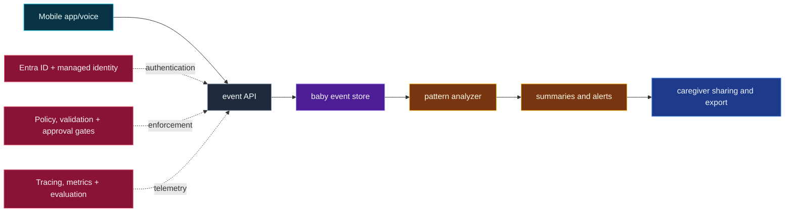

<!-- main-logic:auto -->
**Main execution logic**

1. **Authenticate and validate:** the edge/API layer verifies identity, tenant, request schema, quotas and correlation ID before agent execution.
2. **Load trusted context:** the application loads the minimum required profile, conversation checkpoint, domain state and authorization scope; sensitive fields stay outside prompts unless necessary.
3. **Plan with bounded authority:** the Foundry/Agent Framework adapter receives only allowlisted tool schemas and returns a structured proposal. The app-specific path is `Mobile app/voice -> event API -> baby event store -> pattern analyzer -> summaries and alerts -> caregiver sharing and export`.
4. **Ground every decision:** current facts such as price, availability, policy, entitlement or status come from retrieval and typed tools—not model memory.
5. **Apply deterministic policy:** code validates tool name, arguments, user authority, limits, risk class and output schema. Invalid proposals are rejected and audited.
6. **Approve consequential actions:** writes, purchases, bookings, messages, account changes and other high-impact operations pause for explicit human approval.
7. **Execute safely:** the controlled gateway invokes the narrow business operation with an idempotency key, timeout, bounded retry and compensation or dead-letter behavior.
8. **Commit and learn:** persist the result, return a source-grounded response, emit redacted traces and feed curated outcomes into regression evaluations.

**Runnable code pattern:** [C# policy, approval, idempotency and audit sample](../../samples/agent-workflow-csharp/README.md).

**Core components:** Offline-capable mobile app, quick-log widgets, event store, growth-chart calculator using WHO reference curves, pattern analyzer, caregiver roles, reminders and report exporter.

**Agent/workflow design:** Mostly deterministic workflow with an optional language agent that turns voice notes such as “fed 120 ml at 3” into structured events, shown for confirmation. Summaries describe trends only; threshold alerts, such as fever entries, point to guidance to contact a clinician and never diagnose.

**Data and integrations:** Stores timestamped events, measurements, medication notes and milestones. Integrations: WHO growth standards, calendar for vaccinations from official schedules, wearable or smart-monitor imports only with opt-in, and PDF or CSV export for clinicians.

**Security and safety:** Infant health data is highly sensitive. Use end-to-end or strong at-rest encryption, parent-held accounts, per-caregiver roles and consent for sharing, with audit of who viewed or edited. Collect minimal identifiers, no photos by default and no advertising use. Offer full export and deletion, and display clear non-medical-advice notices.

**Reliability, observability and evaluation:** Offline sync with conflict resolution is key: test merge logic between two caregivers logging concurrently. Monitor sync errors and crash rates. Validate growth percentiles against reference tables and evaluate voice parsing accuracy on sample phrases. Back up encrypted data and test restoration.

**MVP build path:** Weeks 1–3: offline logging for feeds, sleep and diapers with sharing. Weeks 4–5: summaries and growth charts. Weeks 6–8: voice entry, reminders and reports. Include a pediatric-clinician review before pilot.

## 83. Elder-care coordination assistant

**Purpose and user journey:** A proposed assistant that helps family and professional caregivers coordinate care for an older adult. Journey: the elder or authorized representative sets up a care circle, records medications, appointments and tasks, caregivers share updates, and the assistant sends reminders and summarizes changes.

**Reference architecture:** `Care-circle app -> consent and role service -> task and medication store -> coordination agent -> reminders and summaries -> escalation contacts`

<!-- architecture-diagram:auto -->
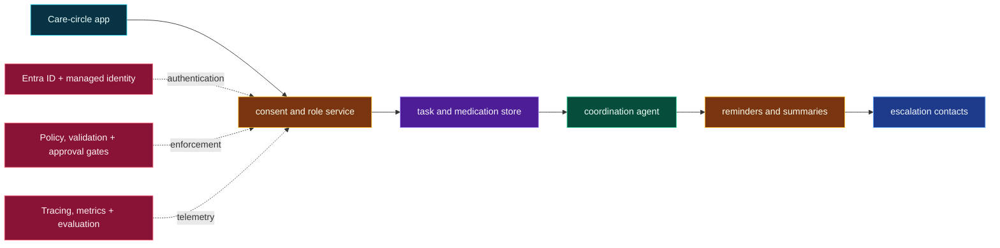

<!-- main-logic:auto -->
**Main execution logic**

1. **Authenticate and validate:** the edge/API layer verifies identity, tenant, request schema, quotas and correlation ID before agent execution.
2. **Load trusted context:** the application loads the minimum required profile, conversation checkpoint, domain state and authorization scope; sensitive fields stay outside prompts unless necessary.
3. **Plan with bounded authority:** the Foundry/Agent Framework adapter receives only allowlisted tool schemas and returns a structured proposal. The app-specific path is `Care-circle app -> consent and role service -> task and medication store -> coordination agent -> reminders and summaries -> escalation contacts`.
4. **Ground every decision:** current facts such as price, availability, policy, entitlement or status come from retrieval and typed tools—not model memory.
5. **Apply deterministic policy:** code validates tool name, arguments, user authority, limits, risk class and output schema. Invalid proposals are rejected and audited.
6. **Approve consequential actions:** writes, purchases, bookings, messages, account changes and other high-impact operations pause for explicit human approval.
7. **Execute safely:** the controlled gateway invokes the narrow business operation with an idempotency key, timeout, bounded retry and compensation or dead-letter behavior.
8. **Commit and learn:** persist the result, return a source-grounded response, emit redacted traces and feed curated outcomes into regression evaluations.

**Runnable code pattern:** [C# policy, approval, idempotency and audit sample](../../samples/agent-workflow-csharp/README.md).

**Core components:** Care-circle and permissions service, appointment and task board, medication schedule, shared care log, summarizer, reminder and escalation service, document vault and visit-prep report generator.

**Agent/workflow design:** A coordination agent summarizes the care log, drafts handoff notes, detects missed tasks and suggests who follows up. Medication or care-plan changes must come from authorized humans; the agent never alters doses, and anything resembling an emergency triggers a direct instruction to call emergency services plus a contact alert.

**Data and integrations:** Stores care plan, contacts, appointments, medication lists and notes. Integrations: calendars, pharmacy refill reminders, telehealth links and optional smart-home or fall-detection signals. Health-record connections use patient-authorized standards such as FHIR where available.

**Security and safety:** Center the elder's autonomy: collect consent from the elder or a legal representative, document who has access, and allow revocation. Use role-based access, encryption, audit logs and minimum necessary health data, aligned with GDPR or HIPAA obligations as applicable. Avoid covert monitoring, and guard against financial exploitation by limiting sensitive documents.

**Reliability, observability and evaluation:** Monitor reminder delivery, acknowledgment rates and escalation latency, with SMS fallback. Evaluate summaries for omission errors using clinician or caregiver-reviewed samples, and test medication-schedule logic exhaustively.

**MVP build path:** Weeks 1–3: care circle, consent and shared task board. Weeks 4–6: medication schedule, reminders and escalation. Weeks 7–10: summaries, visit-prep reports and a small pilot with ethics review.

## 84. Accessible-living assistant

**Purpose and user journey:** A proposed assistant that supports people with disabilities and age-related limitations in daily life, such as describing surroundings, reading documents, finding accessible routes and controlling the home. Journey: users set accessibility preferences, then use voice, text or camera input and receive output in their preferred form.

**Reference architecture:** `Multimodal input (voice/camera/switch) -> preference-aware orchestrator -> vision, speech and maps tools -> adaptive output (audio/large text/haptic) -> user confirmation`

<!-- architecture-diagram:auto -->
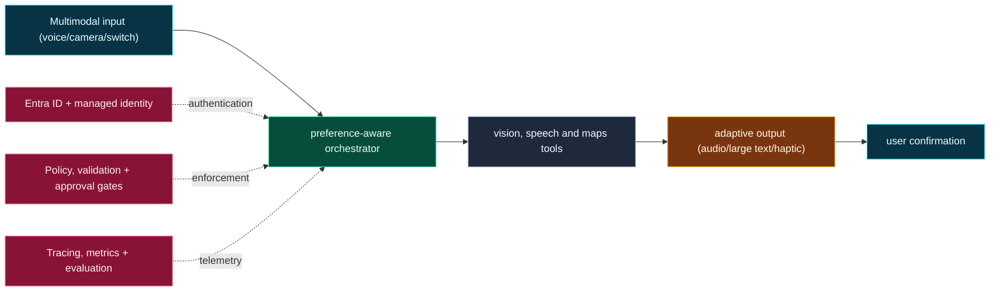

<!-- main-logic:auto -->
**Main execution logic**

1. **Authenticate and validate:** the edge/API layer verifies identity, tenant, request schema, quotas and correlation ID before agent execution.
2. **Load trusted context:** the application loads the minimum required profile, conversation checkpoint, domain state and authorization scope; sensitive fields stay outside prompts unless necessary.
3. **Plan with bounded authority:** the Foundry/Agent Framework adapter receives only allowlisted tool schemas and returns a structured proposal. The app-specific path is `Multimodal input (voice/camera/switch) -> preference-aware orchestrator -> vision, speech and maps tools -> adaptive output (audio/large text/haptic) -> user confirmation`.
4. **Ground every decision:** current facts such as price, availability, policy, entitlement or status come from retrieval and typed tools—not model memory.
5. **Apply deterministic policy:** code validates tool name, arguments, user authority, limits, risk class and output schema. Invalid proposals are rejected and audited.
6. **Approve consequential actions:** writes, purchases, bookings, messages, account changes and other high-impact operations pause for explicit human approval.
7. **Execute safely:** the controlled gateway invokes the narrow business operation with an idempotency key, timeout, bounded retry and compensation or dead-letter behavior.
8. **Commit and learn:** persist the result, return a source-grounded response, emit redacted traces and feed curated outcomes into regression evaluations.

**Runnable code pattern:** [C# policy, approval, idempotency and audit sample](../../samples/agent-workflow-csharp/README.md).

**Core components:** Accessible multimodal client following WCAG and platform accessibility APIs, preference profile, speech recognition and synthesis, document and scene-description service, accessible-route lookup, smart-home bridge and a caregiver-sharing option.

**Agent/workflow design:** An orchestrator selects tools based on the request and the user's profile: for example, OCR for a letter or step-free routes for navigation. It states confidence, asks before acting on devices, and keeps responses short and configurable. Important actions need explicit confirmation by the user's chosen method.

**Data and integrations:** Stores preferences, shortcuts and optional saved places. Integrations: screen readers, OS accessibility services, OpenStreetMap and transit accessibility data, and smart-home standards such as Matter.

**Security and safety:** Camera and voice data are sensitive, so process locally when possible, delete images after use by default and ask consent before sharing with caregivers. Co-design with disabled users and warn that scene descriptions may be wrong and must not be sole guidance for safety-critical decisions such as crossing roads or reading medication labels without verification.

**Reliability, observability and evaluation:** Monitor recognition accuracy, latency and failure modes across users, including degraded and offline operation. Evaluate with disabled participants for task success and effort, run automated accessibility audits, and test OCR and description quality on realistic images.

**MVP build path:** Weeks 1–3: document reading and voice Q&A with accessible UI. Weeks 4–6: scene description with confidence reporting and preference profiles. Weeks 7–10: accessible routes and smart-home control, with iterative testing by disabled users throughout.
