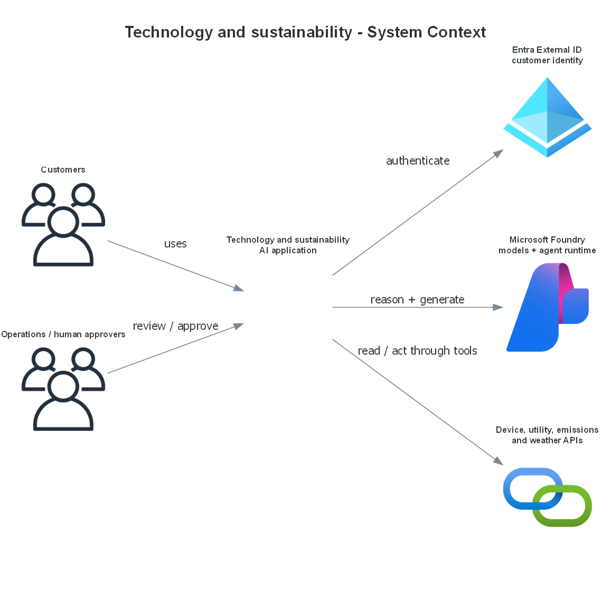
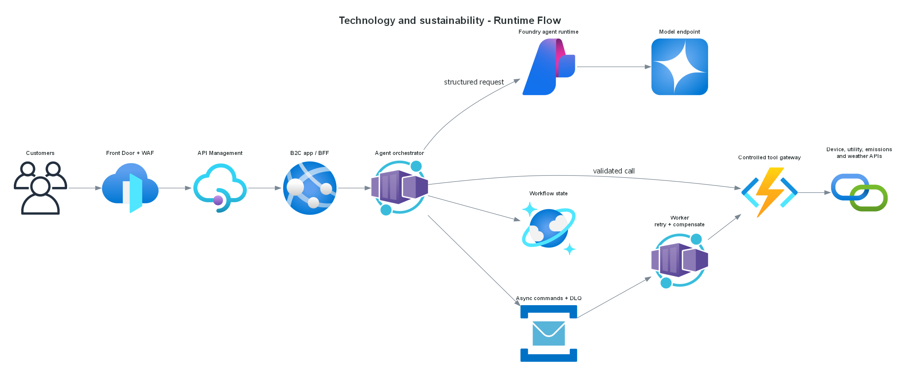
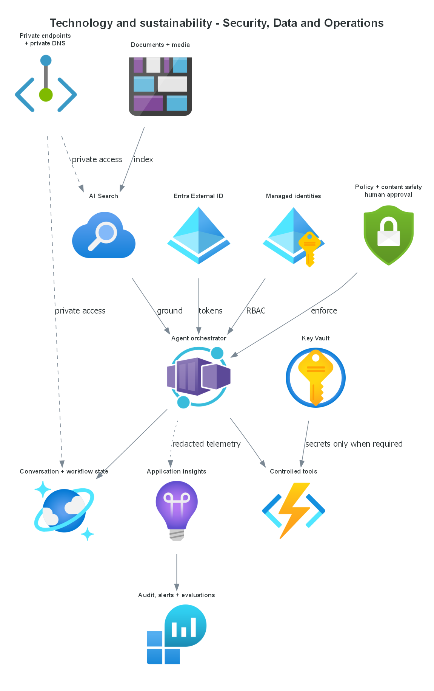

# Consumer Support and Sustainability Assistants (Apps 85-93)

> **Reading guide:** See [how to interpret the system-context, runtime, security/data and application-flow views](README.md#how-to-read-the-architecture-views). Every diagram is a pre-rendered SVG; its editable Mermaid source is linked underneath.

<!-- azure-icon-views:auto -->
## Azure architecture views

These are **logical reference views**, not a claim that every app needs every service. Select services from the non-functional requirements, traffic, data classification and team constraints.

### 1. System context

Shows the customer, human approver, B2C AI system, identity provider, Microsoft Foundry and domain systems.

### 2. Runtime and transaction flow

Shows synchronous ingress, structured model reasoning, controlled tool calls, durable workflow state and asynchronous retry/compensation.

### 3. Security, data and operations

Shows identity, managed authorization, policy and approval gates, grounded retrieval, workflow state, private access, secrets and redacted telemetry.

**Notation:** solid arrows are primary runtime/data flows. Dashed arrows represent identity, policy, secrets or private-network controls. Dotted arrows represent telemetry. The diagrams deliberately split concerns to avoid an unreadable “everything” diagram.

<!-- category-architecture:auto -->
## Category deployment architecture

This Azure-oriented deployment separates deterministic business operations from probabilistic model reasoning. The application owns authorization, validation, workflow state and approval; the model proposes actions only through allowlisted tools.

_[Open editable Mermaid source](../diagrams/mermaid/09-technology-sustainability/source/000-category-deployment.mmd)_

**Responsibility split**

- **Edge and API layer:** authentication, quotas, request validation and tenant routing.
- **Application/orchestration layer:** deterministic workflow, retries, approvals, state and tool authorization.
- **Model layer:** language understanding, planning and explanation; it never becomes the system of record.
- **Tool layer:** narrow typed operations with idempotency, schema validation and audit events.
- **Data layer:** retrieval indexes are separate from transactional state and sensitive records.
- **Control plane:** identity, secrets, policy, privacy, observability and evaluations apply across every request.

## 85. Consumer technical-support agent

**Purpose and user journey:** Resolves common product problems through chat or voice, from identification to resolution or handoff. A customer describes an issue, confirms product and warranty, follows guided checks, and receives a fix, replacement or human escalation.

<!-- implementation-links:auto:start -->
### Implementation references for Consumer technical-support agent

- **Azure / Microsoft (Adjacent match):** [eShopSupport](https://github.com/dotnet/eShopSupport) — implements a closely related domain or workflow that needs adaptation.
- **LangChain / Vercel alternative:** [LangGraph customer-support workflow](https://github.com/langchain-ai/langgraph/tree/main/examples/customer-support).
- **Catalog mapping:** [App #85 in Technology, utilities and sustainability](../../README.md#technology-utilities-and-sustainability).
<!-- implementation-links:auto:end -->

**Reference architecture:** `Customer channel -> Identity/product lookup -> Support agent -> KB retrieval + diagnostic tools -> Policy engine -> Ticket system/human handoff`

<!-- architecture-diagram:auto -->

_[Open editable Mermaid source](../diagrams/mermaid/09-technology-sustainability/source/085-consumer-technical-support-agent.mmd)_

<!-- main-logic:auto -->
**Main execution logic**

1. **Authenticate and validate:** the edge/API layer verifies identity, tenant, request schema, quotas and correlation ID before agent execution.
2. **Load trusted context:** the application loads the minimum required profile, conversation checkpoint, domain state and authorization scope; sensitive fields stay outside prompts unless necessary.
3. **Plan with bounded authority:** the Foundry/Agent Framework adapter receives only allowlisted tool schemas and returns a structured proposal. The app-specific path is `Customer channel -> Identity/product lookup -> Support agent -> KB retrieval + diagnostic tools -> Policy engine -> Ticket system/human handoff`.
4. **Ground every decision:** current facts such as price, availability, policy, entitlement or status come from retrieval and typed tools—not model memory.
5. **Apply deterministic policy:** code validates tool name, arguments, user authority, limits, risk class and output schema. Invalid proposals are rejected and audited.
6. **Approve consequential actions:** writes, purchases, bookings, messages, account changes and other high-impact operations pause for explicit human approval.
7. **Execute safely:** the controlled gateway invokes the narrow business operation with an idempotency key, timeout, bounded retry and compensation or dead-letter behavior.
8. **Commit and learn:** persist the result, return a source-grounded response, emit redacted traces and feed curated outcomes into regression evaluations.

**Runnable code pattern:** [C# policy, approval, idempotency and audit sample](../../samples/agent-workflow-csharp/README.md).

**Core components:** Intent classifier, product registry, knowledge-base retrieval, diagnostic runner, warranty and policy engine, ticketing connector, handoff summarizer, satisfaction survey.

**Agent/workflow design:** Verify the customer, identify the product and gather symptoms. Retrieve approved procedures, ask one step at a time, and run diagnostics. If confidence is low or the issue is safety-related, hand off with a full case summary.

**Data and integrations:** CRM, order and warranty systems, device telemetry with consent, knowledge articles, ticketing, shipping and returns APIs. Redact payment data and keep tool permissions scoped per intent.

**Security and safety:** Technical safety: warn about batteries, mains power, overheating and data loss before risky steps, and never give instructions that bypass safeguards. Authenticate before account actions, limit refunds by policy, resist prompt injection from tickets, and honour privacy rights.

**Reliability, observability and evaluation:** Track resolution rate, containment, escalation quality, policy violations, hallucinated procedures and customer satisfaction. Replay transcripts in regression suites, run red-team tests, sample human audits and alert when the knowledge base is stale.

**MVP build path:** Launch for one product line with retrieval-based answers, read-only order lookup and human handoff. Add diagnostics and ticket creation, then limited actions such as return labels, after approval controls and audit logs are working.

## 86. Device-setup assistant

**Purpose and user journey:** Guides users through setting up phones, routers, smart-home devices and peripherals. The user scans a model or QR code, receives a personalized checklist, completes steps with confirmations and finishes with a verification test.

<!-- implementation-links:auto:start -->
### Implementation references for Device-setup assistant

- **Azure / Microsoft (Adjacent match):** [eShopSupport](https://github.com/dotnet/eShopSupport) — implements a closely related domain or workflow that needs adaptation.
- **LangChain / Vercel alternative:** [LangGraph customer-support workflow](https://github.com/langchain-ai/langgraph/tree/main/examples/customer-support).
- **Catalog mapping:** [App #86 in Technology, utilities and sustainability](../../README.md#technology-utilities-and-sustainability).
<!-- implementation-links:auto:end -->

**Reference architecture:** `Model scan -> Device catalog -> Setup agent -> Step-by-step guide + environment check -> Verification tests -> Completion record`

<!-- architecture-diagram:auto -->

_[Open editable Mermaid source](../diagrams/mermaid/09-technology-sustainability/source/086-device-setup-assistant.mmd)_

<!-- main-logic:auto -->
**Main execution logic**

1. **Authenticate and validate:** the edge/API layer verifies identity, tenant, request schema, quotas and correlation ID before agent execution.
2. **Load trusted context:** the application loads the minimum required profile, conversation checkpoint, domain state and authorization scope; sensitive fields stay outside prompts unless necessary.
3. **Plan with bounded authority:** the Foundry/Agent Framework adapter receives only allowlisted tool schemas and returns a structured proposal. The app-specific path is `Model scan -> Device catalog -> Setup agent -> Step-by-step guide + environment check -> Verification tests -> Completion record`.
4. **Ground every decision:** current facts such as price, availability, policy, entitlement or status come from retrieval and typed tools—not model memory.
5. **Apply deterministic policy:** code validates tool name, arguments, user authority, limits, risk class and output schema. Invalid proposals are rejected and audited.
6. **Approve consequential actions:** writes, purchases, bookings, messages, account changes and other high-impact operations pause for explicit human approval.
7. **Execute safely:** the controlled gateway invokes the narrow business operation with an idempotency key, timeout, bounded retry and compensation or dead-letter behavior.
8. **Commit and learn:** persist the result, return a source-grounded response, emit redacted traces and feed curated outcomes into regression evaluations.

**Runnable code pattern:** [C# policy, approval, idempotency and audit sample](../../samples/agent-workflow-csharp/README.md).

**Core components:** Model recognizer, setup-procedure library, compatibility checker, step state tracker, network or app diagnostics, media and AR helper, backup reminders, completion verifier.

**Agent/workflow design:** Identify device and operating context, check compatibility, then produce a short ordered checklist. Deliver one step at a time with confirmation and rollback notes. Detect divergence and switch to troubleshooting.

**Data and integrations:** Manufacturer manuals, firmware metadata, app-store links, router and smart-home APIs, optional screenshots, and account-linking flows. Do not store Wi-Fi passwords or tokens in logs.

**Security and safety:** Technical safety: recommend official firmware, change default passwords, enable updates, warn before factory resets, and avoid unsafe electrical or battery steps. Never request passwords in chat. Check domains for official links and isolate guest or IoT networks when appropriate.

**Reliability, observability and evaluation:** Measure setup completion, time to finish, step abandonment and firmware-version mismatch. Test procedures on real devices, version guides by model and firmware, and mark unsupported models clearly. Collect anonymous failure points to improve guides.

**MVP build path:** Support three popular device types with curated guides, step tracking and a final test checklist. Add model recognition and compatibility checks, then connect to platform APIs with explicit consent and a clear permission screen.

## 87. Troubleshooting assistant

**Purpose and user journey:** Diagnoses faults in appliances, software and connected devices by asking targeted questions and proposing safe tests. A user reports symptoms, answers prompts, applies low-risk fixes and is told when to stop and contact a professional.

<!-- implementation-links:auto:start -->
### Implementation references for Troubleshooting assistant

- **Azure / Microsoft (Adjacent match):** [eShopSupport](https://github.com/dotnet/eShopSupport) — implements a closely related domain or workflow that needs adaptation.
- **LangChain / Vercel alternative:** [LangGraph customer-support workflow](https://github.com/langchain-ai/langgraph/tree/main/examples/customer-support).
- **Catalog mapping:** [App #87 in Technology, utilities and sustainability](../../README.md#technology-utilities-and-sustainability).
<!-- implementation-links:auto:end -->

**Reference architecture:** `Symptom intake -> Triage agent -> Fault-tree/KB retrieval -> Test planner -> Risk gate -> Fix guidance or professional referral`

<!-- architecture-diagram:auto -->

_[Open editable Mermaid source](../diagrams/mermaid/09-technology-sustainability/source/087-troubleshooting-assistant.mmd)_

<!-- main-logic:auto -->
**Main execution logic**

1. **Authenticate and validate:** the edge/API layer verifies identity, tenant, request schema, quotas and correlation ID before agent execution.
2. **Load trusted context:** the application loads the minimum required profile, conversation checkpoint, domain state and authorization scope; sensitive fields stay outside prompts unless necessary.
3. **Plan with bounded authority:** the Foundry/Agent Framework adapter receives only allowlisted tool schemas and returns a structured proposal. The app-specific path is `Symptom intake -> Triage agent -> Fault-tree/KB retrieval -> Test planner -> Risk gate -> Fix guidance or professional referral`.
4. **Ground every decision:** current facts such as price, availability, policy, entitlement or status come from retrieval and typed tools—not model memory.
5. **Apply deterministic policy:** code validates tool name, arguments, user authority, limits, risk class and output schema. Invalid proposals are rejected and audited.
6. **Approve consequential actions:** writes, purchases, bookings, messages, account changes and other high-impact operations pause for explicit human approval.
7. **Execute safely:** the controlled gateway invokes the narrow business operation with an idempotency key, timeout, bounded retry and compensation or dead-letter behavior.
8. **Commit and learn:** persist the result, return a source-grounded response, emit redacted traces and feed curated outcomes into regression evaluations.

**Runnable code pattern:** [C# policy, approval, idempotency and audit sample](../../samples/agent-workflow-csharp/README.md).

**Core components:** Symptom extractor, fault-tree library, manuals and forum retrieval, hypothesis ranker, test planner, risk classifier, log analyzer, case memory.

**Agent/workflow design:** Convert symptoms into candidate causes, choose the next most informative test, and update probabilities after each answer. Prefer reversible steps. The risk gate blocks hazardous procedures and routes to service, emergency or manufacturer support.

**Data and integrations:** Official manuals, error-code databases, logs, device status APIs, parts catalogs, service-booking links, and community content with provenance and quality scoring. Share logs only after user approval.

**Security and safety:** Technical safety: forbid opening live electrical equipment, gas appliance repair, bypassing safety interlocks and battery abuse. Give emergency guidance for smoke, gas smell or burning. Sanitize logs, resist malicious forum content, and disclose uncertainty clearly.

**Reliability, observability and evaluation:** Evaluate top-k diagnosis accuracy, average steps to resolution, unsafe-suggestion rate and referral appropriateness. Use expert-reviewed cases, adversarial hazard tests and feedback on fixes. Monitor repeated failures to identify missing fault trees.

**MVP build path:** Begin with home Wi-Fi and one appliance category using curated fault trees and safe tests. Add log upload, case memory and service referrals. Expand categories only after expert-reviewed safety rules exist.

## 88. Telecom-plan assistant

**Purpose and user journey:** Helps customers choose or change mobile, broadband and bundle plans. A user provides usage, location and preferences, compares eligible plans with total cost and contract terms, and receives a switching checklist.

<!-- implementation-links:auto:start -->
### Implementation references for Telecom-plan assistant

- **Azure / Microsoft (Base match):** [Azure Search + OpenAI C# RAG app](https://github.com/Azure-Samples/azure-search-openai-demo-csharp) — provides reusable technical building blocks rather than a finished domain app.
- **LangChain / Vercel alternative:** [Vercel AI SDK RAG starter](https://github.com/vercel/ai-sdk-rag-starter).
- **Catalog mapping:** [App #88 in Technology, utilities and sustainability](../../README.md#technology-utilities-and-sustainability).
<!-- implementation-links:auto:end -->

**Reference architecture:** `Usage input -> Customer profile -> Plan agent -> Offer/coverage APIs -> Cost simulator -> Ranked comparison -> Switch checklist`

<!-- architecture-diagram:auto -->

_[Open editable Mermaid source](../diagrams/mermaid/09-technology-sustainability/source/088-telecom-plan-assistant.mmd)_

<!-- main-logic:auto -->
**Main execution logic**

1. **Authenticate and validate:** the edge/API layer verifies identity, tenant, request schema, quotas and correlation ID before agent execution.
2. **Load trusted context:** the application loads the minimum required profile, conversation checkpoint, domain state and authorization scope; sensitive fields stay outside prompts unless necessary.
3. **Plan with bounded authority:** the Foundry/Agent Framework adapter receives only allowlisted tool schemas and returns a structured proposal. The app-specific path is `Usage input -> Customer profile -> Plan agent -> Offer/coverage APIs -> Cost simulator -> Ranked comparison -> Switch checklist`.
4. **Ground every decision:** current facts such as price, availability, policy, entitlement or status come from retrieval and typed tools—not model memory.
5. **Apply deterministic policy:** code validates tool name, arguments, user authority, limits, risk class and output schema. Invalid proposals are rejected and audited.
6. **Approve consequential actions:** writes, purchases, bookings, messages, account changes and other high-impact operations pause for explicit human approval.
7. **Execute safely:** the controlled gateway invokes the narrow business operation with an idempotency key, timeout, bounded retry and compensation or dead-letter behavior.
8. **Commit and learn:** persist the result, return a source-grounded response, emit redacted traces and feed curated outcomes into regression evaluations.

**Runnable code pattern:** [C# policy, approval, idempotency and audit sample](../../samples/agent-workflow-csharp/README.md).

**Core components:** Usage analyzer, plan catalog, coverage and address checker, total-cost simulator, contract-term extractor, recommendation ranker, switching workflow, explanation generator.

**Agent/workflow design:** Collect needs, estimate monthly usage from bills or manual entry, and filter by availability. Compute twelve- and twenty-four-month costs including promotions, fees, roaming and penalties. Explain trade-offs and ask for confirmation before any action.

**Data and integrations:** Carrier catalogs, regulator comparison data, coverage maps, bills via user upload, number-porting information, affiliate disclosures, CRM or store APIs where operated by the provider.

**Security and safety:** Technical and consumer safety: disclose commissions, avoid dark patterns and never hide minimum terms. Protect bills, phone numbers and addresses. Require strong authentication for plan changes, port-outs or SIM actions to reduce SIM-swap fraud, and keep humans in the loop.

**Reliability, observability and evaluation:** Validate prices daily and flag stale offers. Test the cost simulator against known bills, evaluate ranking with fixed scenarios, track complaint rates and recommendation overrides, and audit explanations for omitted fees or misleading comparisons.

**MVP build path:** Start with one country and mobile plans using manual usage entry, a verified catalog and a transparent cost calculator. Add bill parsing and coverage checks, then a switching checklist. Introduce account actions only after fraud controls are tested.

## 89. Energy-plan comparison assistant

**Purpose and user journey:** Helps households compare electricity and gas tariffs using consumption, time-of-use patterns and priorities such as price, renewable share or stability. The user uploads usage, reviews ranked options and receives switching guidance.

<!-- implementation-links:auto:start -->
### Implementation references for Energy-plan comparison assistant

- **Azure / Microsoft (Base match):** [Azure Search + OpenAI C# RAG app](https://github.com/Azure-Samples/azure-search-openai-demo-csharp) — provides reusable technical building blocks rather than a finished domain app.
- **LangChain / Vercel alternative:** [Vercel AI SDK RAG starter](https://github.com/vercel/ai-sdk-rag-starter).
- **Catalog mapping:** [App #89 in Technology, utilities and sustainability](../../README.md#technology-utilities-and-sustainability).
<!-- implementation-links:auto:end -->

**Reference architecture:** `Bills/smart-meter data -> Usage model -> Energy agent -> Tariff API -> Cost + risk simulator -> Ranked plans -> Switch guide`

<!-- architecture-diagram:auto -->

_[Open editable Mermaid source](../diagrams/mermaid/09-technology-sustainability/source/089-energy-plan-comparison-assistant.mmd)_

<!-- main-logic:auto -->
**Main execution logic**

1. **Authenticate and validate:** the edge/API layer verifies identity, tenant, request schema, quotas and correlation ID before agent execution.
2. **Load trusted context:** the application loads the minimum required profile, conversation checkpoint, domain state and authorization scope; sensitive fields stay outside prompts unless necessary.
3. **Plan with bounded authority:** the Foundry/Agent Framework adapter receives only allowlisted tool schemas and returns a structured proposal. The app-specific path is `Bills/smart-meter data -> Usage model -> Energy agent -> Tariff API -> Cost + risk simulator -> Ranked plans -> Switch guide`.
4. **Ground every decision:** current facts such as price, availability, policy, entitlement or status come from retrieval and typed tools—not model memory.
5. **Apply deterministic policy:** code validates tool name, arguments, user authority, limits, risk class and output schema. Invalid proposals are rejected and audited.
6. **Approve consequential actions:** writes, purchases, bookings, messages, account changes and other high-impact operations pause for explicit human approval.
7. **Execute safely:** the controlled gateway invokes the narrow business operation with an idempotency key, timeout, bounded retry and compensation or dead-letter behavior.
8. **Commit and learn:** persist the result, return a source-grounded response, emit redacted traces and feed curated outcomes into regression evaluations.

**Runnable code pattern:** [C# policy, approval, idempotency and audit sample](../../samples/agent-workflow-csharp/README.md).

**Core components:** Meter-data importer, load-profile estimator, tariff normalizer, cost and exit-fee simulator, renewable-claim checker, solar and battery modeler, comparison explainer, reminder service.

**Agent/workflow design:** Normalize usage, simulate each eligible tariff under baseline and high-use scenarios, and rank by user priorities. Highlight variable-rate risk, standing charges and contract ends. Ask for confirmation before submitting any switch request.

**Data and integrations:** Regulated tariff databases, smart-meter or utility APIs, postal-code eligibility, weather and price indices, provider renewable disclosures, and calendar reminders for contract renewals.

**Security and safety:** Sustainability safety: verify renewable claims, distinguish certificates from physical supply, and avoid greenwashing. Technical safety: do not advise tampering with meters or electrical wiring. Protect meter identifiers and consumption data and require explicit consent for data sharing.

**Reliability, observability and evaluation:** Test bill simulation against actual invoices, monitor tariff freshness and API failures, and report uncertainty ranges. Evaluate ranking quality on historical households, audit fairness for sponsored offers and track realized savings against estimates.

**MVP build path:** Ship manual annual-usage entry, one region's tariff feed, cost comparison and exit-fee warnings. Add bill upload and smart-meter import, then time-of-use simulation and solar scenarios. Integrate switching only after regulatory review.

## 90. Sustainability coach

**Purpose and user journey:** Helps people adopt realistic low-impact habits across home, travel, food and shopping. A user sets goals, receives prioritized actions, tracks progress and gets monthly feedback about effort, cost and likely environmental benefit.

<!-- implementation-links:auto:start -->
### Implementation references for Sustainability coach

- **Azure / Microsoft (Base match):** [Getting Started with Foundry Agents and RAG](https://github.com/Azure-Samples/get-started-with-ai-agents) — provides reusable technical building blocks rather than a finished domain app.
- **LangChain / Vercel alternative:** [Vercel AI SDK RAG starter](https://github.com/vercel/ai-sdk-rag-starter).
- **Catalog mapping:** [App #90 in Technology, utilities and sustainability](../../README.md#technology-utilities-and-sustainability).
<!-- implementation-links:auto:end -->

**Reference architecture:** `Goal profile -> Habit planner -> Coach agent -> Impact library + local data -> Action recommender -> Progress tracker -> Check-ins`

<!-- architecture-diagram:auto -->

_[Open editable Mermaid source](../diagrams/mermaid/09-technology-sustainability/source/090-sustainability-coach.mmd)_

<!-- main-logic:auto -->
**Main execution logic**

1. **Authenticate and validate:** the edge/API layer verifies identity, tenant, request schema, quotas and correlation ID before agent execution.
2. **Load trusted context:** the application loads the minimum required profile, conversation checkpoint, domain state and authorization scope; sensitive fields stay outside prompts unless necessary.
3. **Plan with bounded authority:** the Foundry/Agent Framework adapter receives only allowlisted tool schemas and returns a structured proposal. The app-specific path is `Goal profile -> Habit planner -> Coach agent -> Impact library + local data -> Action recommender -> Progress tracker -> Check-ins`.
4. **Ground every decision:** current facts such as price, availability, policy, entitlement or status come from retrieval and typed tools—not model memory.
5. **Apply deterministic policy:** code validates tool name, arguments, user authority, limits, risk class and output schema. Invalid proposals are rejected and audited.
6. **Approve consequential actions:** writes, purchases, bookings, messages, account changes and other high-impact operations pause for explicit human approval.
7. **Execute safely:** the controlled gateway invokes the narrow business operation with an idempotency key, timeout, bounded retry and compensation or dead-letter behavior.
8. **Commit and learn:** persist the result, return a source-grounded response, emit redacted traces and feed curated outcomes into regression evaluations.

**Runnable code pattern:** [C# policy, approval, idempotency and audit sample](../../samples/agent-workflow-csharp/README.md).

**Core components:** Onboarding profile, action library with impact estimates, local-service finder, habit tracker, savings estimator, motivation messaging, community challenge module, evidence registry.

**Agent/workflow design:** Rank actions by impact, feasibility and cost. Break goals into small experiments, adapt after missed check-ins, and explain assumptions. Offer alternatives rather than guilt, and recommend professional help for retrofits or major purchases.

**Data and integrations:** Emission factors, local recycling and transit data, energy and mobility apps, optional wearables or utility feeds, and verified guidance from public agencies. Personal habits stay private unless a user shares them.

**Security and safety:** Sustainability safety: avoid greenwashing, rebound-effect blind spots and unsafe DIY advice for insulation, electrical work, refrigerants or waste disposal. Do not shame users, avoid sponsored bias, and provide consent controls for location, purchase and community data.

**Reliability, observability and evaluation:** Monitor recommendation uptake, retained habits, estimate uncertainty and complaint rates. Audit impact claims against sources, test local-rule accuracy, run user studies on perceived helpfulness and withdraw outdated or unsupported actions.

**MVP build path:** Launch with a questionnaire, ten high-impact action cards, tracking and weekly nudges in one region. Add savings estimates and local resources, then community challenges. Review every claim with a sustainability expert before scaling.

## 91. Carbon-footprint assistant

**Purpose and user journey:** Estimates personal or household emissions and shows how changes would alter them. A user enters or imports travel, energy, diet and purchases, receives a transparent footprint breakdown, compares scenarios and tracks reductions.

<!-- implementation-links:auto:start -->
### Implementation references for Carbon-footprint assistant

- **Azure / Microsoft (Base match):** [Getting Started with Foundry Agents and RAG](https://github.com/Azure-Samples/get-started-with-ai-agents) — provides reusable technical building blocks rather than a finished domain app.
- **LangChain / Vercel alternative:** [Vercel AI SDK RAG starter](https://github.com/vercel/ai-sdk-rag-starter).
- **Catalog mapping:** [App #91 in Technology, utilities and sustainability](../../README.md#technology-utilities-and-sustainability).
<!-- implementation-links:auto:end -->

**Reference architecture:** `Activity data -> Normalizer -> Footprint agent -> Emission-factor engine -> Scenario simulator -> Report + uncertainty ranges -> History store`

<!-- architecture-diagram:auto -->

_[Open editable Mermaid source](../diagrams/mermaid/09-technology-sustainability/source/091-carbon-footprint-assistant.mmd)_

<!-- main-logic:auto -->
**Main execution logic**

1. **Authenticate and validate:** the edge/API layer verifies identity, tenant, request schema, quotas and correlation ID before agent execution.
2. **Load trusted context:** the application loads the minimum required profile, conversation checkpoint, domain state and authorization scope; sensitive fields stay outside prompts unless necessary.
3. **Plan with bounded authority:** the Foundry/Agent Framework adapter receives only allowlisted tool schemas and returns a structured proposal. The app-specific path is `Activity data -> Normalizer -> Footprint agent -> Emission-factor engine -> Scenario simulator -> Report + uncertainty ranges -> History store`.
4. **Ground every decision:** current facts such as price, availability, policy, entitlement or status come from retrieval and typed tools—not model memory.
5. **Apply deterministic policy:** code validates tool name, arguments, user authority, limits, risk class and output schema. Invalid proposals are rejected and audited.
6. **Approve consequential actions:** writes, purchases, bookings, messages, account changes and other high-impact operations pause for explicit human approval.
7. **Execute safely:** the controlled gateway invokes the narrow business operation with an idempotency key, timeout, bounded retry and compensation or dead-letter behavior.
8. **Commit and learn:** persist the result, return a source-grounded response, emit redacted traces and feed curated outcomes into regression evaluations.

**Runnable code pattern:** [C# policy, approval, idempotency and audit sample](../../samples/agent-workflow-csharp/README.md).

**Core components:** Activity importers, unit normalizer, emission-factor database, calculation engine, uncertainty estimator, scenario planner, methodology explainer, report exporter, offset-claim checker.

**Agent/workflow design:** Parse activities, ask for missing quantities, and use the calculation engine rather than model arithmetic. Select region- and year-specific factors, show ranges, and simulate changes such as commuting or tariff switching. The agent explains method and limits.

**Data and integrations:** Public emission-factor datasets, grid intensity APIs, mobility and utility imports, receipts or bank categories with opt-in, product databases, and standards such as the GHG Protocol. Version all factors.

**Security and safety:** Sustainability safety: state boundaries, avoid false precision, never present offsets as erasing emissions, and disclose data gaps. Technical and privacy safety: minimize bank and location access, encrypt histories, support deletion, and prevent calculation tools from executing untrusted code.

**Reliability, observability and evaluation:** Unit-test calculations against reference cases, track factor versions, flag outliers and measure estimate error where verified data exist. Evaluate explanations for correct caveats and monitor user correction rates and unsupported category mappings.

**MVP build path:** Build a manual calculator for transport, home energy and food with a versioned factor table, ranges and an explanation of method. Add imports and scenario comparisons next, then independent methodology review before any public claims.

## 92. Gardening assistant

**Purpose and user journey:** Helps home gardeners plan, plant and maintain gardens. A user enters location, space, sun, soil and goals, receives a seasonal plan, plant suggestions, watering and pest-prevention reminders, and logs progress with photos.

<!-- implementation-links:auto:start -->
### Implementation references for Gardening assistant

- **Azure / Microsoft (Adjacent match):** [Garden Shop AI Chat](https://github.com/dotnet/maui-labs/tree/main/samples/AIExtensions.Sample.Garden) — implements a closely related domain or workflow that needs adaptation.
- **LangChain / Vercel alternative:** [Vercel AI Chatbot](https://github.com/vercel/chatbot).
- **Catalog mapping:** [App #92 in Technology, utilities and sustainability](../../README.md#technology-utilities-and-sustainability).
<!-- implementation-links:auto:end -->

**Reference architecture:** `Garden profile -> Climate/soil lookup -> Garden agent -> Plant database + calendar planner -> Reminders -> Journal/photo log`

<!-- architecture-diagram:auto -->

_[Open editable Mermaid source](../diagrams/mermaid/09-technology-sustainability/source/092-gardening-assistant.mmd)_

<!-- main-logic:auto -->
**Main execution logic**

1. **Authenticate and validate:** the edge/API layer verifies identity, tenant, request schema, quotas and correlation ID before agent execution.
2. **Load trusted context:** the application loads the minimum required profile, conversation checkpoint, domain state and authorization scope; sensitive fields stay outside prompts unless necessary.
3. **Plan with bounded authority:** the Foundry/Agent Framework adapter receives only allowlisted tool schemas and returns a structured proposal. The app-specific path is `Garden profile -> Climate/soil lookup -> Garden agent -> Plant database + calendar planner -> Reminders -> Journal/photo log`.
4. **Ground every decision:** current facts such as price, availability, policy, entitlement or status come from retrieval and typed tools—not model memory.
5. **Apply deterministic policy:** code validates tool name, arguments, user authority, limits, risk class and output schema. Invalid proposals are rejected and audited.
6. **Approve consequential actions:** writes, purchases, bookings, messages, account changes and other high-impact operations pause for explicit human approval.
7. **Execute safely:** the controlled gateway invokes the narrow business operation with an idempotency key, timeout, bounded retry and compensation or dead-letter behavior.
8. **Commit and learn:** persist the result, return a source-grounded response, emit redacted traces and feed curated outcomes into regression evaluations.

**Runnable code pattern:** [C# policy, approval, idempotency and audit sample](../../samples/agent-workflow-csharp/README.md).

**Core components:** Hardiness-zone lookup, plant and companion database, planting-calendar engine, watering scheduler, soil-test interpreter, weather connector, garden journal, shopping list generator.

**Agent/workflow design:** Build a profile, filter plants by climate and constraints, create a sequenced calendar and adjust for weather. Ask clarifying questions when soil or light data is missing. Prefer low-risk cultural practices before products, and escalate serious problems to local extension services.

**Data and integrations:** Local climate and frost dates, weather forecasts, regional plant databases, extension-service guidance, soil-test results, calendar and notification systems, optional garden-sensor feeds. Location precision is user-controlled.

**Security and safety:** Sustainability safety: recommend native or non-invasive species, water-saving practices and integrated pest management. Technical and health safety: warn about toxic plants for children and pets, pesticide label compliance, tool and electrical hazards, and foraging risks. Avoid unverified chemical mixes.

**Reliability, observability and evaluation:** Evaluate zone and frost-date accuracy, plant suitability, invasive-species checks and reminder usefulness. Monitor weather API failures and user corrections. Use horticulturist-reviewed scenarios and regional regression tests, and expire stale seasonal advice.

**MVP build path:** Start with one climate region and 100 common vegetables and herbs. Deliver profile intake, planting calendar, watering reminders and a journal. Add weather adjustment and soil-test interpretation, then expand regions with local expert review.

## 93. Plant-diagnosis assistant

**Purpose and user journey:** Identifies likely causes of plant problems from photos and descriptions, then suggests confirmation tests and treatments. A user uploads leaf, stem and whole-plant images, answers care questions, and receives ranked possibilities with confidence and next steps.

<!-- implementation-links:auto:start -->
### Implementation references for Plant-diagnosis assistant

- **Azure / Microsoft (Base match):** [C# vision chat application](https://github.com/Azure-Samples/ai-chat-vision-quickstart-csharp) — provides reusable technical building blocks rather than a finished domain app.
- **LangChain / Vercel alternative:** [Vercel AI SDK image generator](https://github.com/vercel-labs/ai-sdk-image-generator).
- **Catalog mapping:** [App #93 in Technology, utilities and sustainability](../../README.md#technology-utilities-and-sustainability).
<!-- implementation-links:auto:end -->

**Reference architecture:** `Photo/care intake -> Image quality check -> Vision + symptom models -> Diagnosis agent -> Differential list -> Treatment guide -> Follow-up tracker`

<!-- architecture-diagram:auto -->

_[Open editable Mermaid source](../diagrams/mermaid/09-technology-sustainability/source/093-plant-diagnosis-assistant.mmd)_

<!-- main-logic:auto -->
**Main execution logic**

1. **Authenticate and validate:** the edge/API layer verifies identity, tenant, request schema, quotas and correlation ID before agent execution.
2. **Load trusted context:** the application loads the minimum required profile, conversation checkpoint, domain state and authorization scope; sensitive fields stay outside prompts unless necessary.
3. **Plan with bounded authority:** the Foundry/Agent Framework adapter receives only allowlisted tool schemas and returns a structured proposal. The app-specific path is `Photo/care intake -> Image quality check -> Vision + symptom models -> Diagnosis agent -> Differential list -> Treatment guide -> Follow-up tracker`.
4. **Ground every decision:** current facts such as price, availability, policy, entitlement or status come from retrieval and typed tools—not model memory.
5. **Apply deterministic policy:** code validates tool name, arguments, user authority, limits, risk class and output schema. Invalid proposals are rejected and audited.
6. **Approve consequential actions:** writes, purchases, bookings, messages, account changes and other high-impact operations pause for explicit human approval.
7. **Execute safely:** the controlled gateway invokes the narrow business operation with an idempotency key, timeout, bounded retry and compensation or dead-letter behavior.
8. **Commit and learn:** persist the result, return a source-grounded response, emit redacted traces and feed curated outcomes into regression evaluations.

**Runnable code pattern:** [C# policy, approval, idempotency and audit sample](../../samples/agent-workflow-csharp/README.md).

**Core components:** Image quality checker, plant identifier, disease and pest classifier, symptom questionnaire, care-history analyzer, differential ranker, treatment knowledge base, outcome tracker, expert escalation.

**Agent/workflow design:** Check the image, identify the plant, and ask about watering, light, recent changes and pests. Combine visual and contextual evidence into ranked hypotheses. Recommend non-chemical tests first, then treatments, and ask for a follow-up photo.

**Data and integrations:** Labeled plant-pathology images, extension-service diagnostics, regional pest alerts, weather and care logs, garden-profile integration, and lab or expert-referral links. Images are stored privately and metadata location can be removed.

**Security and safety:** Technical and health safety: do not overstate confidence, never recommend mixing chemicals, enforce label and local legal limits, and warn about toxicity to people, pets and pollinators. Sustainability safety: favor cultural and biological controls and prevent spreading quarantined pests.

**Reliability, observability and evaluation:** Measure top-three accuracy by species and region, calibration, low-quality-image rejection, harmful-advice rate and follow-up recovery. Test with expert-labeled holdout images, confusing look-alikes and out-of-distribution plants. Show uncertainty and route unknowns to experts.

**MVP build path:** Launch with a narrow set of common houseplants and vegetables, image-quality checks, ranked causes and conservative cultural advice. Add the follow-up tracker, regional pest alerts and expert review queue before enabling any pesticide-specific recommendations.
