# Creative, social, safety and public services architecture overviews

<!-- category-architecture:auto -->
## Category deployment architecture

This Azure-oriented deployment separates deterministic business operations from probabilistic model reasoning. The application owns authorization, validation, workflow state and approval; the model proposes actions only through allowlisted tools.

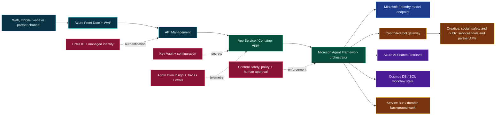

**Responsibility split**

- **Edge and API layer:** authentication, quotas, request validation and tenant routing.
- **Application/orchestration layer:** deterministic workflow, retries, approvals, state and tool authorization.
- **Model layer:** language understanding, planning and explanation; it never becomes the system of record.
- **Tool layer:** narrow typed operations with idempotency, schema validation and audit events.
- **Data layer:** retrieval indexes are separate from transactional state and sensitive records.
- **Control plane:** identity, secrets, policy, privacy, observability and evaluations apply across every request.

*Proposed reference architectures for new systems, not descriptions of existing repositories. Safety, legal and privacy controls need expert review before launch.*

## 94. Photography coach

**Purpose and user journey:** Helps hobbyist photographers improve through photo critique, shoot planning and practice drills. The user states a goal such as portraits or night skies, uploads images with optional EXIF, receives a structured critique of composition, exposure, focus and editing, gets one short assignment for the next outing, and later sees progress against earlier shots.

**Reference architecture:** `Web/mobile app -> upload service -> EXIF + vision analysis -> critique agent -> lesson planner -> progress store`

<!-- architecture-diagram:auto -->
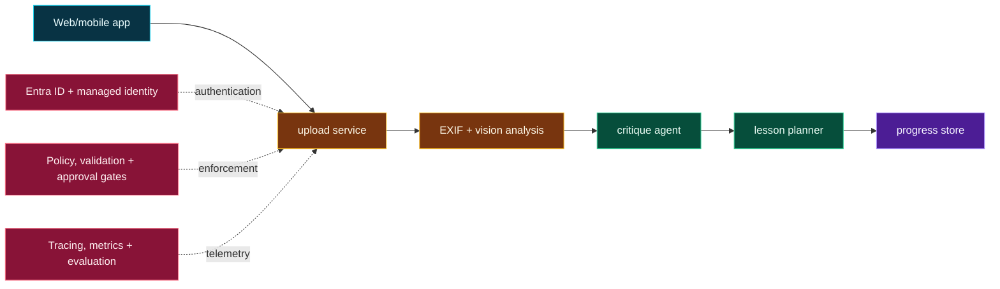

**Core components:** Upload and EXIF parser; vision-language model for critique; rubric library (composition, light, focus, colour, edit); skills graph linking weaknesses to lessons; licensed exemplar-gallery retriever; progress timeline; gear profile.

**Agent/workflow design:** One orchestrating agent with tools analyze_image, read_exif, retrieve_lesson, find_exemplar and schedule_assignment. Camera-specific settings advice is grounded in retrieved manual excerpts and cited.

**Data and integrations:** Stores images, EXIF, goals, gear and critique history. Integrations: photo-library picker, Lightroom/export import, weather and golden-hour APIs, mapping for location scouting, camera-manual corpus, licensed exemplar libraries with attribution.

**Security and safety:** GPS and device metadata are stripped before storage unless the user opts in. No facial recognition or identification of bystanders. Scouting advice warns about private property, drone restrictions and no-photography zones rather than suggesting trespass. Rate limits and per-account upload quotas deter scraping and abuse. Users can delete images and history.

**Reliability, observability and evaluation:** Image jobs run through a queue with retries; if vision fails, the agent falls back to EXIF-only advice and says so. Track critique helpfulness ratings, latency, cost per critique and refusal rates, with traces per job. Run regression tests for hallucinated camera features.

**MVP build path:** 1) Upload, EXIF parsing and a single critique prompt. 2) Structured rubric output and saved history. 3) Progress timeline and assignments. 4) Weather, golden-hour and exemplar retrieval with citations. 5) Calibrate against expert reviewers and add moderation hardening before public launch.

## 95. Creative-writing assistant

**Purpose and user journey:** Supports fiction and nonfiction writers with brainstorming, outlining, feedback and revision while keeping the author's voice and ownership. A writer opens a project, sets genre, audience and goals, discusses ideas, receives developmental or line-level feedback on pasted chapters, and tracks revision tasks across sessions.

**Reference architecture:** `Editor UI -> project service -> context builder (story bible) -> writing agent -> critique/style tools -> versioned manuscript store`

<!-- architecture-diagram:auto -->
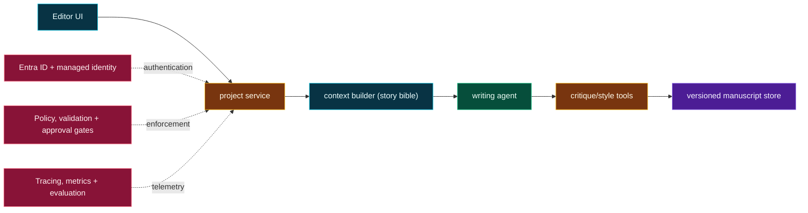

**Core components:** Manuscript editor with versioning; story bible (characters, timeline, world rules); retrieval over the user's own drafts; feedback modes (brainstorm, developmental, line edit, continuity); style-profile extractor; export to DOCX/Markdown.

**Agent/workflow design:** A mode-aware agent. Generation of prose is opt-in and clearly labelled, defaulting to suggestions and questions. Long manuscripts are chunked, with summaries of earlier chapters to preserve context. Research claims in nonfiction require cited sources or are marked unverified.

**Data and integrations:** Stores drafts, bible entries, feedback history and style preferences. Integrations: Google Docs/Word import, Scrivener-style export, public-domain corpora for reference, optional plagiarism-similarity check, and reference sources for factual checks.

**Security and safety:** Manuscripts are private by default, encrypted, and never used for model training without explicit consent. Content policies cover sexual content involving minors, real-person defamation and targeted harassment. When a writer's text suggests self-harm or imminent danger rather than fiction, the agent steps out of the story, responds with care and surfaces crisis resources. Anti-abuse controls cap bulk generation to limit content-spam farming.

**Reliability, observability and evaluation:** Autosave and version history prevent lost work; model timeouts degrade to cached notes. Monitor acceptance rate of suggestions, edit distance between suggested and kept text, session retention and latency.

**MVP build path:** 1) Editor, project storage and brainstorm chat. 2) Passage-anchored critique. 3) Story bible with retrieval and continuity checks. 4) Style profile and versioning. 5) Export, similarity checks and consent-based quality feedback.

## 96. Music-discovery assistant

**Purpose and user journey:** Helps listeners find new music that matches mood, activity, taste and curiosity, and explains why. The user connects a streaming account or describes preferences, asks for things like "post-rock for focus, nothing with vocals", receives a short explained playlist, gives feedback, and saves results back to their service.

**Reference architecture:** `Chat/voice UI -> taste-profile service -> candidate retrieval -> ranking and explainer agent -> playlist writer`

<!-- architecture-diagram:auto -->
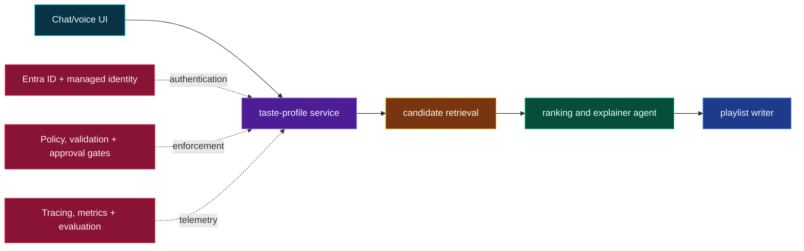

**Core components:** Taste profile built from listening history and explicit likes; music metadata graph (artists, genres, credits, audio features); embedding-based candidate retriever; diversity and novelty ranker; explanation generator; playlist export connector.

**Agent/workflow design:** The agent parses intent into constraints (mood, tempo, language, explicit-content filter, era, novelty level), calls retrieval tools, then re-ranks for diversity and exploration. Each recommendation carries a reason grounded in metadata or editorial sources, such as shared producer or influence, and it cites them. Feedback (skip, like, "too mellow") updates the profile.

**Data and integrations:** Data: listening history, saved tracks, ratings, metadata from licensed catalogues such as MusicBrainz and streaming APIs, editorial reviews with attribution. Integrations: Spotify, Apple Music or YouTube Music via OAuth; concert listings; lyrics only through licensed providers.

**Security and safety:** Minimum-scope OAuth with revocable tokens; listening history treated as sensitive and deletable on request. Explicit-content and child-account filters are enforced server-side. No reproduction of full lyrics. Mood requests that signal distress, such as repeated hopelessness, trigger gentle supportive responses and crisis resources rather than only playlists. Rate limits and bot detection protect API quotas and discourage artificially boosting streams.

**Reliability, observability and evaluation:** Cache catalogue lookups and degrade to genre-based suggestions if the personalisation service is down. Track playlist save rate, skip rate and artist-diversity metrics, and evaluate offline with held-out listening sessions.

**MVP build path:** 1) Connect one streaming provider and read top artists. 2) Intent parsing and retrieval over metadata. 3) Explained playlists with export. 4) Feedback loop and diversity ranking. 5) Add cross-service support, concerts and bias audits.

## 97. Book-recommendation assistant

**Purpose and user journey:** Helps readers choose their next book and manage a reading list. The user imports ratings, describes what they want ("hopeful sci-fi, short chapters, no cliffhangers"), receives a handful of explained picks with content notes and availability, and the assistant tracks what they read and reacts to.

**Reference architecture:** `Chat UI -> reader-profile store -> hybrid retrieval (metadata + reviews) -> recommender agent -> availability checker -> reading list`

<!-- architecture-diagram:auto -->
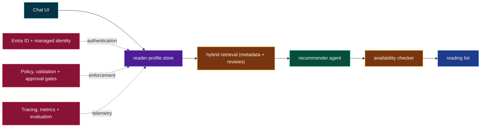

**Core components:** Book metadata index (ISBN, genres, themes, length, content notes); review and synopsis summariser; reader profile from Goodreads-style imports; library and retailer availability checker; reading-list and progress tracker; spoiler guard.

**Agent/workflow design:** The agent extracts constraints and mood, retrieves candidates with semantic search over descriptions and reviews, filters by length, language, accessibility format and content-warning preferences, then explains each pick in two sentences with citations to publisher blurbs, award lists or reviews. A spoiler-safe mode forbids plot reveals. ISBN validation guards against hallucinated books.

**Data and integrations:** Data: ratings, shelves, reading history, DNF reasons. Integrations: Open Library and Google Books APIs, library catalogues and Libby/OverDrive for loans, bookstore links, accessibility formats such as audiobooks and large print, publisher and award data.

**Security and safety:** Reading history can reveal beliefs and health, so it is private, encrypted and exportable or deletable. No profiling for ads and no inference of sensitive traits. Affiliate links are disclosed and never alter ranking. If a user asks for books because of a crisis, the assistant offers books carefully alongside support resources. Fake-review and review-bombing signals are down-weighted, and request limits discourage scraping.

**Reliability, observability and evaluation:** Every recommended title must resolve to a real catalogue record before display; unresolved titles are dropped. Monitor hallucinated-title rate, add-to-list rate and availability accuracy, and have librarians judge persona queries.

**MVP build path:** 1) Metadata index and ISBN-verified title lookup. 2) Chat recommender with citations. 3) Ratings import and reader profile. 4) Library availability and spoiler guard. 5) Content-note accuracy review and accessibility formats.

## 98. Movie and streaming assistant

**Purpose and user journey:** Helps individuals or groups decide what to watch tonight and where to stream it. A user (or household) states mood, time available, ages present and subscriptions owned, gets a ranked shortlist with runtime, ratings, content advisories and where it is available, and can vote or save titles to a watchlist.

**Reference architecture:** `Chat UI -> household profile -> catalogue and availability index -> recommender agent -> group-consensus tool -> watchlist/alerts`

<!-- architecture-diagram:auto -->
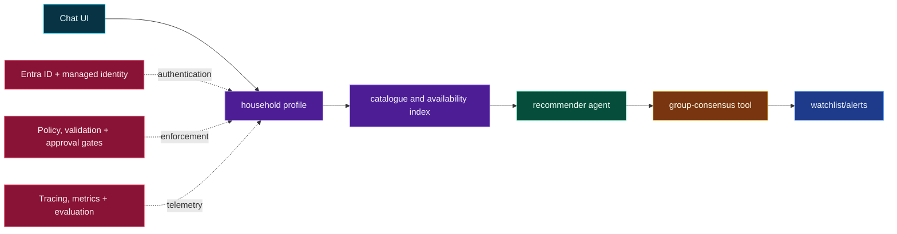

**Core components:** Title catalogue with cast, genre, runtime and certification; regional streaming-availability index; household and individual profiles; parental-guidance and content-advisory service; group-voting module; watchlist with leaving-soon alerts.

**Agent/workflow design:** The agent turns a request into constraints, queries the availability index for the user's region and subscriptions, and ranks by taste and fit. Each result cites its source for ratings and availability, with a timestamp, since catalogues change. It refuses to guess availability when data is stale and says so. Spoilers are suppressed by default. For groups it merges profiles using a least-misery rule.

**Data and integrations:** Data: ratings, watch history, household composition, region, subscriptions. Integrations: TMDB or similar metadata, JustWatch-style availability feeds, IMDb-equivalent ratings under licence, Common Sense-style advisories, calendar for watch-party scheduling, smart-TV deep links.

**Security and safety:** Child profiles enforce certification limits server-side and cannot be changed without an adult PIN. Watch history is private, with no sale to advertisers and per-profile deletion. Sponsored placements are labelled and separated from ranking. The agent does not infer sensitive traits from viewing. Rate limiting and account-sharing checks limit abuse of premium features, and link-outs avoid piracy sources entirely.

**Reliability, observability and evaluation:** Cache availability with expiry and fall back to catalogue-only suggestions if feeds fail. Track click-through, stale-availability errors and complaints about wrong ratings, and test group-merge fairness on synthetic households.

**MVP build path:** 1) Catalogue and availability lookup for one region. 2) Single-user recommendation chat with citations. 3) Household profiles and parental filters. 4) Group voting and watchlist alerts. 5) Multi-region rollout and freshness monitoring.

## 99. Gaming assistant

**Purpose and user journey:** Helps players pick games, get unstuck, optimise builds and plan play sessions without spoiling the experience. A player names a game, platform and spoiler tolerance, asks for a hint or a build, receives graduated guidance (nudge, hint, full answer), and can track backlog and play time.

**Reference architecture:** `Chat/overlay -> game-context resolver -> retrieval over wikis/patch notes -> guide agent -> hint-level controller -> backlog tracker`

<!-- architecture-diagram:auto -->
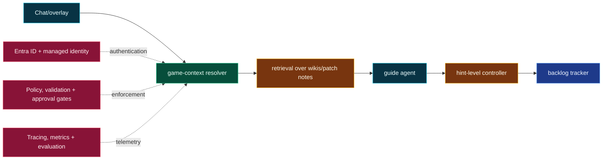

**Core components:** Game and version resolver; retrieval index over official docs, patch notes and community wikis; graduated-hint controller; build and loadout calculator; backlog and playtime tracker; platform account connector.

**Agent/workflow design:** The agent resolves game, version and platform first, because advice becomes wrong after patches. It retrieves current sources, answers at the lowest spoiler level the user chose, and offers escalation. Build advice calls deterministic calculators for stats. Every claim is cited with the patch version, and conflicting community sources are surfaced. For competitive games, it covers learning and strategy but not cheating tools.

**Data and integrations:** Data: owned library, achievements, playtime, preferences. Integrations: Steam, Xbox, PlayStation and Nintendo account APIs where available, IGDB or RAWG metadata, official patch-note feeds, community wikis under their licences, HowLongToBeat-style duration data.

**Security and safety:** Account links use least-privilege tokens; library and playtime data are private. The assistant refuses requests for cheats, aimbots, exploits in live multiplayer, account trading or credential sharing, and warns about phishing and scam marketplaces. For signs of gambling-like spending or distress, it responds supportively and points to wellbeing resources. Toxicity-related requests such as harassing players are declined. Rate limits stop automation abuse.

**Reliability, observability and evaluation:** Index freshness is key: ingest patch notes daily and flag answers older than the latest patch. Monitor hint-level compliance (no spoilers above chosen level), citation coverage, wrong-version rate and user thumbs-down.

**MVP build path:** 1) Pick two games and index their wikis and patch notes. 2) Version-aware Q&A with citations. 3) Graduated hints and spoiler settings. 4) Build calculators. 5) Account linking, backlog tracker and wider catalogue.

## 100. Social-event assistant

**Purpose and user journey:** Helps people organise and attend gatherings such as meetups, birthdays and community events. A host describes the occasion, guest count, budget and constraints; the assistant proposes dates, venues and an agenda, drafts invitations, collects RSVPs and dietary needs, and sends reminders. Attendees can also ask it to find events nearby.

**Reference architecture:** `Chat UI -> event planner agent -> scheduling/venue tools -> invitation and RSVP service -> reminders -> post-event feedback`

<!-- architecture-diagram:auto -->
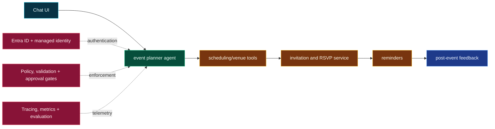

**Core components:** Event model (date, venue, capacity, budget, roles); availability polling; venue and event search; invitation generator; RSVP and dietary tracker; reminder scheduler; budget and task checklist; accessibility checker.

**Agent/workflow design:** A planner agent decomposes the event into tasks, proposes options with cost estimates, and asks the host to approve before anything is sent. It reconciles RSVP changes, flags capacity and allergy conflicts, and cites venue sources, including hours and capacity, with retrieval dates.

**Data and integrations:** Data: guest names, contact details, RSVPs, dietary and accessibility needs, locations. Integrations: Google/Outlook calendars, email and SMS, Eventbrite or Meetup, maps and transit, venue listings, payment links for ticketing, weather.

**Security and safety:** Guest data is minimised and visible only to the host; dietary and accessibility data is sensitive and optional. Messages go only to contacts the host supplies, with unsubscribe handling, and rate limits and approval gates prevent spam or harassment campaigns. Public events show the host's chosen location precision, and private home addresses are released only to confirmed guests. Reports of harassment or threats are escalated to organiser tools and emergency resources. Payment links use a certified processor, never card data in chat.

**Reliability, observability and evaluation:** Reminders use idempotent jobs so guests are not messaged twice; failed sends are retried and reported. Track RSVP conversion and bounce rate, and test approval gates to confirm nothing is sent unapproved.

**MVP build path:** 1) Event model with availability poll and invitation drafts. 2) RSVP page with dietary capture. 3) Reminders and calendar sync. 4) Venue search with citations and budget tracker. 5) Public-event discovery with reporting and moderation.

## 101. Dating-planning assistant

**Purpose and user journey:** Helps users plan respectful, enjoyable dates and prepare for meetings, not impersonate them or manipulate partners. A user shares preferences, budget, location, accessibility needs and comfort level, receives date ideas with logistics, message-drafting help in their own voice, and an optional safety plan for first meetings.

**Reference architecture:** `Chat UI -> preference profile -> ideas and venue retrieval -> planner agent -> logistics tools -> safety-check module`

<!-- architecture-diagram:auto -->
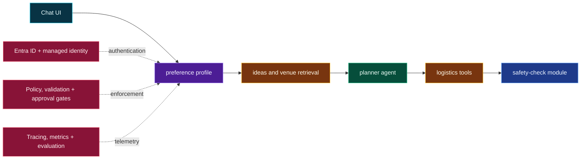

**Core components:** Preference and boundaries profile; venue and activity retriever; itinerary builder with transport and timing; message-coaching tool; first-date safety planner; feedback capture after the date.

**Agent/workflow design:** The agent proposes two or three options matched to interests and constraints, builds an itinerary with fallback plans, and confirms bookings only after user approval. Message help focuses on clarity and respect and refuses deceptive, coercive or mass-automated outreach. It cites venue hours and reviews, and asks before using personal details.

**Data and integrations:** Data: preferences, location, schedule, optional partner-provided constraints, itinerary. Integrations: maps, reservation platforms, event and weather APIs, calendar, ride and transit services, optional trusted-contact messaging. No scraping of dating-app profiles.

**Security and safety:** Dating information is highly sensitive: encrypt it, store minimum data, keep it out of analytics and allow full deletion. Photo or profile-verification help is limited to platform-approved checks. It declines manipulation tactics, pressure, catfishing and sexual content involving minors. Safety escalation: if the user reports coercion, stalking, intoxication concerns or feeling unsafe, it gives immediate steps, emergency-number guidance and domestic-violence or sexual-assault hotline resources. Anti-abuse limits block harassment-message generation.

**Reliability, observability and evaluation:** Booking tools are idempotent and confirm before purchase; fallback itineraries cover closures. Monitor plan acceptance, safety-plan adoption, refusal accuracy and post-date comfort ratings.

**MVP build path:** 1) Preference profile and idea generator with cited venues. 2) Itinerary and calendar. 3) Safety planner and trusted-contact sharing. 4) Message coaching with refusal policies. 5) Reservations and red-team evaluation.

## 102. Wedding-planning assistant

**Purpose and user journey:** Coordinates the many moving parts of a wedding for couples and planners. The couple enters date range, budget, guest estimate, culture and priorities; the assistant builds a timeline and checklist, shortlists venues and vendors, tracks budget and contracts, manages guest lists and RSVPs, and keeps both partners and helpers aligned.

**Reference architecture:** `Web/mobile app -> wedding workspace -> planner agent -> vendor/venue search -> budget and contract tracker -> guest/RSVP service`

<!-- architecture-diagram:auto -->
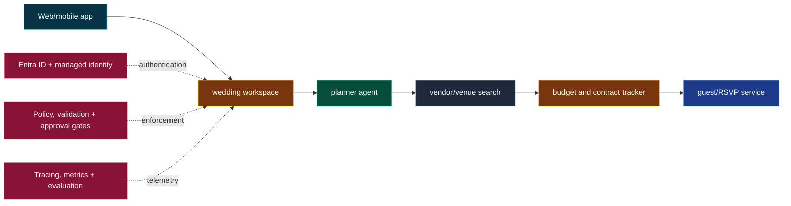

**Core components:** Shared workspace with roles; timeline and task engine; budget ledger; vendor directory with quotes; contract document store with clause extraction; guest list, seating and RSVP module; day-of run sheet generator.

**Agent/workflow design:** A planning agent works backwards from the wedding date to create milestones, then proposes tasks and negotiates trade-offs within budget. It compares vendor quotes, extracts deposits, cancellation terms and deadlines from contracts, and cites the exact clause. Anything that spends money or messages vendors or guests needs explicit approval. It flags unrealistic timelines early.

**Data and integrations:** Data: budget, guest PII, dietary needs, vendor quotes, contracts, payment schedules. Integrations: venue and vendor marketplaces, calendar, email, maps, weather, registry services, payment links, accommodation block booking.

**Security and safety:** Contracts and guest data are encrypted, role-restricted and exportable. Anti-abuse: invitation limits, verified vendor listings and sponsored-vendor disclosure. The assistant gives planning guidance, not legal advice, and never handles card numbers. Safety escalation covers family conflict, coercion or abuse in a relationship, and venue risks such as capacity, allergen and fire-safety compliance, with contact guidance for local authorities.

**Reliability, observability and evaluation:** Deadline reminders use durable scheduled jobs with audit logs; contract-clause extraction shows the source page for human verification. Monitor task completion, budget variance and extraction accuracy, and evaluate clause extraction against lawyer-annotated contracts.

**MVP build path:** 1) Shared workspace, timeline and budget. 2) Guest list and RSVP. 3) Vendor search with comparison. 4) Contract upload with clause extraction and deadline alerts. 5) Seating, run sheet and planner-role collaboration.

## 103. Personal safety assistant

**Purpose and user journey:** Helps individuals reduce risk in daily life and respond when they feel unsafe, such as when walking home late or meeting someone new. Users set trusted contacts and check-in rules, start a monitored journey, receive route and situational guidance, and can trigger an escalation that alerts contacts and points to emergency services.

**Reference architecture:** `Mobile app -> safety-session service -> risk and route tools -> check-in monitor -> escalation engine -> contacts and emergency handoff`

<!-- architecture-diagram:auto -->
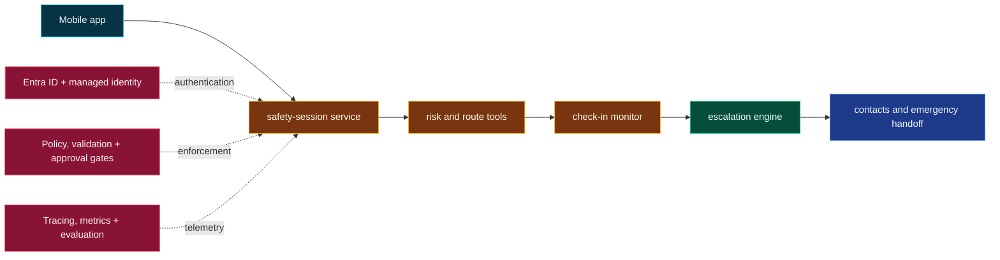

**Core components:** Trusted-contact manager; journey and check-in timers; location sharing with consent; route and area-information service; discreet panic trigger; escalation policy engine; incident log; resource directory by country.

**Agent/workflow design:** A deterministic state machine owns safety-critical actions, while the language model supplies calm guidance, planning and drafting. A missed check-in triggers a notification ladder: prompt the user, alert contacts, offer to call emergency services. Statements of immediate danger skip conversation and show "call your local emergency number" with one-tap dialing. The model never promises protection. Advice cites reputable sources such as police or domestic-abuse organisations and avoids victim-blaming.

**Data and integrations:** Data: precise location, contacts, schedules, incident notes. Integrations: device location, SMS and push, mapping and transit, emergency-number directory, local helplines, optional ride-share trip sharing.

**Security and safety:** Location is shared only during an active session, encrypted, and deleted quickly; contacts must opt in. It does not claim to replace emergency services and does not dispatch them autonomously without local-law review. Covert tracking is prohibited and a visible sharing indicator is always shown, because abusers could misuse monitoring. Safety escalation includes jurisdiction-specific numbers, domestic-violence and suicide hotlines. Anti-abuse: block requests to locate third parties.

**Reliability, observability and evaluation:** Safety paths need SMS fallback, duplicated channels and watchdog timers. Monitor missed-alert rate, time-to-notify and false alarms, with audit trails. Evaluate with expert-reviewed scenarios and failure injection for GPS loss and dropped messages.

**MVP build path:** 1) Trusted contacts and timed check-in with SMS fallback. 2) Live-location sharing with consent. 3) Escalation ladder and country resource directory. 4) Conversational guidance with expert-reviewed content. 5) Pilot with advocacy organisations and independent security review.

## 104. Emergency-preparedness assistant

**Purpose and user journey:** Helps households prepare for disasters such as floods, wildfires, storms, outages and earthquakes. A user enters location, household members, pets, medical needs and mobility constraints; the assistant produces a tailored plan with supply lists, evacuation routes, contact trees and drills, and sends reminders and official alerts. During an event it relays authoritative instructions.

**Reference architecture:** `App -> household profile -> hazard-risk service -> plan generator agent -> reminder engine -> official-alert relay`

<!-- architecture-diagram:auto -->
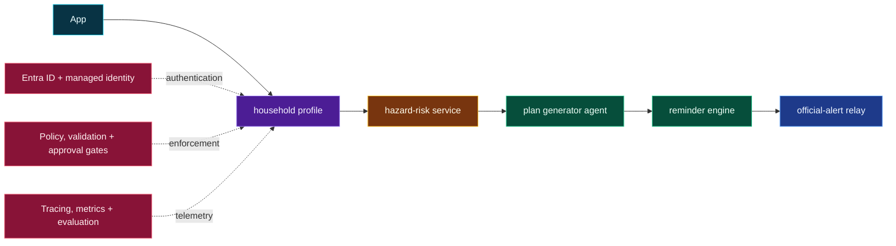

**Core components:** Household profile; local hazard and risk lookup; supply checklist generator with expiry tracking; evacuation-route and shelter finder; family communication plan; drill scheduler; official-alert ingestion; offline plan pack.

**Agent/workflow design:** The agent assembles plans from vetted guidance such as civil-protection and Red Cross material and cites every recommendation. It tailors quantities for infants, elders, medications and pets. During active alerts it stops generating and displays the official message verbatim with source and time, then links to local emergency instructions. Plans are versioned and tested by drills.

**Data and integrations:** Data: address, household health and mobility needs, supplies and expiry dates, contacts. Integrations: national weather and hazard services, CAP alert feeds, flood and wildfire maps, shelter and transport data, emergency-number directory, offline maps, SMS.

**Security and safety:** Health and address data is minimised, encrypted and shared only with chosen contacts. The assistant gives preparedness guidance, not medical advice. If a user reports an emergency, it immediately shows the local emergency number and shelter-in-place or evacuate instructions from official sources. Alerts are accepted only from verified feeds. Anti-abuse: rate limits and signed messages prevent fake alert injection.

**Reliability, observability and evaluation:** Resilience is the core requirement: offline plan export, multiple alert channels, cached official guidance and graceful degradation when networks fail. Monitor alert latency and feed uptime, and run game-day tests simulating feed outages and false alerts.

**MVP build path:** 1) Household profile and hazard lookup for one region. 2) Checklist and plan generator with citations. 3) Expiry reminders and drills. 4) Verified alert relay with offline pack. 5) Add regions, accessibility features and civil-protection partnership review.

## 105. Citizen-services navigator

**Purpose and user journey:** Helps residents find and complete government services such as renewing a passport, registering a business, claiming benefits or paying a fine. A user describes the need in plain language, the assistant identifies the correct service, jurisdiction, eligibility, documents, fees and deadlines, walks them through steps, and hands off to the official portal or a human office.

**Reference architecture:** `Chat/voice -> intent and jurisdiction router -> service-knowledge retrieval -> guidance agent -> checklist/appointment tools -> human handoff`

<!-- architecture-diagram:auto -->
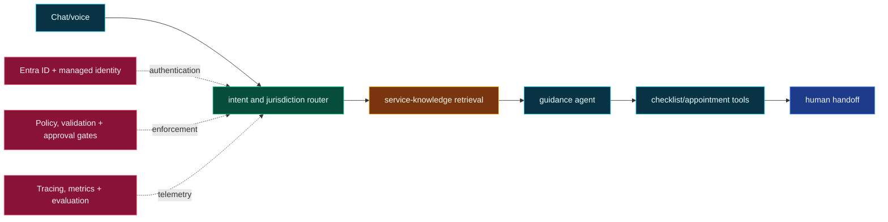

**Core components:** Service catalogue mapped to life events; jurisdiction resolver; retrieval index over official pages with versioning; eligibility rule engine; document checklist builder; multilingual and accessibility layer; appointment and form-link tools; case-handoff queue.

**Agent/workflow design:** The agent answers only from retrieved official sources, quotes the relevant rule, and gives the page link and last-verified date. Eligibility is computed by deterministic rules where available. When sources conflict or confidence is low, it says so and routes to staff. It does not guess fees or deadlines.

**Data and integrations:** Data: location, selected service, anonymised case state. Integrations: government CMS and open data, appointment systems, form portals, payment gateways, translation services, identity providers through redirect only, and contact-centre ticketing.

**Security and safety:** No collection of national ID numbers, tax details or other sensitive identifiers in chat; the assistant redirects users to authenticated official portals. Privacy-by-design, data-protection impact assessment, short retention and audit logs apply. Escalation covers urgent situations such as domestic violence, homelessness, or threats of eviction, linking to emergency and social-support services. Scam warnings cover fake portals. Accessibility and language equity are mandatory. Rate limits and bot protection protect the service.

**Reliability, observability and evaluation:** Source freshness is the main risk: crawl official pages daily, diff changes and alert content owners. Monitor citation coverage, answer accuracy, handoff rate, task completion and complaints by language.

**MVP build path:** 1) Index one agency's top services with citations. 2) Jurisdiction routing and checklists. 3) Eligibility rules and appointment links. 4) Multilingual support and staff handoff. 5) Expand across agencies with content-owner freshness workflow.

## 106. Immigration-document organizer

**Purpose and user journey:** Helps applicants organise paperwork for visa, residence or citizenship processes, not provide legal advice or submit filings on their behalf. The user picks a route and uploads documents; the assistant classifies them, extracts dates, tracks expiry, builds an official-requirements checklist and prepares a reviewable package.

**Reference architecture:** `Secure upload vault -> OCR/classification -> field extraction -> requirements checklist engine -> consistency checker -> export for applicant/lawyer`

<!-- architecture-diagram:auto -->
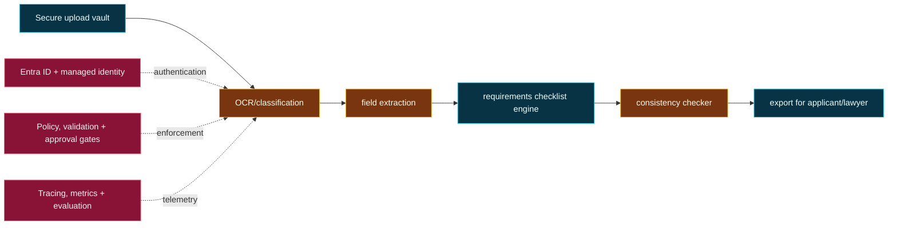

**Core components:** Encrypted document vault; OCR and document classifier; field extractor for names, dates, document numbers; official-requirements knowledge base; discrepancy checker; deadline calendar; translation and certification tracker; sharing with expiry.

**Agent/workflow design:** The agent maps each document to the checklist item it satisfies, flags missing, expired or inconsistent items such as name spelling differences or date mismatches, and cites the official requirement page and version. It never advises on eligibility strategy and recommends a licensed adviser for complex cases.

**Data and integrations:** Data: passports, certificates, employment and financial records, addresses, timelines. Integrations: official requirement pages, calendar, translator directory, e-signature, lawyer sharing links.

**Security and safety:** This is highly sensitive data: end-to-end or envelope encryption with user-held keys where possible, MFA, field-level redaction in logs, strict retention and instant deletion. No selling or training on documents. The assistant refuses to forge, alter or fabricate documents, or coach misrepresentation, and warns about fraudulent "agents" and fee scams. Users facing detention, deportation notices, trafficking, exploitation or domestic abuse receive immediate pointers to legal-aid, hotlines and emergency services. Sharing links expire.

**Reliability, observability and evaluation:** Every extracted field is shown for human confirmation with its source highlighted. Monitor extraction accuracy by document type, checklist correctness, requirement-freshness lag and deletion SLAs. Evaluate on synthetic and consented documents across languages, with lawyer review of checklist logic.

**MVP build path:** 1) Vault with MFA and one route's checklist. 2) OCR, classification and confirmed extraction. 3) Discrepancy and expiry alerts. 4) Lawyer-sharing package export. 5) More routes and languages after legal and privacy review.

## 107. Consumer complaint assistant

**Purpose and user journey:** Helps consumers resolve problems with purchases, services, subscriptions or fees. The user describes the issue and uploads receipts; the assistant identifies rights, builds an evidence timeline, drafts a complaint, picks the channel (merchant, chargeback, regulator, ombudsman) and tracks deadlines.

**Reference architecture:** `Chat UI -> case builder -> evidence extractor -> rights retrieval (statutes/regulator guidance) -> letter drafter -> channel router/tracker`

<!-- architecture-diagram:auto -->
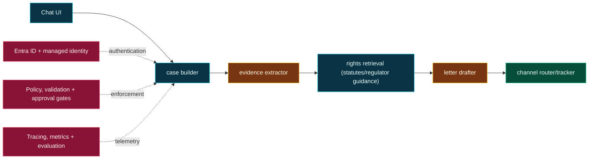

**Core components:** Case file with timeline; receipt extractor; jurisdiction-aware consumer-rights knowledge base; deadline calculator; letter generator; escalation router; outcome tracker.

**Agent/workflow design:** The agent interviews the user for facts, structures them chronologically, retrieves the relevant rule from regulator or statute text, and cites it with the jurisdiction and date. It drafts a polite, factual letter, shows it for approval, and sends nothing unless the user consents. It never guarantees outcomes, does not invent legal citations and marks unverified claims. It escalates from merchant to payment provider to regulator based on elapsed time.

**Data and integrations:** Data: receipts, order numbers, correspondence, payment details (masked), merchant information. Integrations: email import, regulator portals, ADR directories, card-dispute guidance, calendar.

**Security and safety:** Evidence is encrypted, redacted for card numbers and ID details, and deletable. The assistant gives information, not legal advice. Anti-abuse: it will not draft fraudulent, defamatory, harassing or threatening complaints, fabricate evidence, or help serial bogus refund claims; unusual claim patterns are rate-limited and reviewed. Safety escalation applies where a dispute involves threats, debt-collector harassment, fraud or identity theft, directing users to police, banks and fraud hotlines.

**Reliability, observability and evaluation:** Track legal-source freshness. Monitor cited-rule accuracy, resolution rate and reported hallucinations. Evaluate with adviser-verified scenarios per jurisdiction and adversarial refusal tests.

**MVP build path:** 1) Case intake and evidence timeline. 2) Jurisdiction-specific rights retrieval for one country with citations. 3) Letter drafting with approval flow. 4) Deadline tracking and escalation routing. 5) Regulator and ADR integrations and adviser-reviewed evaluation.
