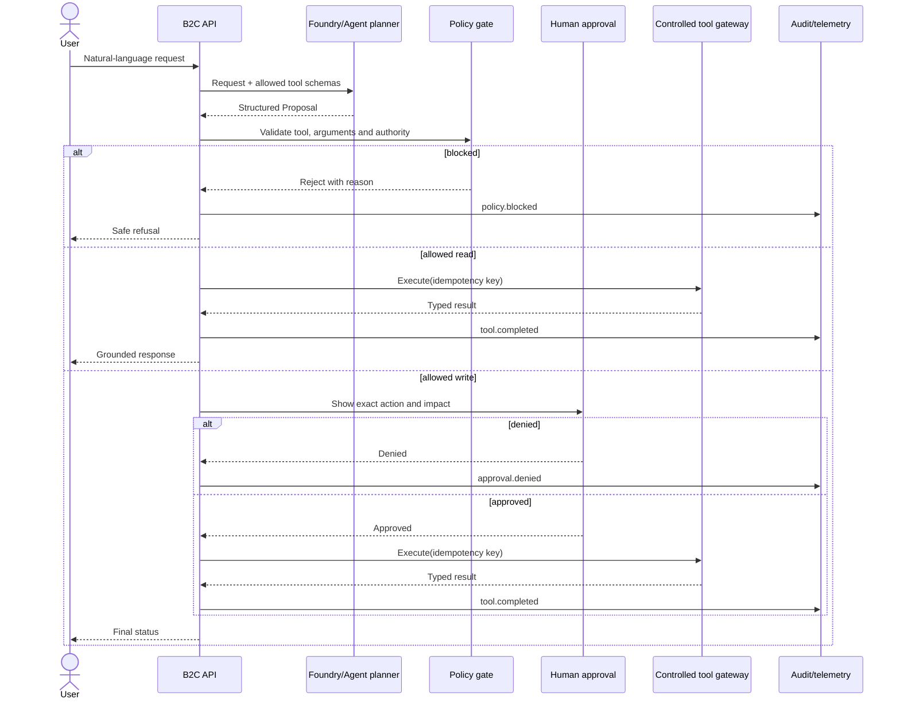

# C# agent-workflow reference implementation

This runnable sample shows the main logic shared by the 107 architectures. It deliberately keeps the model behind an `IAgentPlanner` interface so the business application—not the model—owns authorization, policy, approvals, tool execution, idempotency and audit.

## Execution flow



## Project structure

```text
src/AgentWorkflow/
  AgentWorkflow.cs          Domain contracts and tested orchestrator
tests/AgentWorkflow.Tests/
  Program.cs                Dependency-free automated behavior tests
demo/
  Program.cs                Shopping-assistant wiring example
```

## Run

```bash
dotnet run --project tests/AgentWorkflow.Tests/AgentWorkflow.Tests.csproj
dotnet run --project demo/AgentWorkflow.Demo.csproj
```

## Main design rules

1. The model produces a typed `Proposal`; it never receives arbitrary HTTP, SQL or shell authority.
2. `IPolicyGate` validates the tool name, arguments, user authority, limits and risk classification.
3. Read-only actions can execute immediately after policy validation.
4. State-changing actions require a visible approval step.
5. Every tool call uses a stable idempotency key.
6. The audit sink receives proposal, policy, approval and execution events.
7. Replace the sample adapters independently:
   - `IAgentPlanner` → Microsoft Agent Framework or a Foundry agent adapter;
   - `IToolGateway` → allowlisted Azure Functions, MCP or OpenAPI operations;
   - `IApprovalService` → UI callback, Teams Adaptive Card or workflow event;
   - `IAuditSink` → Application Insights/OpenTelemetry plus durable audit storage.

## Applying it to the catalog

Keep the orchestration code unchanged and replace only the domain tools and schemas. A shopping app might expose `SearchCatalog` and `AddToCart`; a travel app might expose `SearchFlights` and `HoldReservation`; a healthcare-navigation app should expose only administrative read/search operations and conservative escalation tools.
